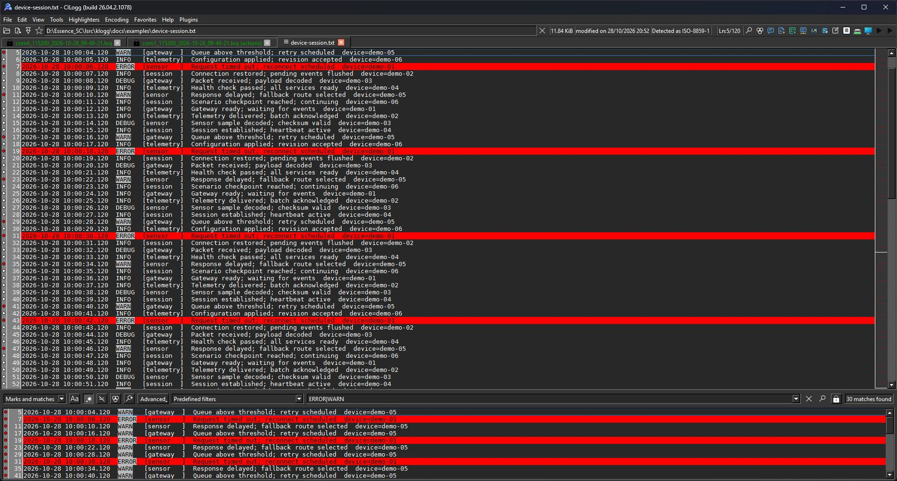
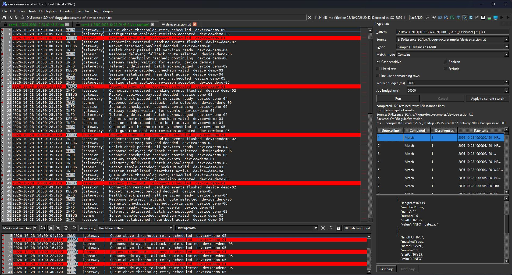
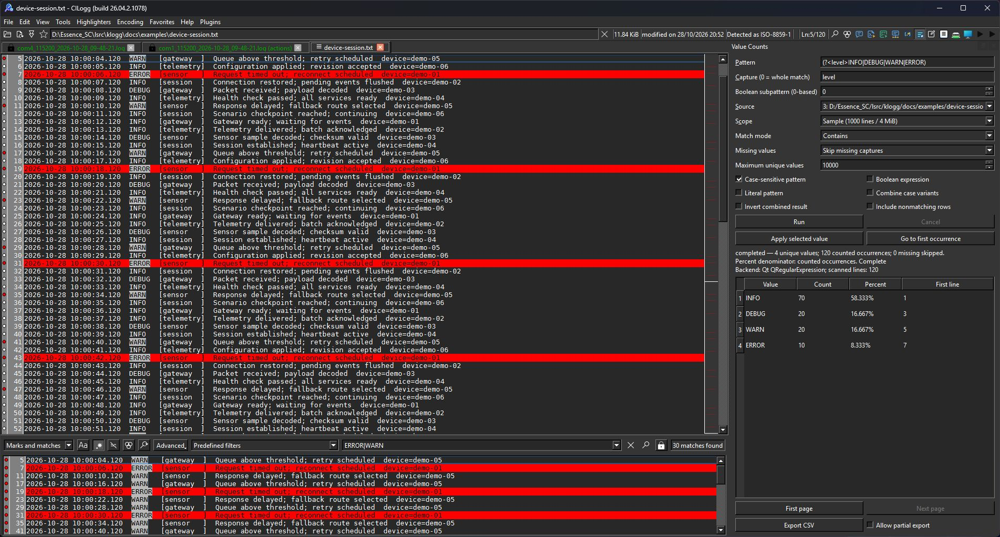
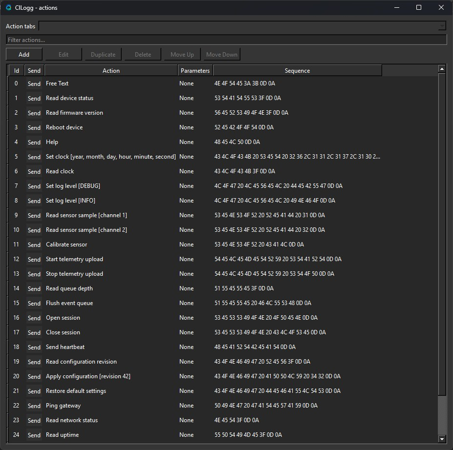
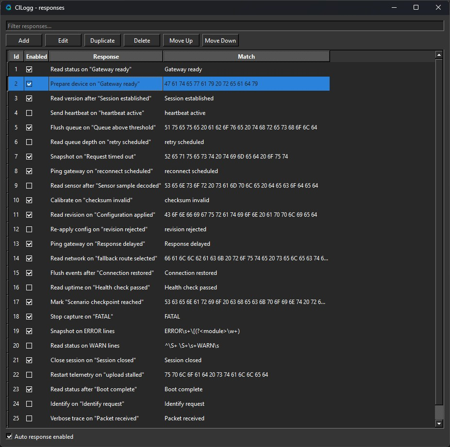
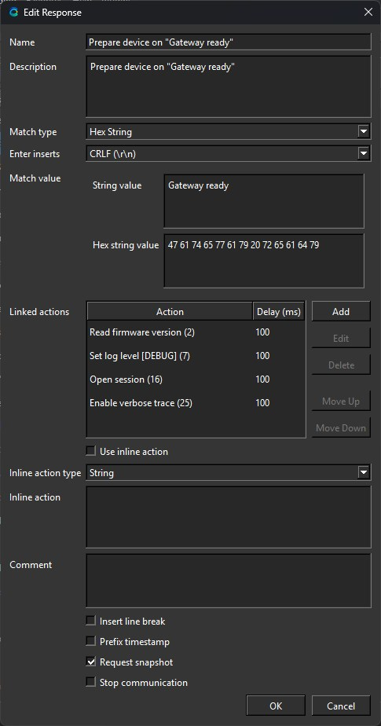
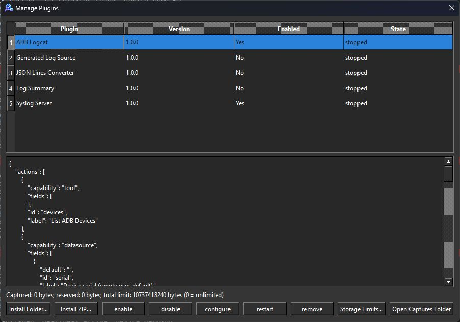
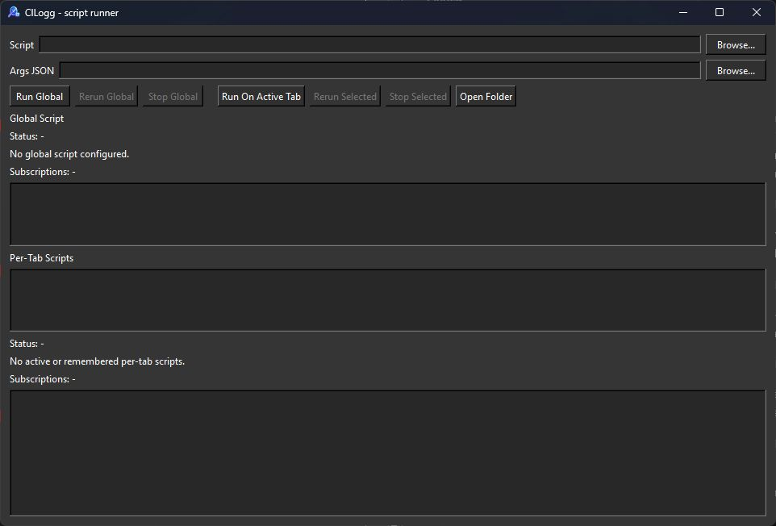
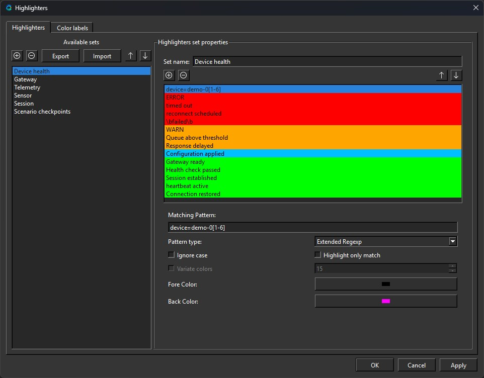

# CILogg user guide

**From the first error to a repeatable investigation.** Browse large logs, capture
live sources, inspect patterns, and automate the workflow.

[Download](https://github.com/dm17ryk/klogg/releases) ·
[Project overview](README.md) · [CLI & MCP](MCP.md) · [Build from source](BUILD.md)

**[Explore the screenshot gallery →](docs/screenshots.md)** — ten views captured
from the normal installed Windows application, build 26.04.2.1078.



## Choose your workflow

| I want to… | Start here |
| --- | --- |
| Find errors in an existing log | [Your first investigation](#your-first-investigation) |
| Follow a growing log | [Browsing changing log files](#browsing-changing-log-files) |
| Inspect regex groups before applying a filter | [Regex Lab](docs/regex-lab.md) |
| Find the most frequent captured values | [Value Counts](docs/value-counts.md) |
| Capture serial output and send commands | [Serial capture and device commands](#serial-capture-and-device-commands) |
| Receive Android logcat or UDP syslog | [Live sources and plugins](#live-sources-and-plugins) |
| Control CILogg from scripts or an AI assistant | [CLI and MCP automation](#cli-and-mcp-automation) |

## Table of Contents

1. [Getting started](#getting-started)
1. [Your first investigation](#your-first-investigation)
1. [Feature guides](#feature-guides)
1. [Plugins: packing, repositories and updates](#plugins-packing-repositories-and-updates)
1. [Exploring log files](#exploring-log-files)
1. [Settings](#settings)
1. [Crash reporting](#crash-reporting)
1. [Keyboard commands](#keyboard-commands)
1. [Mouse navigation](#mouse-navigation)
1. [Command line options](#command-line-options)


## Getting started

*CILogg* can be started from the command line, optionally passing the
file to open as an argument, or via the desktop environment's menu or
file association. If no file name is passed, *CILogg* will initially open
the most recent file.

The main window is divided into three parts: the top displays the log
file. The bottom part, called the "filtered view", displays the results of
the search. The line separating the two contains the regular expression
used as a filter.

Entering a new regular expression or a simple search term will update
the bottom view, displaying the results of the search. The lines
matching the search criteria are listed in order in the results, and are
marked with a red circle in both windows.

## Your first investigation

Try the same data shown in the screenshots:

1. Open the included [sample device log](docs/examples/device-session.txt) using
   **File → Open** or drag it into CILogg. It contains 120 synthetic records.
2. Enter `ERROR|WARN` in the search field, choose regular expression mode, and run
   the search. The filtered view shows 30 warning/error lines with the original
   log still available above it.
3. Open **Tools → Regex Lab**. Use the current file as the source, keep the sample
   scope, and try `(?<level>INFO|DEBUG|WARN|ERROR)\s+\[(?<service>[^\] ]+)`.
   Run it to inspect the named `level` and `service` groups.
4. Open **Tools → Value Counts**, use `(?<level>INFO|DEBUG|WARN|ERROR)` as the
   pattern and `level` as the capture. Run against the current file's sample to
   see `INFO` occur 70 times, `DEBUG` and `WARN` 20 times each, and `ERROR` 10 times.
5. Select a count row to apply that value as a search, navigate to its first
   occurrence, or export the result as CSV. See the
   [Value Counts guide](docs/value-counts.md) for the exact controls and limits.

### Inspect patterns with Regex Lab



Use a sample for a quick experiment, a selection for a focused investigation, or
an explicit whole-file snapshot for a broader scan. Results expose captures and
source locations; status reports completion and any partial-result reason.
[Read the Regex Lab guide →](docs/regex-lab.md)

### Discover recurring values



Count a regex capture such as a severity, device ID, or error code. Inspect the
distribution, filter on a selected value, navigate back to the log, or export CSV.
Runs use snapshots; rerun after new data arrives.
[Read the Value Counts guide →](docs/value-counts.md)

## Feature guides

### Serial capture and device commands

Open a COM port from the **File** menu to capture serial output into a log tab.
Use actions for reusable transmitted commands and automatic responses to react
to incoming lines. Typed parameters let a command definition guide data entry.

| Reusable commands | Automatic responses |
| --- | --- |
| [](docs/images/actions-showcase.jpg) | [](docs/images/responses-showcase.jpg) |

The response editor links an incoming match to a sequence of actions and delays:

[](docs/images/response-editor-showcase.jpg)

- [Commander and serial workflows](README.md#commander-automation)
- [Routing actions across multiple serial tabs](docs/multiple-action-tabs.md)
- [Automatic response controls and counters](docs/automatic-responses.md)
- [Exporting actions, responses, and highlighters](CONFIGURATION_EXPORTS.md)

Pause communication to release a port temporarily, then resume the same capture
tab. CLI equivalents are `pause_comm` and `play_comm`; a running GUI is required.

### Live sources and plugins

Open **Plugins → Manage Plugins…** to configure the bundled **ADB Logcat** and
**Syslog Server** sources. Android capture requires an ADB executable and device;
UDP Syslog defaults to the local machine. Both sources feed ordinary searchable
log tabs. Plugins run in separate processes with the current user's permissions.



[View the Syslog encoding, output, severity, and sender settings →](docs/images/syslog-settings-showcase.jpg)

- [Plugin repositories: packing, publishing and installing](#plugins-packing-repositories-and-updates)
- [Plugin installation, configuration, and SDK](docs/plugin-sdk.md)
- [ADB devices, filters, and capture](plugins/examples/adb-logcat/README.md)
- [Syslog listener, sender restrictions, and formats](plugins/examples/syslog-server/README.md)

### CLI and MCP automation

Commander controls a running CILogg session. The native MCP server exposes command
discovery, session inspection, GUI controls, and CLI modes to local stdio clients.
See [MCP setup and coverage](MCP.md) for automatic client installation and generated
Codex/Claude Code skills, and [command-line usage](README.md#command-line-usage)
for scripting examples.

Python scripts and scenarios support repeatable workflows. Headless scenario runs
and remote lab controller/agent/operator modes are listed in the
[CLI command reference](README.md#main-commands-and-options); use each command's
`--help` to discover its current options.



The Script Runner view above shows its configuration and status controls before a
script is selected. Choose a script and optional JSON arguments to begin.

Tools that work on a tab (Regex Lab, Value Counts, plugin actions and views, Script
Runner, Preview and search) choose their source the same way: the focused tab, a tab
of any window, a file, or all open tabs. See
[choosing what a tool works on](docs/source-picker.md).

### More investigation tools

- [Discontiguous row selections](docs/discontiguous-selection.md)
- [Highlight rules](#using-highlighters) and [quick color labels](#color-labels)
- [Scratchpad transformations](#scratchpad)
- [Analysis commands and result paging](docs/analysis-commands.md)

<a name="plugin-repositories-guide"></a>

## Plugins: packing, repositories and updates

CILogg installs plugins from **plugin repositories**. A repository is a `plugins.json` catalog
at an HTTPS address, with the plugin packages (ZIP files) it names. You can use several
repositories at once: the CILogg examples on GitHub, a repository of your team, your own.
Open this guide from **Help → Plugin Repositories Guide** or from **How to…** on the
Repositories tab of the Plugins and Packs window.

### 1. Pack a plugin

A package is a folder, or a ZIP of it, with `plugin.json` at its root and the program beside
it. Packages cannot contain links, `..` paths, absolute paths or Windows device names such as
`CON`.

- `plugin.json` names the plugin: `id` (lowercase letters, digits, `.`, `_`, `-`), `name`,
  `version`, `protocol_version: 1`, the `executable` (a path inside the package, or `python`
  with the script in `arguments`) and its `capabilities`. The
  [plugin SDK](docs/plugin-sdk.md) describes every field and the protocol.
- `version` follows [Semantic Versioning 2.0.0](https://semver.org): `1.4.0`,
  `2.0.0-beta.1`. Raise it for every change you publish: a published version never changes,
  and CILogg updates only to a higher version.
- Optional keys that repositories show: `description`, `homepage`, `license`, `released`,
  and `min_host_version` (the oldest CILogg version that can use the plugin, such as `26.5`).

Build the ZIPs and the catalog with `scripts/plugins/build_catalog.py` from the CILogg source
tree (Python 3.9 or newer, nothing else to install):

```text
python scripts/plugins/build_catalog.py --package my-plugin --os windows --arch x86_64 \
    --exclude "tests/**" --catalog site --base-url https://example.com/cilogg
```

It writes `site/packages/<id>-<version>.zip` and `site/plugins.json` with each package's
SHA-256 and address. The ZIPs are reproducible (fixed timestamps, stored entries, LF line
endings in text files). The `executable` named in `plugin.json` keeps its execute permission;
on Linux and macOS so does every file with an execute bit, so build packages of native
programs there. Use `--os any --arch any` (the default) for a plugin that runs
everywhere, such as a pure-Python plugin; list each platform for native programs. Rebuilding
an unchanged plugin changes nothing, and a changed plugin with the same version is refused.
For several packages, list them in a `sources.json` file and pass `--sources sources.json`.

**Configuration packs** are packages without a program: `"kind": "config-pack"` and a `content`
object that lists preview definitions (`previews.json` format), Lua files for TShark and their
decoder routes, predefined filters (the file **Export** in the Predefined Filters dialog writes),
highlighter sets (the file **Export** in the Highlighters dialog writes) and Python decoders
(carried now, run by a later CILogg). They install, update, enable and remove
like plugins, from the same repositories; build them with `--os any --arch any`. Pack previews
appear in the previews dialog with the pack's name, and **Copy to My Previews** makes your own
copy. Pack filters appear in the predefined filter list as "<name> (<pack>)" and in the Predefined
Filters dialog after yours, read only: **Copy to My Filters** makes your own copy (it replaces the
pack's), **Edit…** edits the pack's filter in place, and **Packs…** opens the Plugins and Packs
window. Pack highlighter sets work the same way: the Highlighters menu lists them as
"<name> (<pack>)" and you turn them on and off like your own (which sets are on stays your
choice, also across pack updates); the Highlighters dialog shows them after yours, read only, with
**Copy to My Highlighters**, **Edit…** and **Packs…**. CILogg asks before it enables a pack with
Lua, because that Lua runs on your computer. The [plugin SDK](docs/plugin-sdk.md#configuration-packs) describes the
format; [plugins/examples/protocol-pack](plugins/examples/protocol-pack) is a complete example.

**Editing a pack in place.** Select a pack preview in the previews dialog and click **Edit…**, or
select the pack on the Installed tab and click **Pack Files…** to edit any of its previews, blocks,
filters, highlighter sets or Lua and Python files. Items open in a text editor (JSON for previews and blocks) with **Open in
External Editor**, **History…** (every saved version, with **Revert to This Version**) and **Reset
to Pack Version**. The Installed tab shows "Edited locally (n)". Your edits survive updates: a
new version is merged with them, and only when the new version changes the same field you changed
does CILogg ask. The **merge window** lists each conflicting field with the installed value,
yours and the new one; choose **Keep Mine**, **Take Theirs**, **Edit…** or, for a preview,
**Keep Both** (the new version stays the pack's, and once it is installed yours is copied to
your own previews as "<name> (mine)"), or decide for all rows at once. Lua and Python files get a three-pane merge
with an editable result, per-conflict buttons and **Open in External Merge Tool…** (Beyond
Compare, KDiff3, WinMerge, Meld, P4Merge or any command with `$BASE`, `$LOCAL`, `$REMOTE` and
`$MERGED`). Nothing changes until **Apply**; **Cancel** keeps the installed version and your
edits. An automatic update that would need a merge is not installed: a notice says so, and the
pack shows "Update to X needs a merge" until you click **Update**. From the CLI, MCP or Python an
update with conflicts fails and lists them; run it again with `"strategy": "keep_mine"` or
`"take_theirs"`, or with `resolutions`. CILogg keeps each pack's history in a small local store;
you never need Git.

### 2. Create your own repository

**Public.** Any HTTPS static host serves `plugins.json` and the ZIPs: a GitHub repository
(the `raw.githubusercontent.com` address of `plugins.json`, the ZIPs as files or release
assets), GitHub Pages, or a company web server. Publish the ZIPs first and the catalog that
names them last, so the catalog never names a missing file. The catalog format is
`schema_version: 1` with a `plugins` list; see the [plugin SDK](docs/plugin-sdk.md#packages-and-catalog-publication).

**Private (Azure DevOps).** Keep the catalog in an Azure DevOps Git repository, usually on a
`catalog` branch that a pipeline writes. `build_catalog.py` writes the Azure DevOps addresses
of such a catalog (`--organization`, `--project`, `--repository`, `--branch` instead of
`--base-url`); [plugin repositories](docs/plugin-repositories.md) section 7 describes the
repository and pipeline layout. Users need only Read access to that repository.

- **Add** it with **Sign-in: Azure DevOps** and paste the repository address
  (`https://dev.azure.com/<organization>/<project>/_git/<repository>`) or a link to
  `plugins.json` copied from the Azure DevOps web portal. Addresses on
  `<organization>.visualstudio.com` are converted to `dev.azure.com`. Branch and path default
  to `catalog` and `/plugins.json`; a file link sets both.
- **Git Credential Manager** (the default) signs you in the way Git does: if you already
  cloned from that organization, there is no prompt; otherwise the credential manager shows its
  own sign-in window. CILogg runs Git by its full path (or the `gitExecutable` path in the
  plugin `settings.ini`) and never clones anything.
- **Personal access token**: when Git is not installed, choose it in **Edit…** or when adding,
  then **Sign In…** asks for a token with the **Code (Read)** scope. CILogg keeps it in the
  operating system credential store (Windows Credential Manager, macOS Keychain, Secret Service
  or KWallet on Linux), never in its settings. Without a usable store the token is kept until
  CILogg exits, and the window says so. **Sign Out** deletes it; removing the repository deletes
  it too (if the store refuses, CILogg tries again later). Each CILogg copy, installed or
  portable, keeps its own tokens.
- Changing the credential source in **Edit…** shows "Sign-in needed" until you sign in with
  the new one.
- The credential is sent only to addresses of the repository's organization on
  `dev.azure.com`, never to other hosts, other organizations or after a redirect leaves them.
  It never appears in logs, settings, job results or problem reports.

**Troubleshooting.** "Sign-in needed" means Azure DevOps answered 401 or a sign-in page:
use **Sign In…** on the Repositories tab. Only the CILogg window can show a sign-in window;
the CLI, native MCP, Python and scenarios check silently and report "Sign-in needed" instead.
"Not found (HTTP 404)" usually means a wrong branch or path, or no Read access.

### 3. Use it in CILogg

**Plugins → Manage Plugins…** and **Plugins → Browse Plugins…** open the **Plugins and
Packs** window at its Installed and Available tabs.

- **Repositories** tab: one row per repository, in order: position, Enabled, Name, Address,
  Sign-in, State, Last check and Auto-update. **Add…** asks for a name, the sign-in and the address (the
  HTTPS address of `plugins.json`, or an Azure DevOps repository); new repositories go to the
  end of the list, and an Azure DevOps repository is signed in at once. **Edit…** renames a
  repository or changes its credential (Git Credential Manager or personal access token); its
  address cannot change (add a new repository for another address, then remove the old one).
  **Sign In…** and **Sign Out** apply to Azure DevOps repositories.
  **Move Up** and **Move Down** change the order. Clearing **Enabled** keeps the repository
  but stops fetching it. **Remove** deletes it; plugins installed from it stay installed.
- **The order is a priority.** The Available tab lists repositories in this order, and when
  two repositories offer the same plugin, a new install takes the higher one unless you select
  the other row. Moving a repository never changes or updates an installed plugin.
- **Available** tab: **Fetch** loads every enabled repository at once. Each repository is a
  group with its state: the number of packages, "No plugins in this repository", or the error
  ("Not found (HTTP 404).", a network error). A failing repository does not hide the others,
  and its packages from the last fetch that worked stay listed.
  The columns are Name, Kind, Version, Source, Installed and Description; the **Kind** filter
  and the search box narrow the list. **Install / Update** installs the selected row.
- **Updates come from the install source.** CILogg remembers the repository each plugin was
  installed from and updates it only from there: **Update** on the Installed tab checks that
  repository and installs its newest version. Installing the same plugin from another
  repository is a **Switch source**, which CILogg asks you to confirm and which makes that
  repository the source from then on. A plugin installed from a local folder or ZIP has no
  source and is never updated from a repository.
- **Installed** tab: Name, Kind, Version, Source ("Shipped with CILogg", "Local file", a
  repository name, or "source unavailable" when its repository was removed or disabled) and
  State ("Enabled", "Running", "Update to 1.3.0", "Also offered by …").
- **Update checks.** About a minute after CILogg starts, and then daily while it runs, CILogg
  checks every enabled repository that was not checked in the last 24 hours, silently: no
  sign-in window, no dialog when a repository cannot be reached (it is tried again the next
  day). New versions of plugins installed from that repository appear as **Plugins → Updates
  (n)…**, on the **Update (n)** button and in the State column, and each new version shows
  one notice with **Open Plugins**, **Skip This Version** and **Close**. **Skip This Version**
  (also a button on the Installed tab) hides that version until a newer one appears; you can
  still install it with **Update**. **Check for Updates** on the Installed tab checks every
  enabled repository at once. The check is off in automation and headless runs; turn it off
  with **Tools → Options → Update → Check plugin repositories for plugin updates once a day**.
  CILogg keeps the last catalog of each repository in the plugin data folder
  (`catalog-cache`), so it knows the versions of a repository it did not check today.
- **Auto-update** (a check box per repository on the Repositories tab, off by default):
  a check that finds a new version within the installed major version (1.2.0 → 1.4.1, not
  1.x → 2.0) downloads, verifies and installs it for plugins already installed from that
  repository, keeping their configuration and their Enabled state. It never installs a new
  plugin. A running plugin is replaced when it stops (Disable, Restart, closing CILogg); until
  then it keeps running the old version, and if CILogg closes first the next start installs it
  again. A new major version is announced and waits for **Update**. Each automatic update shows
  a notice and is recorded in the activity journal; a failed one is reported once and tried
  again at the next check.

The same operations work from the command line, native MCP (`cilogg_execute`) and Python
(`klogg.app.command`). Options go in a JSON file:

```text
cilogg command --action plugin_manage --plugin-operation repositories
cilogg command --action plugin_manage --plugin-operation repository_add --json-file repo.json
cilogg command --action plugin_manage --plugin-operation repository_move --json-file move.json
cilogg command --action plugin_manage --plugin-operation catalog
cilogg command --action plugin_manage --plugin-operation install --plugin-id org.example.tool
```

with, for example, `repo.json` containing
`{"name": "Team tools", "url": "https://example.com/cilogg/plugins.json"}` and `move.json`
containing `{"repository": "team-tools", "direction": "up"}` (or `"position": 1`).
`repository_update` takes `repository` and `name`, `enabled`, `auto_update` or
`credential_source`; `repository_remove` takes `repository`; `catalog` takes an optional
`repository`; `install` and `update` take an optional `catalog_entry_id` and
`switch_source: true`. `check_updates` (optional `repository`) fetches the repositories now and
returns a job whose result lists the `updates` (`id`, `installed`, `available`, `repository`,
`entry_id`, `skipped`, `majorChange`); `skip_update` with `--plugin-id` and `{"version": "1.3.0"}`
is **Skip This Version**. `get_plugins` gives each plugin an `update` (the newest version from
its source repository, or `null`). An Azure DevOps
repository is added with `"sign_in": "azure-devops"` and optional `branch`, `path` and
`credential_source` (`git-credential-manager` or `personal-access-token`).
`repository_sign_in` (`repository`, `method`) tests the sign-in and reports `signedIn`;
`repository_sign_out` deletes a stored token. A personal access token is given only from the
window or with the CLI options `--token-file <path>` or `--token-stdin`, never as an
argument, from native MCP, Python or a scenario:

```text
cilogg command --action plugin_manage --plugin-operation repository_sign_in \
    --json-file signin.json --token-file my-token.txt
```

with `signin.json` containing `{"repository": "team", "method": "personal-access-token"}`.

### 4. Share your changes

Plugins are shared by publishing a new version in your repository: raise `version`, rebuild
with `build_catalog.py` and publish the files. Users get it with **Update**.

### 5. Troubleshooting

- **"No plugins in this repository"**: the catalog loaded but has no entry for this platform.
  Check the `os` and `arch` of the entries (`windows`, `linux`, `macos`, `x86_64`, `arm64`, or
  `any`).
- **"Not found (HTTP 404)."**: the address of `plugins.json` is wrong, or the file is not
  published yet.
- **"The address answered with a web page, not plugins.json."**: the address points at a web
  page (for example a GitHub page instead of the `raw.githubusercontent.com` file, or a sign-in
  page).
- **"Plugin package SHA-256 mismatch."**: the ZIP changed after the catalog was written.
  Rebuild the catalog; never replace a published ZIP.
- **"Package identity differs from catalog."**: the `id` or `version` in the ZIP's
  `plugin.json` is not the one in the catalog entry.
- **Entries left out**: an invalid entry (for example without `sha256`, or with a version that
  is not a Semantic Version) is left out on its own and counted in the repository's state.
  Entries of a kind this CILogg version does not support, or that need a newer CILogg
  (`min_host_version`), are not offered.

## Exploring log files

Regular expressions are a powerful way to extract the information you
want from the log file. *CILogg* uses *extended regular
expressions*.

One of the most useful regexp features when exploring logs is the
*alternation* feature, using parentheses and the | operator. It searches for
several alternatives and displays several line types in the
filtered window, in the same order they appear in the log file.

For example, to verify that every connection opened is also closed, one
can use an expression similar to:

`Entering (Open|Close)Connection`

Any 'open' call without a matching 'close' will immediately stand out
in the filtered window. The alternation also works with the whole search
line. If you would like to know what kind of connection has
been opened:

`Entering (Open|Close)Connection|Created a .* connection`

`.*` will match any sequence of characters on a single line, but *CILogg*
will only display lines with a space and the word `connection` somewhere
after `Created a`

Sometimes alternation using regular expression syntax is cumbersome.
For such cases *CILogg* can do logical search pattern combinations using
`and`, `or`, and `not` operators. This mode can be enabled using button
from search input panel. In this mode all patterns must be enclosed in `"`.
Following logic operations are supported:

|Operator        |Actions                                                                   |
|----------------|--------------------------------------------------------------------------|
|`and`           |Logical AND, True only if x and y both match input line. (eg: `"x" and "y"`)|
|`or`            |Logical OR, True if either x or y match input line. (eg: `"x" or "y"`)      |
|`&`             |Similar to AND but with left to right expression short circuiting optimization  |
|`\|`             |Similar to OR but with left to right expression short circuiting optimization   |
|`not`           |Logical NOT, Negate the logical sense of the input. Input must be enclosed in `()` (eg: `not("x")`)|

*CILogg* keeps track of used search patterns and provides autocomplete
for them. This history can be edited or cleared from the search text box context menu.
Autocomplete is case-sensitive if this option is selected for matching 
regular expressions. The size of autocomplete history is configured in general options.

In addition to the filtered window, the match overview on the right-hand
side of the screen offers a view of the position of matches in the log
file. Matches are shown as small red lines.

In addition to regexp matches, *CILogg* enables its users to mark any
interesting line in the log. To do this, click on the round bullet in
the left margin in front of the line that needs to be marked. Or, select
the line and press the `'m'` hotkey.
To mark several lines at once select them and use the `'m'` hotkey or context menu.

By default, filtered view always shows all marked lines. It is possible to switch filtered
view mode to show either only the lines matching search pattern or only marked lines.

Marks also appear as blue lines in the match overview.

The filtered view has a "Matched by" column between the line numbers and the text:

* for a search built from predefined filters it shows the name of the filter (or filters)
  that selected each line, also when only one filter is used;
* for a typed expression with alternatives, such as `WARN|ERROR`, it shows the alternative
  that matched. A leading inline option such as `(?i)` applies to the alternatives after it,
  exactly as in the search;
* for a single typed pattern it shows the matched text;
* an inverse search names nothing, and marked lines show `mark`.

Labels are computed in the background, so a cell can stay blank for a moment after the line
appears. The column is shown or hidden from the filtered view context menu.

`Clear Results` (next to the search buttons, and `Clear results` in the filtered view context
menu of any search tab) empties the filtered view but keeps the search: lines the search has
not reached yet, and lines appended to the file later, still appear when they match, and a
maximum match count starts again from zero. Marked lines stay visible, because marks are your
own lines and not search results. Running the search again restores every match.

It is possible to quickly jump to a specific line using `Ctrl+L` shortcut.

*CILogg* uses Hyperscan library to perform regular expressions search. Hyperscan is very
fast, but it doesn't support some patterns, most notably any lookahead is not supported 
(check [hyperscan documentation](https://intel.github.io/hyperscan/dev-reference/compilation.html#pattern-support) for 
supported syntax). To overcome this *CILogg* will switch to Qt regular expression engine with full PCRE syntax support
if Hyperscan can't handle the search pattern. However, in this case search will be significantly slower.

### Opening files

*CILogg* provides several options for opening files:

* using dedicated open file item in `File` menu or toolbar
* dragging files from the file manager
* downloading files from a provided url
* providing one or many files via the command line
* using recent files or favorite menu items.

On Windows and Mac OS, the *CILogg* installer configures the operating system to open `.log` files by
clicking them in the file manager.

#### Archives

*CILogg* can open archives (`zip`, `7z`, and `tar`). The archive is extracted
to a temporary directory and standard open file dialog is presented to
select files. The type of archive is determined automatically by file
content or extension.

*CILogg* can open compressed files (`gzip`, `bzip2`, `xz`, `lzma`). Such files are
decompressed to a temporary folder and then opened. The compression type is
determined automatically by file content or extension.

#### Remote URLs

*CILogg* can open files from remote URLs. In that case, *CILogg* will
download the file to a temporary directory and open it from there.

#### Recent files

*CILogg* saves a history of recent opened files. Up to 5 recent files are
available from the `File` menu.

#### Favorites

Opened files can be added to the `Favorites` menu either from
`Favorites->Add to Favorites` or from the toolbar.

This menu is used to provide fast access to files that are opened less
often and don't end up in the recent files section.

#### Clipboard

Pasting text from the clipboard to *CILogg* also works. In this case, *CILogg*
will save pasted text to a temporary file and open that file for
exploring.

#### Switching between opened files

Switching from one opened file to another can be done from the
`View->Opened files` menu or by using the `Ctrl+Shift+O` shortcut 
which displays special dialogue to choose between opened files.

#### Split panes

One window can show several logs side by side, like several *CILogg* windows running in
parallel. Each **pane** has its own row of file, COM and URL tabs, and every tab keeps its
own log view, search line and filtered view.

| To | Use |
|---|---|
| Split the active pane | `View->Split Right` (`Ctrl+Alt+Right`) or `View->Split Down` (`Ctrl+Alt+Down`), or the tab context menu |
| Move a tab to another pane | Tab context menu `Move to Pane`, or `View->Move Tab to Pane`; `New Pane Right` / `New Pane Down` split and move in one step |
| Close a pane | `View->Close Pane` or the tab context menu. A pane with tabs asks whether to **close all its tabs** or **move them to the neighbouring pane** |
| Resize | Drag the splitter between panes; `View->Equalize Panes` gives all panes the same size |
| Go back to one pane | `View->Merge All Panes` moves every tab into one pane, in the same order |

- The **active pane** has a thin accent frame; click its tab row or into one of its views to
  activate a pane. Files you open go into the active pane, and the menus, the toolbar, Quick
  Find and Commander requests without a tab selector act on the current tab of the active
  pane. `Ctrl+Tab` switches tabs within the active pane.
- Moving a tab keeps everything it owns: its tab id, log, search and filtered view, follow
  mode, COM capture, Actions and running script. Nothing restarts.
- A window holds up to 8 panes; each pane holds any number of tabs.
- The layout is saved with the session and with projects. Sessions and projects saved
  before split panes open in one pane, and older *CILogg* versions open a split session's
  tabs in one pane.
- Commander keeps its tab selectors: `--tab-id` is unchanged, and `--tab-index` counts tabs
  pane by pane in layout order, so the indices of a window with one pane are as before.

Panes can also be driven from the command line, the built-in MCP server and Python scripts,
with the same command names everywhere:

| Command | What it does |
|---|---|
| `split_pane` | Opens a new pane right of (`--direction right`, the default) or below (`--direction down`) the active pane, or the pane named by `--pane-id`, `--pane-index` or a tab selector |
| `focus_pane` | Makes a pane active (`--pane-id` or `--pane-index`); its current tab becomes the focused tab |
| `move_tab` | Moves `--tab-id` to another pane (`--pane-id` / `--pane-index`) or to a new pane (`--direction right` / `down`); the tab keeps its id and everything it owns |
| `close_pane` | Closes a pane. A pane with tabs closes only with `--tabs close` or `--tabs move` (to the neighbouring pane), so automation never sees the confirmation |
| `merge_panes` | Moves every tab of a window back into one pane |

`get_info` lists each window's `panes` (id, index, tab ids, current tab, and an
`orientationPath`: the orientation and position of every split from the outermost one down to
the pane, empty for a single pane) and its `activePaneId`, and every tab names its pane
(`paneId`, `paneIndex`, `paneTabIndex`); `dump_state` adds `activePaneId`, `activePaneIndex`
and `paneCount`. Pane indices count panes in layout order; without `--window-index` the
active window is used. To open a file in a particular pane, focus the pane first: files open
in the active pane. For example:

```powershell
$pane = (cilogg command --action split_pane --direction down | ConvertFrom-Json).paneId
cilogg command --action open_file --file D:\logs\device.log   # opens in the new, active pane
cilogg command --action move_tab --tab-id $tabId --pane-id $pane
cilogg command --action close_pane --pane-id $pane --tabs move
```

```python
from klogg import app

pane = app.split_pane("down")["paneId"]
app.move_tab(tab_id, pane_id=pane)
app.focus_pane(pane_index=0)
app.close_pane(pane_id=pane, tabs="move")
```

### Encodings

*CILogg* tries to guess the encoding of an opened file. If that guess happens to
be wrong, then the desired encoding can be selected from the `Encoding` menu.

### Predefined filters

If some search patterns are used very often they can be saved as predefined filters.
Predefined filters are configured from the `Tools` menu.

Predefined filters are added to a dropdown near the search input and allow to 
add several patterns to regular expression. Predefined filter has a name
which is displayed in the dropdown, a pattern to add to search regular expression
and a setting to treat pattern as a regular expression
or simple text search.

It is possible to save the current search pattern as a predefined filter from
search input context menu.

### Using highlighters



*Highlighters* can colorize some lines of the log being displayed
to draw attention to lines indicating an error, or to associate
a color with a certain type of event. 

Highlighters are grouped into sets. One set of highlighters can be active
at any given time. The current active set can be selected using either the
context menu or the `Tools->Highlighters` menu.

Any number of highlighters can be defined in a single set.
Highlighter configuration includes a regular expression to match
as well as color options. Another option is to use plain text patterns
in cases when complex regular expression are unnecessary.
Highlighters don't have support for logical search pattern combinations.

Each highlighter can be configured to apply foreground and 
background colors either to the whole line that matched its regular
expression or only to matching parts of the line. In the latter case,
if the regular expression contains capture groups then only the captured
parts of the matching line are highlighted.

It is possible to set a color variance. In that case different strings
that match the same regular expression will have slightly different color.

Any number of highlighters set can be applied to opened file using either 
the context menu or the main menu.

The order of highlighters in the set and the order of sets in configuration is important.
For each line all highlighters are tried from bottom to top. Each new matching 
highlighter overrides colors for the current line. 

Highlighter configuration can be exported to a file and 
imported on another machine. Each set is identified
by unique id. Only new sets are imported from the file. Please export the file
with a `.conf` extension to ensure *CILogg* will be able to import it.

Enabled [configuration packs](#plugins-packing-repositories-and-updates) can bring highlighter sets too. They follow your own sets in
the menus and in the dialog, with the pack's name, and apply after yours. A set of yours with the
same id replaces the pack's (that is what **Copy to My Highlighters** makes); **Edit…** changes the
pack's set in place, and your edits survive its updates. Export and project snapshots contain your
own sets only.

### Color labels

In addition to predefined highlighters sets it is possible to create quick highlight rules
from selected text. These are called color labels. By default, *CILogg* has 9
color labels enabled. Adding color label to selected text is done either
via context menu or with shortcuts `Ctrl+Shift+1-9`. Any number of 
strings can be marked with a single color label. Also the is `Ctrl+D` shortcut
that applies the next color label to selected text.

To remove color label from selected text either select the text and use 
context menu to set color label to `None` or use `Ctrl+Shift+0` shortcut that
will remove all color labels.

The colors that are used for text highlight can be configured from the color labels
tab of highlighters configuration dialog.

### Browsing changing log files

*CILogg* can display and search through logs while they are written to
a disk. This might be the case when debugging a running program or
server. The log is automatically updated when it grows, but the
'Auto-refresh' option must be enabled if you want the search results to
be automatically refreshed.

The `'f'` key may be used to follow the end of the file as it grows (a
la `tail -f`).

*CILogg* detects if new lines have been appended to the file or if the file has
been overwritten. In the former case, search results will be updated as new
matching lines appear in the file. If the file is overwritten, then
search results will be cleared. 

*CILogg* has two options to distinguish appends from overwrites.
The general and more stable option is to recalculate the hash of the 
indexed part of the file and check if it matches current file on disk. 
This is reliable but can be slow for large files and for slow file systems
(e.g. network shares). The other option is to check hashes for only the 
first and last parts of the file. This usually works quickly 
but can skip over changes in the middle of the file. You can choose your 
preferred option in `Settings->File` tab.

The following file mode requires monitoring of the file system for any changes.
If native monitoring or polling are both disabled in settings, then the 
following file mode is also disabled.

### Scratchpad

Sometimes in log files there are text in base64 encoding, unformatted
xml/json, etc. For such cases *CILogg* provides Scratchpad tool. Text can
be copied to this window and transformed to human-readable form.
Use context menu to either add data to the current scratchpad tab or 
replace its content with selected text. There are shortcuts `Ctrl+Z` and `Ctrl+Shit+Z` for these actions.

New tabs can be opened in Scratchpad using the `Ctrl+N` hotkey.

## Settings

### General

#### Search options

Determines which type of regular expression *CILogg* will use when
filtering lines for the bottom window, and when using QuickFind.

*   Extended Regexp. The default, uses regular expressions similar to
    those used by Perl
*   Fixed Strings. Searches for the text exactly as it is written, no
    character is special

If incremental quickfind is selected, *CILogg* will automatically restart
quickfind search when the search pattern changes.

Turning on highlight of matched text will cause the text that matched the
search pattern to be highlighted in both main view and filtered view.
Enabling color variation will cause the highlight color of different strings
that match the same pattern be slightly different.

Search size history controls the number of patterns that are saved for autocompletion
in the search input box.

Turning on option to run search on add or replace pattern will cause *CILogg* to
immediately perform search when pattern is update from context menu.

#### Session options

*   Load last session -- if enabled, *CILogg* will reopen files that were
    opened when *CILogg* was closed. View configuration, marked lines and
    `follow` mode settings are restored for each file.
*   Follow file on load -- if enabled, *CILogg* will enter `follow` mode
    for for all new opened files.
*   Minimize to tray -- if enabled, *CILogg* will minimize to tray instead
    of closing main window. Use tray icon context menu of `File->Exit`
    to exit application. This option is not available on Mac OS.
*   Enable multiple windows -- if enabled *CILogg* will allow opening
    more than one main window using `File->New window`. In this mode last
    closed windows will be saved to open session on next *CILogg* start.
    When exiting *CILogg* using `File->Exit` all windows are saved and
    will be reopened.

#### Version checking options

If version checking is enabled then *CILogg* will try to grab a version
information file from the GitHub repository and see if a new version has been released
once per week.

Stable builds will check if a new stable version is available and pop a dialogue about it.
Testing builds will check for new testing versions.

### View

#### Font

The font used to display the log file. A clear, monospace font (like the
free, open source, [DejaVu Mono](http://www.dejavu-fonts.org) for
example, is recommended.

Font antialiasing can be forced if auto-detected options result in low-quality
text rendering.

Font size can be changed from either main or filtered view using `Ctrl+Mouse wheel`
to zoom in/out.

#### Style

Qt usually comes with several options for drawing application widgets.
By default, *CILogg* uses a style that matches current operating systems.
Other styles can be chosen from the dropdown menu.

*CILogg* will try to respect current display manager theme and to
use white icons for dark themes. 

Another option is to select Dark or Windows Dark style. In this case *CILogg*
will use a custom dark mode stylesheet. 

#### High DPI

Options in this group can be used in case *CILogg* window looks 
bad on High DPI monitors. Usually, Qt detects the correct settings.
However, these options may be useful, especially for non-integer
scale factors manual overrides.

#### Miscellaneous

Some log files contain ANSI color codes to be displayed by terminals with
color support. These color codes create visual noise, so *CILogg* provides
an option to hide them from both main and filtered view. However, enabling
this option will cause regular expression search to be slower.

### File

#### File change monitoring

If file change monitoring is enabled, *CILogg* will use facilities
provided by the operating system to reload the file when data is changed on the
disk.

Sometimes this kind of monitoring is unreliable on
network shares or directories mounted via sftp. In that case, polling can
be enabled to make *CILogg* check for changes.

*CILogg* tries to detect if the file was changed in the already indexed
area. This mechanism involves hash recalculation and can be slow for
large files and network filesystems. If fast modification detection
is enabled *CILogg* will check hash for the first and last parts of
changed files. This is faster but can skip over changes in the middle of
the file. This feature should be used with caution.

It is possible to enable follow file mode by scrolling past the end of file.
This behavior can be disabled.

#### Encoding

*CILogg* tries to detect file encoding automatically. If encoding detection
is not required then it is possible to specify the encoding that will be
used for all new opened files.

#### Archives

If extract archives is selected then *CILogg* will detect if opened file
is of one of supported archives type or a single compressed file and
will ask user permission to extract archives content to a temporary folder.

If you do not want *CILogg* to ask for permission, check 
"extract archives without confirmation" option.

#### File download

By default, *CILogg* will not download files using HTTPS if certificates
can't be checked. In some development environments self-signed 
certificates are used. In this case, *CILogg* can be instructed to ignore
SSL errors.

### Advanced options

These options refer to the customization of performance related settings.

If parallel search is enabled, *CILogg* will try to use several CPU cores
for regular expression matching. This does not work with quickfind.

*CILogg* has several strategies for regular expression search based on file 
encoding. By default, it is optimized for files with UTF8 or single-byte
encodings. If most of the files are in multi-byte encodings then enabling
search optimization for non-latin encodings could improve performance.

If search results cache is enabled, *CILogg* will store numbers of lines
that matched the search pattern in its memory. Repeating searches for the same
pattern will not go through all files but will use cached line numbers
instead.

In case there is an issue with *CILogg*, logging can be enabled with
a desired level of verbosity. Log files are saved to a temporary directory.
A log level of 4 or 5 is usually enough. Enabling logging can slow down 
regular expressions search.

## Crash reporting

*CILogg* uses Crashpad crash handler to collect minidump files in case of 
unexpected crashes. At startup, *CILogg* checks for new minidumps and asks  the user
if these files should be sent to developers.

Crash report provides information about:

* operating system: name, version, architecture, cpu features, system memory
* Qt version
* modules that were loaded into *CILogg* process: filename, size and hashes for symbols
* stacktraces for all running threads in *CILogg* process

These minidumps do not include the full content of *CILogg* process memory during the crash.

## Keyboard commands

*CILogg* keyboard commands try to approximately emulate the default
bindings used by the classic Unix utilities *vi* and *less*.

The main commands are:

|Keys            |Actions                                                           |
|----------------|------------------------------------------------------------------|
|arrows          |scroll one line up/down or one column left/right                  |
|\[number\] j/k  |move the selection 'number' (or one) line down/up                 |
|h/l             |scroll left/right                                                 |
|\^ or \$        |scroll to beginning or end of selected line                       |
|\[number\] g    |jump to the line number given or the first one if no number is    |
|                |entered                                                           |
|G               |jump to the first line of the file (selecting it)                 |
|Shift+G         |jump to the last line of the file (selecting it)                  |
|Alt+G           |show jump to line dialog                                          |
|' or "          |start a quickfind search in the current screen                    |
|                |(forward and backward)                                            |
|n or N          |repeat the previous quickfind search forward/backward             |
|\* or .         |search for the next occurrence of the currently selected text      |
|/ or ,          |search for the previous occurrence of the currently selected text  |
|f               |activate 'follow' mode, which keep the display as the tail of the |
|                |file (like "tail -f")                                             |
|m               |put a mark on current selected line                               |
|\[ or \]        |jump to previous or next marked line                              |
|+ or -          |decrease/increase filtered view size                              |
|v               |switch filtered view visibility mode                               |
|                |(Marks and Matches -&gt; Marks -&gt; Matches)                     |
|F5              |reload current file                                               |
|Ctrl+S          |Set focus to search string edit box                               |
|Ctrl+Shift+O    |Open dialog to switch to another file                             |

All shortucts can be configured from the shortcuts tab in options dialog.

## Mouse navigation

Holding `Alt` while scrolling will scroll horizontally.
Holding `Shift` while scrolling will scroll faster.

## Command line options

|Switch             |Actions                                                   |
|-------------------|----------------------------------------------------------|
|-h, --help         |print help message and exit                               |
|-v, --version      |print version information                                 |
|-m,--multi         |allow multiple instances of cilogg to run simultaneously (use together with -s)|                                    |
|-s,--load-session  |load the previous session (default when no file is passed)|
|-n,--new-session   |do not load the previous session (default when a file is passed) |
|-l,--log           |save the log to a file                                    |
|-f,--follow        |follow initial opened files                               |
|-d,--debug         |output more debug (include multiple times for more verbosity e.g. -dddd) |


