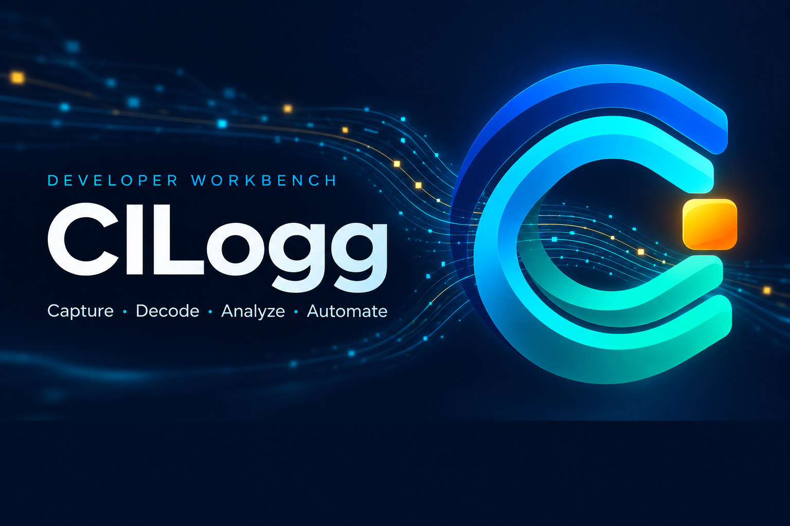
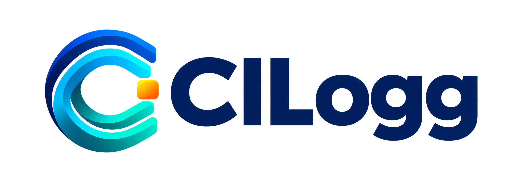

# CILogg — Developer Workbench identity

New logo and splash artwork, created on **30 October 2026** after reviewing the
canonical workbench plan, its 105-task index, 187 mapped requirements, current
progress ledger, and live GitHub milestones M00–M08.

## The product direction

CILogg's current foundation already combines fast log exploration, Regex Lab,
Value Counts, serial capture, actions/responses, Python/scenario tooling,
process plugins, and shared CLI/MCP control. The new program extends that
foundation into a general developer workbench, rather than a device-specific
utility or a log viewer alone.

The canonical package contains **105 tasks**: 3 reconciliation/gate tasks,
16 data tasks, 18 visualization tasks, 13 workspace tasks, 5 investigation tasks,
8 automation tasks, 18 communication tasks, 12 ecosystem tasks, 8 decoder tasks,
and 4 release tasks. Its progress ledger currently records G01 as completed,
G02/G03 as in progress, and 102 tasks as planned. Those counts describe the
expanded program, not the amount of existing CILogg functionality already shipped.

### Planned features and their effect on the identity

| Product family | Planned scope | Visual implication |
| --- | --- | --- |
| Exploration and data | Typed fields, regex/JSON/logfmt/CSV/syslog parsing, multiline events, exact time domains, folders, merged sources, tables, queries, enrichment, compression, and export | Parallel streams resolve into an orderly structure. |
| Charts and dashboards | Linked trends, categories, distributions, heatmaps, scatter/box plots, tables, hierarchy/network/state/profile/geo views, shared selections, drilldown, saved dashboards, and reports | The same signal remains recognizable across several views. |
| Workspace | Design system, welcoming open/connect/run flow, inspectors, facets, saved searches, groups, QuickFind, command palette, annotations, ANSI, and accessibility | A simple, legible primary symbol and strong type hierarchy. |
| Investigations | Pattern reduction, rarity, exceptions, comparisons, correlations, transactions, baselines, and explicitly experimental forecasts | One amber event stands out from the stream. |
| Automation | Conditions, workflows, assertions, Python hooks, deterministic replay, schedules, CI reports, and execution journals | A directed flow communicates progress without a generic success checkmark. |
| Communications and Protocol Lab | Byte-exact RX/TX, ASCII/HEX views, parameterized sequences, framing/checksums, serial/network/HID/pipe capabilities, bridges, simulation, and replay | The symbol represents both log records and communication signals. |
| Message decoders | TShark/Lua application-PDU decoding, nested streams, typed field trees, EHCP/EHCI, AT and SRING, inspector integration, and runtime validation | The open C acts as an inspection/decoding aperture. |
| Ecosystem and release | Process/stdin, containers, Kubernetes, SSH/OS logs, OpenTelemetry, backend connectors, trace/profile imports, IDE links, packs, Git team configuration, optional AI, and platform acceptance | A neutral developer identity that fits desktop, backend, QA, DevOps, mobile, and embedded work. |

### Milestone alignment

All nine public milestones were open when checked on 30 October 2026. Milestone
goals are future acceptance scope, not claims that those features are delivered.

| Milestone | Goal |
| --- | --- |
| [M00](https://github.com/dm17ryk/klogg/milestone/1) | Project readiness, documentation, distribution, and discoverability. |
| [M01](https://github.com/dm17ryk/klogg/milestone/2) | First linked charts and everyday usability. |
| [M02](https://github.com/dm17ryk/klogg/milestone/3) | Structured logs, typed data, sources, and navigation. |
| [M03](https://github.com/dm17ryk/klogg/milestone/4) | Analytical dashboards and linked visualizations. |
| [M04](https://github.com/dm17ryk/klogg/milestone/5) | Investigations, automation, reproducible checks, and CI. |
| [M05](https://github.com/dm17ryk/klogg/milestone/6) | Advanced visualization families and specialist data. |
| [M06](https://github.com/dm17ryk/klogg/milestone/7) | Protocol Lab, Docklight capabilities, and decoder delivery. |
| [M07](https://github.com/dm17ryk/klogg/milestone/8) | Developer integrations, connectors, and reusable packs. |
| [M08](https://github.com/dm17ryk/klogg/milestone/9) | Cross-platform release acceptance and complete evidence. |

The current execution policy remains **W0 → decoder core MD01–MD06 with its
prerequisites → W1–W6**. MD07/MD08 integration follows its later dependencies.
Branding does not alter that order or mark planned work complete.

## The visual concept

**Signal aperture:** nested blue/cyan/teal ribbons form an open C. They connect
the CILogg name to incoming logs, communication streams, structured data, and
linked analysis. The amber tile represents the event worth investigating.

- **Blue:** the reliable application and its raw-data foundation.
- **Cyan and teal:** active streams, decoding, and linked exploration.
- **Amber:** a selected event or useful finding.
- **Ink navy:** a calm backdrop with strong contrast for the splash typography.

The splash names the destination **Developer Workbench**, with the descriptive
line **Capture · Decode · Analyze · Automate**. It avoids a baked-in version
number or a checklist implying that the entire roadmap has shipped.

## Artwork files

| File | Native dimensions | Intended use |
| --- | --- | --- |
| [logo-mark.png](logo-mark.png) | 1254 × 1254, RGBA | Standalone symbol with transparent background. |
| [logo-wordmark.png](logo-wordmark.png) | 2172 × 724, RGBA | Horizontal lockup with navy lettering for light surfaces. |
| [splash-screen.png](splash-screen.png) | 1536 × 1024, RGB | Landscape startup artwork with a dark status area. |

The bottom 18% of the splash is kept dark and free of artwork for live startup
status. The current [StartupSplashScreen implementation](../../src/app/main.cpp)
draws an 82-pixel status/detail/progress panel; this artwork leaves approximately
123 pixels of clear footer space when exported to the current 1024 × 682 canvas.
Loading text and progress belong to the application and are not painted into
the artwork.

The three master PNGs retain their generated native pixels and transparency.
Production exports now replace the application and website branding at their
existing resource paths:

| Consumer | Production asset |
| --- | --- |
| Qt application/window icon and Linux desktop installation | `src/app/images/hicolor/{16,32,48,64,128,256,512}x…/cilogg.png` |
| Windows executable icon | `Resources/cilogg.ico`, with 16, 24, 32, 48, 64, 128, and 256-pixel frames |
| macOS bundle icon | `Resources/cilogg.icns`, including high-DPI representations through 1024 pixels |
| Qt startup splash | `src/app/images/splash.png`, exported at the existing 1024 × 682 canvas |
| Alternate splash asset | `src/app/images/splash_screen.png`, at the same canvas |
| Shared icon exports | `Resources/cilogg_{16,32,48,64,128,256,512,1024}.png` and `Resources/cilogg_icon.png` |
| Shared wordmark | `Resources/logo.png` |
| README hero | `Resources/splash_screen.png`, displayed at 100% of the README content width |
| Website header icon and favicon | `website/static/cilogg.png` and `website/static/favicon.png` |
| Website hero | `website/static/branding/splash-screen.png` |

Sized PNG exports use Lanczos resampling and preserve alpha for icons. The Qt
resource names, CMake packaging paths, and startup progress drawing code remain
the consumers of these files; a rebuild embeds the new art. No loading text or
progress bars are baked into the splash.

## Sources and generation record

- [Product specification](../../plans/cilogg-workbench-2026-10-21/00-product-spec.md)
- [All feature requirements](../../plans/cilogg-workbench-2026-10-21/FEATURE_COVERAGE.md)
- [105-task index](../../plans/cilogg-workbench-2026-10-21/TASK_INDEX.json)
- [Progress and execution policy](../../plans/cilogg-workbench-2026-10-21/PROGRESS.json)
- [Milestone mapping](../../plans/cilogg-workbench-2026-10-21/PUBLIC_TRACKING.md)
- [Live GitHub milestones](https://github.com/dm17ryk/klogg/milestones)
- [Exact generation prompts](PROMPTS.md)

Generated with the built-in image-generation tool. The logo mark was used as the
identity reference for the wordmark and splash; no API-key-based CLI was used.
