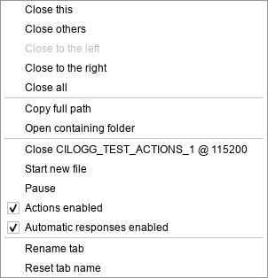

# Per-tab automatic responses

Each communication tab has an **Automatic responses enabled** check box beside
**Actions enabled** in its tab context menu and in File → COM ports → connection.
Disabling automatic responses leaves the tab available for manual Actions and
keeps its response counters and log observations. Other tabs are unaffected.



Automatic replies require an open connection, Actions enabled for that tab,
its automatic-response check box enabled, and the global automatic-response
switch enabled. Existing captures default to automatic responses enabled.
The per-tab choice is saved in capture settings and restored with sessions
and projects.

Changing the automatic-response choice cancels previous automatic timers,
linked response steps and response finalization. Re-enabling cannot revive
that pending work. Queued manual sends use a separate generation and continue.
Partial lines that span a change remain observable but cannot trigger a reply.

## CLI and native MCP

```console
cilogg command --action set_auto_responses_enabled --disabled --tab-id <tab-id>
cilogg command --action set_auto_responses_enabled --enabled --window-index 0 --tab-index 1
cilogg command --action get_comm_status --tab-id <tab-id>
```

Omitting selectors targets the current communication tab. `get_info` and
`get_comm_status` expose `com.autoResponsesEnabled` (the saved choice) and
`com.autoResponsesActive` (the combined current eligibility).

Native MCP discovers the same Commander operation through `cilogg_commands`.
For example, call `cilogg_execute` with:

```json
{
  "action": "set_auto_responses_enabled",
  "arguments": { "tab_id": "<tab-id>", "disabled": true }
}
```

Menu callbacks resolve stable tab IDs and verify the original connection is
still attached before applying a change, including after tab reordering.
