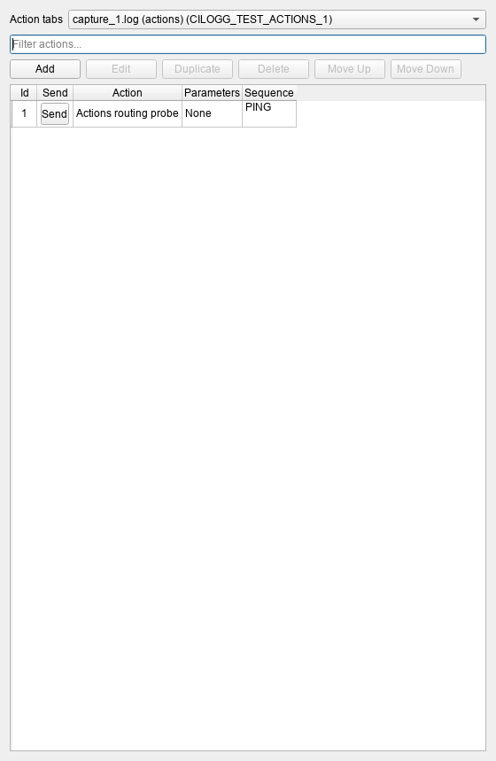

# Multiple Actions tabs

Every live communication tab has its own **Actions enabled** flag. Enable or
disable it in the tab's right-click menu or **File > COM ports > port > Actions
enabled**. Several tabs can be enabled together. The existing saved
`useForActions` setting persists each tab's flag independently.

Automatic responses require both the tab flag and the global automatic-response
switch. Matching, counters and response actions belong to the receiving session;
enabling another tab does not move responses to that tab. Disabling Actions does
not stop capture, logging or explicit response waits.

The Actions window's **Action tabs** combobox lists connected, enabled tabs in
that window. Its selected tab receives manual actions, regardless of which log
tab is currently visible. The last explicit choice or successful manual send is
remembered while the window lives. Automatic fallback to another eligible tab
does not overwrite that history: a temporarily unavailable last-used tab is
selected again when eligible, unless another destination was explicitly used in
the meantime. Opening a new, never-used Actions tab preserves a valid selection.
This destination history is not persisted across application restarts.



The screenshot uses logical test sessions; no serial device is opened.

An unavailable destination is removed from the combobox; Send is disabled when
none remain. Disabling/re-enabling a tab or closing/reopening its connection
invalidates previously queued actions and automatic-response work. A parameter
dialog retains a safe snapshot of its action and target; any destination change,
including switching away and back, cancels the send. Buffered lines retain the
eligibility of every received fragment, so a line partly received while Actions
was disabled cannot trigger a response after re-enabling it. Line observation
continues normally.

## CLI and MCP

Use `get_info` or `get_comm_status` to discover stable tab IDs. Both expose
`com.actionsEnabled` and `com.selectedForActions`; the existing
`com.isActionsPort` key remains an alias for the per-tab enable flag.

```powershell
cilogg command --action set_actions_enabled --tab-id '<tab-id>' --enabled --require-running
cilogg command --action set_actions_enabled --tab-id '<tab-id>' --disabled --require-running
cilogg command --action select_actions_tab --tab-id '<tab-id>' --require-running
cilogg command --action send_action --id 1 --require-running
```

The new operations accept the existing tab/window selectors and default to the
current tab when no tab selector is supplied. `set_actions_enabled` requires an
explicit enable/disable choice. `select_actions_tab` requires a connected,
enabled tab. A selector-free `send_action` uses the Actions window destination.
An explicit `send_action --tab-id ...` retains direct targeting, including a
connected tab whose automatic responses are disabled.

Native MCP discovers these operations from the shipped command help. Execute
them with the existing `cilogg_execute` tool, for example:

```json
{"action":"set_actions_enabled","arguments":{"tab_id":"<tab-id>","enabled":true}}
{"action":"set_actions_enabled","arguments":{"tab_id":"<tab-id>","disabled":true}}
{"action":"select_actions_tab","arguments":{"tab_id":"<tab-id>"}}
{"action":"send_action","arguments":{"id":1}}
```

## Verification scope

Automated regressions cover command parsing/discovery, per-session response
gating, generation cancellation, combobox routing/history, menus and persistence.
Hardware-free dispatch fixtures observe logical action notifications; they do not
claim that bytes were delivered through a physical serial port.

The focused unit suite passes 530 assertions across 23 cases. Native CLI/MCP
smoke validation restores two unavailable ports as paused sessions and checks
nine independent enable/disable transitions, status parity, destination rejection,
failed-send isolation and an empty disabled destination picker. The isolated
process is closed after the run. Logs are under `build_root/actions-smoke/artifacts`.

Final local validation (2026-10-18): the focused UI suite passes 252 assertions
in five cases; full CTest passes 4/4 in 398.18 seconds. MSVC with installed Qt
6.10.1 builds the application, portable application, grep and both test binaries.
Independent C++ and general reviews approved the implementation. CodeGraph,
code-review-graph and GitNexus were refreshed; GitNexus full-text search remains
unavailable. Hosted cross-platform CI is tracked separately from these results.
