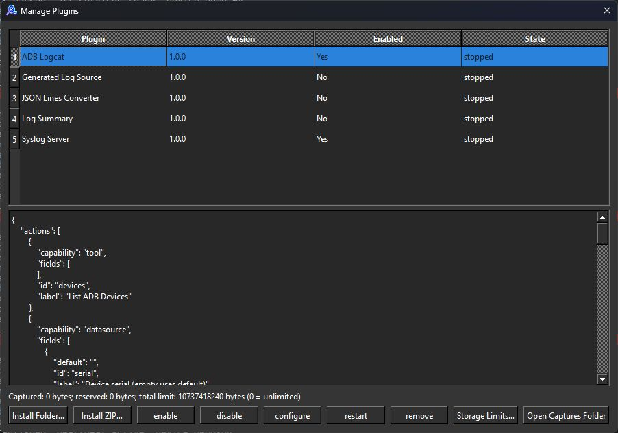
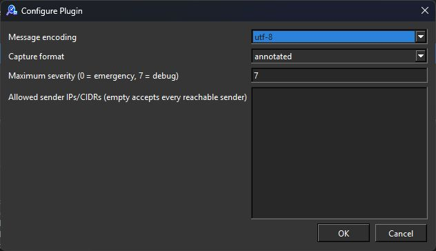

# CILogg process plugins

CILogg plugins run as separate executables. Protocol version 1 supports live
data sources, file converters, and tools. A plugin may expose several capabilities.
Plugins run with the current user's OS permissions. Native LogSquirl libraries
must be ported to this protocol.

## Using plugins



Open **Plugins → Manage Plugins…** to install a folder or ZIP, enable it, configure
it, inspect jobs/errors, restart it, or remove the user-installed copy. ADB Logcat
and Syslog Server are preinstalled and enabled by default; the demonstration
examples are disabled initially. Saved disable choices survive rescans and upgrades.
Both log sources and their SDK files ship in Windows installers/portable ZIPs,
Linux DEB/RPM/AppImage packages, and macOS app bundles/DMGs.
Enabled plugins start on the first action.
Actions appear in the Plugins menu and on the main toolbar unless their manifest
sets `menu` or `toolbar` to false; views get a toolbar button only with
`toolbar: true`. A failed plugin needs an explicit restart. Captured logs survive
stream stop or plugin failure.

**Browse Plugins…** opens the Available tab of the same **Plugins and Packs**
window: one list merged from every enabled plugin repository (an ordered table on
the Repositories tab), with each entry's source. A plugin updates only from the
repository it was installed from. All catalog packages require SHA-256. Updates
preserve enabled state and configuration. The default repository catalog starts
empty; it only advertises assets after release publication and verification. See
[Plugins: packing, repositories and updates](../DOCUMENTATION.md#plugins-packing-repositories-and-updates).

Python plugins require Python 3.9 or newer. CILogg checks its existing bundled
Python runtime, `CILOGG_SCRIPT_PYTHON`, then Python on PATH. Each shipped package
includes its standard-library-only SDK module.

## ADB and syslog log sources



Preinstalled **ADB Logcat** provides device discovery and live Android logcat capture.
Configure its ADB executable path, then use **List ADB Devices** or **Start ADB
Logcat**. See `plugins/examples/adb-logcat/README.md` for device selection and filters.

Preinstalled **Syslog Server** receives UDP logs like the syslog feature in Tftpd64.
Configure text encoding, severity filtering and optional sender restrictions.
Syslog defaults to loopback. Remote listeners require an explicit bind address;
configure allowed sender IPs/CIDRs before accepting network traffic.
See `plugins/examples/syslog-server/README.md` for addresses, ports and output
formats. Both plugins use the standard capture, job and
cancellation paths and are included in self-contained ZIP packaging.

## Authoring

Start from `plugins/examples` for Python or `plugins/sdk/cpp/template` for C++17.
The C++ helper links Qt Core and runs inside your executable; it never links a
CILogg host library. Build the C++ template with `CILOGG_PLUGIN_SDK_DIR` pointing
to the directory containing `cilogg_plugin.h`. Put the resulting executable and
its runtime dependencies beside `plugin.json`. Executable names without a suffix
receive `.exe` on Windows.

Each package has `plugin.json` at its root:

```json
{
  "id": "org.example.my-plugin",
  "name": "My Plugin",
  "version": "1.0.0",
  "protocol_version": 1,
  "capabilities": ["tool"],
  "executable": "python",
  "arguments": ["main.py"],
  "actions": [{"id": "hello", "label": "Hello", "capability": "tool", "fields": []}],
  "configuration": []
}
```

`executable` is a relative package path, or the special value `python`.
Arguments are separate strings, never a shell command. IDs contain letters,
digits, dots, underscores and hyphens. Versions use semantic-version notation.
Capabilities are `datasource`, `converter`, and `tool`.

Flat fields use `id`, `label`, `type`, optional `required` and `default`, numeric
`minimum`/`maximum`, and `choices` for choices. Types: `text`, `multiline`,
`number`, `integer`, `boolean`, `choice`, `file`, `directory`.

## Protocol

The optional manifest flag `enabled_by_default: true` is honored only for valid
plugins in CILogg's shipped plugin directory, and only when no enable/disable
choice has been saved. A user-installed package cannot enable itself with this
flag. Valid user-installed updates of a preinstalled plugin retain its default;
invalid overrides are reported without applying a new enable default.

Stdin/stdout carry UTF-8 JSON-RPC 2.0 objects, one per newline. Diagnostics go to
stderr. Messages are limited to 1 MiB, pending stream traffic to 8 MiB. Split large
records into batches; SDK stream writers wait for acknowledgements. The host
terminates initialization after 10 seconds and shutdown after 3 seconds.

Python SDK accepts `stream.write(records, finish_on_cancel=True)` to finish an
already-collected batch during job cancellation. This opt-in limits cancellation
credit/acknowledgement waits to one second and still honors stream stop and plugin
shutdown. Ordinary writes retain their immediate cancellation checks.

Host requests:

| Method | Parameters / result |
| --- | --- |
| `initialize` | `protocol_version`, `plugin_id`, `configuration`, `config_directory`, transport limits, `host_features` (`["views", "view_edit", "queries", "tooltips", "icons", "menus", "shortcuts"]`), `host_feature_versions`, `host_version`, `host_limits`; return identity/version, capabilities, actions, configuration fields, and optionally `features` (the host-to-plugin methods the plugin handles) and `sdk` (`{name, version}`) |
| `invoke` | `job_id`, `action`, `arguments`, `context`; respond to the request ID when complete. An action run from a menu entry or its shortcut gets `context.menu`: `location`, `menu_id`, `item_id`, for `log` entries `line` and `selection` (`ranges`, `count`, `text`, `truncated`), and for `element` entries `view_id`, `element_id`, the clicked `row_id` and `column_id` (tables) or `node_id` (a tree's node, a file tree's path), `selected_ids` and `selected_count` |
| `tooltip/resolve` | A host query (ids `q:<n>`), sent only to a plugin that lists it in `handles` and `features`: `view_id`, `window_id`, `element_id`, optional `row_id`, `column_id`, `tooltip_key`, `timeout_ms`, `context`; answer a tooltip object or `null` (see below) |
| `menu/populate` | A host query for a `dynamic` menu entry (docs/plugin-sdk-advanced.md 7.4): `menu_id`, `item_id`, `location`, `window_id`, `context` (ids, the line under the pointer and the selected line ranges, never the text), `timeout_ms`; answer `{items, cache_ms}` with entries of the menu schema without shortcuts or dynamic entries; `null` is an empty list |
| `field/complete` | A host query 150 ms after typing pauses in a view field with `completion` (docs/plugin-sdk-advanced.md 8.2): `view_id`, `window_id`, `element_id`, `text`, `cursor`, `timeout_ms` (500 ms, `completion_timeout_ms` up to 2,000), `context`; answer `{items: [{value, label, icon}]}` (at most 100, each with a string `value`), a list of items, or `null` |
| `tree/children` | A host query when a node with `has_children` and no children of a `lazy` tree expands (docs/plugin-sdk-advanced.md 11.1 and 28.1): `view_id`, `window_id`, `element_id`, `node_id`, `context`, `timeout_ms` (10 s, at most 30 s); answer `{nodes: [...]}` (a list alone is accepted; nested `children` count, 1,000 nodes in all), or `null` or no nodes for no children |

The plugin process environment also contains `CILOGG_EXECUTABLE` (the running CILogg
executable) and `CILOGG_INSTANCE_ID` (the single-application name that Commander clients use to
reach this instance). A plugin can run `"$CILOGG_EXECUTABLE" command --action ...` to control its
own CILogg, for example `pause_comm --wait` before it opens a serial port.

Host notifications: `configure` (`configuration`), `cancel` (`job_id`), `shutdown`,
`stream/opened` (`stream_id`), `stream/ack` (`stream_id`, `sequence`), and
`stream/stop` (`stream_id`). Host context includes stable window/tab IDs and the
file path when a file is targeted. Jobs return immediately to command callers.

Menus (E17b, docs/plugin-sdk-advanced.md section 7): plugin.json `menus` declares menus in the
locations `plugins` (the plugin's submenu in Plugins, which replaces its flat entries), `menubar`
(one menu after Plugins), `tab`, `pane` and `log` (context menus). Entries run an `action`, open a
`view`, or with `event: true` send the host notification `ui/command` (`origin` (`menu` or
`shortcut`), `menu_id`, `item_id`, `location`, `window_id`, `checked`, `context` with the selected
text for `log` entries); list `ui/command` in `handles`, or the host disables those entries. The
plugin notification `menu/update` (`menu_id`, `items: [{id, set: {title, icon, tooltip, enabled,
visible, checked}}]`) changes declared entries in every window. `shortcut` (on menu entries,
actions and views, at most 32) is a portable key sequence with Ctrl, Alt or Meta, or a function
key; a shortcut CILogg already uses is refused and listed in the Plugins and Packs window.

Choices and fields (E17c, docs/plugin-sdk-advanced.md sections 8 and 26): view choices may be
objects (`value`, `label`, `icon`, `tooltip`, `enabled`) with `{"type": "separator"}` and
`{"type": "section", "label": ...}` between them; fields take `indicator`, `style`, `orientation`,
`columns`, `searchable`, `editable` and `completion`, the kinds `multiline`, `secret`, `integer`,
`slider`, `color`, `date`, `time` and `datetime`, and the validation keys `required`, `pattern`,
`min`, `max`, `min_length`, `max_length` and `error`; the elements `checkbox`, `radio_group` and
`check_group` are new, and buttons take `requires_valid`. A `changed` event of a field with a
rule carries `valid` when the plugin declares `handles`. Hosts without these features announce no
`choices`, `toggles`, `field_kinds` or `validation`, and the Python SDK sends such a host the
fields it knows.

Rich tables and element menus (E17d, docs/plugin-sdk-advanced.md sections 10 and 27): table cells
may be objects (`text`, `icon`, `tooltip`, `tooltip_key`, `tone`, `bold`, `progress`, `sort`);
rows take `icon` and `checked`; columns take `align`, `hidden`, `sortable`, `sort_as`,
`min_width`, `check` and `icon`; tables take `header`, `toggle_selection`, `context_menu`,
`copy`, `export`, `reorderable` and `keep_columns`. A patch entry `{id, select, current,
scroll_to}` sets the selection. Tables send `checked` (`{row_id, row_ids, checked}`) and `moved`
(`{row_ids, before}`), and for plugins that declare `handles` also `activated`
(`{row_id, column_id}`) and `current` in `selected`. `context_menu` names a manifest menu with
`location: "element"`; its entries get `view_id`, `element_id`, `row_id`, `column_id`,
`selected_ids` and `selected_count` in their context. Hosts without these features announce no
`rich_tables` or `element_menus`.

Trees (E17e, docs/plugin-sdk-advanced.md sections 11 and 28): the element `tree` takes
`columns`, `nodes`, `selection`, `toggle_selection`, `checkboxes`, `auto_tristate`, `lazy`,
`expand_events`, `header`, `context_menu`, `copy`, `export` and `reorderable`; its nodes have
`id`, `text` or `cells`, `icon`, `tooltip`, `tooltip_key`, `tone`, `children`, `has_children`,
`expanded`, `checkable`, `checked` (`null`: partly), `editors` and `drag`. The element
`file_tree` takes `roots`, `filters`, `hide_filtered`, `show_files`, `show_hidden`, `columns`,
`selection`, `toggle_selection`, `select`, `checkboxes`, `value`, `context_menu` and `copy`. A
tree's patch entry takes `replace_nodes`, `update_nodes`, `insert_nodes` (with `parent` and
`before`), `remove_nodes`, `expand`, `collapse` and the selection keys; a file tree's takes
`expand` (paths) and `set: {value}`. Trees send `selected`, `activated` (`{node_id,
column_id}`), `checked` (`{node_id, checked, node_ids}`), `edited`, `moved` (`{node_ids, parent,
before}`) and, with `expand_events`, `expanded` and `collapsed` (`{node_id}`) to every plugin;
file trees send `selected` (the paths) and `activated` (`{path}`). Element menu entries on a tree
get `node_id` (on a file tree, the clicked path) instead of `row_id` and `column_id`. Hosts
without these features announce no `tree` or `file_tree` and skip the elements with a warning.

Plugin notifications:

| Method | Parameters |
| --- | --- |
| `progress` | `job_id`, `value` between 0 and 1 |
| `panel/update` | `job_id`, `panel`: `id`, `title`, `elements` |
| `stream/open` | `job_id`, plugin-generated `stream_id`; wait for `stream/opened` |
| `stream/data` | `stream_id`, `sequence` starting at 0, `records` array of UTF-8 strings; wait for the matching acknowledgement |
| `stream/close` | `stream_id` |
| `log` | `message` |

The host acknowledges data after writing and flushing its capture file. Closing
the source tab sends `stream/stop`. Converters receive `input_path` and a
host-assigned `output_path`; only a successful conversion opens the output.
Never overwrite the input. Cancellation must be checked throughout long actions.

Job states are `pending`, `running`, `cancelling`, `completed`, `failed` and `cancelled`;
`pending`, `running` and `cancelling` are active, the others final. `cancel_plugin_job` on a
running job sends `cancel` and moves the job to `cancelling` for up to 10 seconds. During that
grace period the host still accepts the job's `progress`, `panel/update` and final answer, so a
plugin can report its cleanup. The job then ends as `cancelled`. A late `result` or `error` is
kept for diagnostics only: a converter's output is not opened and storage state is unchanged.
Without an answer the job becomes `cancelled` when the grace period ends. A job that was not yet
sent to the plugin, and a job whose window or file is closed, is cancelled at once, without a
grace period. Job arguments that would exceed the 1 MiB message limit fail the job instead of
the plugin.

Panel elements support `text` (`text`), `table` (`columns`, `rows`), `progress`
(`value`), and `button` (`label`, `action`, optional `arguments`). CILogg renders
plain text and native controls, and keeps panels in the originating window.

## Views and message boxes

A plugin can declare interactive **views** in `plugin.json`: docks on any side or floating,
top-level windows and dialogs with fields, buttons, progress bars and large tables. Each view
with `"menu": true` (the default) gets a **Plugins → <title>** entry. Views are updated by
element id, so scroll position, selection, focus and typed text survive progress updates.
Every plugin can also show host message boxes with an optional countdown, from a job or a view,
with or without declared views (at most 8 open and 10 new boxes per 5 seconds per plugin).
Everything is a notification; the plugin still never sends requests to the host.

```json
"views": [
  {"id": "main", "title": "My Tool", "kind": "dock", "area": "right"},
  {"id": "editor", "title": "Editor", "kind": "window", "width": 800, "height": 500},
  {"id": "ask", "title": "Question", "kind": "dialog", "modal": true, "menu": false}
]
```

| Direction | Method | Parameters |
| --- | --- | --- |
| host → plugin | `view/opened` | `view_id`, `window_id`, `context` |
| host → plugin | `view/closed` | `view_id`, `window_id` |
| host → plugin | `view/event` | `view_id`, `window_id`, `element_id`, `type` (`changed`, `clicked`, `selected`, `edited`), `value`, `inputs`; `edited` also has `row_id`, `column_id`, `previous` |
| plugin → host | `view/update` | `view_id`, optional `window_id`, and `root` or `patch` |
| plugin → host | `view/show`, `view/hide` | `view_id`, optional `window_id`; `view/show` also takes `area`, `floating`, `title`, `focus` |
| plugin → host | `ui/message`, `ui/close_message` | `message_id`, `title`, `text`, `icon`, `buttons`, `default`, `timeout_ms`, `modal` |
| host → plugin | `ui/message_result` | `message_id`, `button`, `timed_out`, and `error` when the box was rejected |

A view button with `action` starts a normal plugin job through `invoke_plugin`, so CLI and MCP
callers get the same behaviour. Its `arguments` carry `inputs` (all field values) and
`save_path` when the button has a `save_dialog`. See [plugin views](plugin-views.md) for the
element reference, limits, lifecycle and automation names. The Python SDK has element builders
(`column`, `label`, `field`, `button`, `table`, …), `update`, `patch`, `show_view`, `hide_view`,
`message` (with `Message.wait()` or a callback) and `on_view_opened` / `on_view_closed` /
`on_view_event` callbacks that run on a worker thread. `plugins/examples/view-demo` shows all of
them; it is disabled by default.

Hosts that announce `view_edit` also support editable table cells and the `multichoice` field (see
[plugin views](plugin-views.md), sections 2.5 and 2.3) and the `toolbar` / `menu` / `icon` manifest
keys (section 2.1). The Python SDK helpers are
`table_column(id, title=None, width=None, editable=None, tooltip=None, tooltip_provider=None, tooltip_key=None)`,
`table_row(id, cells, tone=None, tooltip=None, editors=None, tooltip_provider=None, tooltip_key=None)` and
`editor(kind, choices=None, min=None, max=None, max_length=None, placeholder=None, value=None,
*, searchable=None, indicator=None)`; `searchable` (choice, multichoice) and `indicator="radio"`
(choice) need the host feature `choices` and are removed for an older host.
`Plugin.supports_view_edit` is true when the host announced `view_edit`; a plugin should fall back to
read-only tables when it is false. The view-demo has an editable table.

External windows belong to the plugin process. See the Python `external-window`
SDK example: Tk runs on the main thread while the protocol reader and jobs run on
workers. Keep the protocol reader responsive, and close windows on shutdown.

## Advanced SDK in the host: negotiation, host queries, tooltips and icons (E17a)

The [advanced plugin SDK](plugin-sdk-advanced.md) keeps protocol version 1. A plugin that does not
opt in gets exactly the frames it got before, apart from the additive `initialize` keys (a
golden-frame test checks this).

- **Manifest keys.** `handles` lists the host-to-plugin methods the plugin handles (for example
  `["tooltip/resolve", "query/cancel"]`); names this CILogg does not know are allowed. `requires`
  (`{"host_features": ["tooltips", "views>=2"]}`) makes an older CILogg show "Requires a newer CILogg
  (missing: …)" and never start the plugin. `icon_ref` on actions and views takes every icon
  reference form and wins over the file `icon`, which stays a plugin file so the previous CILogg
  still loads the manifest. Older hosts ignore all three keys.
- **Host queries.** The host sends `tooltip/resolve` only while the plugin is ready and reading its
  input, and only when the method is in both `handles` and the initialize `features`. At most 8
  queries are outstanding per plugin and one tooltip query per view. When the host stops waiting
  (timeout, the pointer left, the view closed) it sends `query/cancel` `{id}`; a late answer is
  dropped. Five failures in a row (timeouts, errors, invalid answers; a `null` answer does not
  count) pause the method for 60 seconds. `get_plugins` reports `features`, `sdk`,
  `missingFeatures` and per method `sent`, `answered`, `timedOut`, `failed`, `medianMs`, `p95Ms`
  and `pausedUntil`.
- **Tooltips.** Every element's `tooltip` is plain text, as row tooltips already were; table
  columns take `tooltip` too. `"tooltip_provider": true` on an element, a table column or a row
  asks the plugin (default timeout 1,500 ms, `tooltip_timeout_ms` up to 5,000); `tooltip_key`
  (128 characters) is part of the cache key. The answer is `null` or `{title, text, rows, tone,
  icon, footer, ttl_ms}`; the host renders it with every string escaped. While the plugin answers,
  the static tooltip shows, or "Loading…" after 250 ms. Answers are kept for `ttl_ms` (default
  30 s, at most 10 minutes; 256 per view) and dropped by a patch to the element or row, by
  `tooltip/invalidate` `{view_id, element_id, row_ids}`, and when the plugin restarts.
- **Icons.** An icon reference is a plugin file (`.png`, `.ico`, `.svg`), `builtin:<name>`,
  `status:<tone>`, `image:<id>` or `{"light": …, "dark": …}`. `ui/icons`
  `{"icons": {"<id>": {"png": "<base64>"} | {"svg": "<text>", "mask": true}}, "remove": [...]}`
  registers images until the plugin stops (256 icons of 64 KiB, 4 MiB in all, 256 × 256 pixels;
  16 pictures of 1 MiB with `"picture": true`; 128 MiB decoded in all). SVG, registered or a plugin
  file, may embed only raster `data:` images and fragments of itself; anything else is refused.
- **Accessibility.** An element's accessible name is its caption or text (field and button
  `label`, group `title`, label text), else its id; `accessible_name` and
  `accessible_description` override, and the static tooltip is the description by default. Field
  captions are the label buddies of their controls.
- **C++ SDK** (`cilogg_plugin.h` 2.0.0): `onQuery(method, handler)` with the same per-method
  workers as Python, `features` and `sdk` in the initialize result, `-32601` for unknown host
  requests, `supports()`, `hostLimits()`, `hostVersion()`, `invalidateTooltips()` and
  `registerIcons()` (both do nothing on an older host). A long handler should poll
  `query.expired()`, which turns true on `query/cancel`, at the deadline and at shutdown. E17b
  adds `onCommand(handler)` for `ui/command` (on the protocol reader thread, like
  `onNotification`; registering it announces `ui/command` in `features`) and
  `updateMenu(menuId, items)` (nothing on a host without `menus`); a dynamic submenu is an
  `onQuery( "menu/populate", ... )` handler that returns `{items, cache_ms}`.

## Python SDK 2.0: negotiation, host queries, tooltips, icons, menus and testing

`plugins/sdk/python/cilogg_plugin.py` is version 2.0.0 (`SDK_VERSION`); it is still one
standard-library file for Python 3.9 or newer, fully type-hinted (`TypedDict` classes for the
messages, such as `InitializeParams`, `TooltipResolveParams`, `Tooltip` and `IconImage`) and
checked with `mypy --strict` in CI. Every name of the earlier SDK keeps working. The design is
[the advanced plugin SDK](plugin-sdk-advanced.md) (E17); slice E17a adds:

- **Negotiation.** `plugin.supports(feature, version=1)` is true when the host announced the
  feature in `host_features` at that version or newer (`host_feature_versions`; a host that sends
  no versions has every listed feature at version 1, and a version alone does not announce a
  feature). `plugin.host_limits` is a dict with `max_elements`, `max_table_cells`,
  `max_text_chars` and `max_message_bytes`: the host's values, or the E13/E14 limits
  (`DEFAULT_HOST_LIMITS`) on an older host. `plugin.host_version` is the host's version string,
  or None. The initialize result always carries `sdk` (`{"name": "cilogg_plugin.py",
  "version": "2.0.0"}`) and, when handlers are registered, `features`.
- **Host queries.** `@plugin.tooltip(view_id, element_id=None)` registers the advanced-tooltip
  handler of one element, or of every other element of the view when `element_id` is None (the
  element's own handler wins). `@plugin.query(method)` registers a handler for any other query
  method (`menu/populate`, `tree/children`, `field/complete`, …; see also
  `@plugin.tree_children` below); one registered for
  `tooltip/resolve` is the fallback after the tooltip handlers. A handler gets a `Query`
  (`id`, `method`, `params`, `context`, `timeout_ms`, `deadline`, `remaining()`, `cancelled`,
  `check_cancelled()`); a tooltip handler gets a `TooltipQuery`, which adds `view_id`,
  `window_id`, `element_id`, `row_id`, `column_id`, `node_id` and `tooltip_key`. A tooltip
  handler returns a dict (build it with `tooltip_content(text, title=, rows=, tone=, icon=,
  footer=, ttl_ms=)`), a plain string (the tooltip text) or None (the static tooltip stays); any
  other handler returns its JSON result. An exception answers the JSON-RPC error `-32000` with its
  message. The SDK lists the registered methods, and `query/cancel`, in `features`
  (`plugin.handled_methods()`), so register handlers before `serve()`.
- **`handles`.** CILogg sends a query method only to a plugin whose `plugin.json` lists it in
  `handles` (and `query/cancel` with it):

  ```json
  "handles": ["tooltip/resolve", "query/cancel"]
  ```

  At start the SDK prints a warning on stderr for every handled method that `handles` lacks.
- **Lanes.** Query handlers never run on the reader, on job threads or on the view-callback
  thread:

  | Method | Workers | A newer query… |
  | --- | --- | --- |
  | `tooltip/resolve`, `field/complete` | 1 each | replaces a waiting one (latest wins; the replaced one gets no answer) |
  | `menu/populate` | 1 | waits its turn |
  | `tree/children` | 2 | waits its turn |
  | any other method | 1 per method | waits its turn |

  A query whose deadline (`timeout_ms` from receipt, or the method's default) passed before its
  handler started is dropped without an answer. `query/cancel` `{id}` drops a waiting query and
  suppresses the answer of a running one; a long handler can poll `query.check_cancelled()`.
- **Tooltips and accessible names on elements.** Every element builder takes `tooltip`,
  `tooltip_provider=True` (ask the plugin for the tooltip), `tooltip_key` (at most 128 characters,
  part of the host's cache key: change it when the tooltip changes), `accessible_name` and
  `accessible_description` as keyword properties; table columns take a header `tooltip`,
  `tooltip_provider` and `tooltip_key`, rows `tooltip_provider` and `tooltip_key`.
  `plugin.invalidate_tooltips(view_id, element_id=None, row_ids=None, node_ids=None,
  window_id=None)` (also `View.invalidate_tooltips`) drops cached answers; a patch of an element
  or row drops them by itself.
- **Icons.** `plugin.register_icons({id: entry}, remove=None)` registers images for the plugin's
  lifetime. Build entries with `png_icon(data, picture=False)` and `svg_icon(text,
  picture=False, mask=False)` (`mask`: a monochrome icon that the host recolours), and refer to
  icons with `image_ref(id)`, `builtin_ref(name)`, `status_ref(tone)` or
  `themed_ref(light, dark)`.
- **Forward compatibility.** A request the SDK does not know (a method of a newer host) is
  answered with the JSON-RPC error `-32601` "Method not found", and an unknown notification is
  ignored; SDK 1 ended its protocol loop on both.
- **Backward compatibility.** `update()` and `patch()` remove, centrally, what the host does not
  know: `tooltip_provider`, `tooltip_key` and column `tooltip` without the `tooltips` feature,
  `accessible_name` and `accessible_description` without `views` version 2. The caller's
  dictionaries are not changed. `invalidate_tooltips` and `register_icons` send nothing and return
  False on a host without `tooltips` or `icons`, because an older host logs a warning for every
  unknown method. `Plugin(manifest)` also accepts a manifest dict instead of a `plugin.json` path,
  and `serve(stdin=None, stdout=None)` accepts binary streams.

`plugins/examples/ui-gallery` (disabled by default) shows static and advanced tooltips on a
label, a button, a field, table headers and every table cell, a registered icon,
`invalidate_tooltips` and accessible names, a Plugins submenu with a check box, radio entries, a
dynamic submenu and a shortcut, log and tab context menu entries, every choice style, check
boxes, radio buttons, the new field kinds, validation and completion, a table with cell
objects, a check column, row dragging, Export CSV and its own context menu, an explorer view
with a lazy tree (check boxes, dragging, node tooltips, a context menu) and a file tree, a
layout window with tabs, a form, a grid, a splitter, a text view, Markdown notes, a chart, a
sparkline, a registered picture, button styles, a menu button, a checkable button, a busy
overlay, unsaved changes, focus and a dialog with OK, Cancel and Apply, and degrades on an older
CILogg.

### Menus and commands (E17b)

A host that announces `menus` and `shortcuts` (version 1 each) shows the `menus` of
`plugin.json`: the plugin's submenu of **Plugins**, a menu-bar menu, and entries in the tab,
pane, log and element context menus and in toolbar drop-downs (design section 7). The SDK builds
the entries and handles the two host-to-plugin methods:

- **Builders.** `menu(id, location, items, title=None, icon=None)` (`location` is one of
  `MENU_LOCATIONS`: `plugins`, `menubar`, `tab`, `pane`, `log`, `element`, `toolbar`),
  `menu_item(id, title, *, icon=None, tooltip=None, enabled=None, visible=None, checkable=None,
  checked=None, group=None, event=None, action=None, arguments=None, view=None, items=None,
  dynamic=None, when=None, shortcut=None)`, `menu_separator()` and `menu_section(title)` return
  plain dicts (`Menu`, `MenuEntry`) for `plugin.json` and for populate answers. `menu_item`
  raises ValueError for the shapes CILogg refuses: an entry does exactly one of `action` (with
  `arguments`), `view` or `event=True`, or is a submenu (`items`, or `dynamic=True`) without
  shortcut or check mark; `checked=True` and `group` need `checkable=True`; `shortcut` is a key
  sequence such as `"Ctrl+Alt+D"` or a list of two.
- **Dynamic submenus.** `@plugin.menu_populate(menu_id, item_id=None)` registers
  `handler(MenuQuery)` for the `dynamic` entry `item_id` of a menu, or for every dynamic entry of
  the menu; an entry's own handler wins, and a `@plugin.query("menu/populate")` handler is the
  last fallback (its result goes out unchanged). `MenuQuery` adds `menu_id`, `item_id`,
  `location`, `window_id` and, for log menus, `line` (the line under the pointer), `selection`,
  `ranges` and `line_count` to `Query` (a populate query never carries the selected text). The handler returns a list of entries, a
  dict `{"items": [...], "cache_ms": n}` (CILogg may show the answer again for `cache_ms`
  without asking) or None. The SDK removes `shortcut` keys from the entries, keeps `cache_ms`
  within 0 to 60,000 ms and answers the error `-32000` for any other return value. Handlers run
  on the `menu/populate` lane (default timeout 1,000 ms).
- **Commands.** `@plugin.on_command(menu_id=None, item_id=None)` registers `handler(UiCommand)`
  for `ui/command`, which CILogg sends when the user picks an `event` entry (`origin` `menu`) or
  presses its shortcut (`shortcut`). The most specific handler wins: menu and entry, then the
  entry in any menu, then the menu, then the handler without ids; a command without a handler
  is reported on stderr. `UiCommand` has `params`, `origin`, `menu_id`, `item_id`, `location`,
  `window_id`, `checked` (the new state of a checkable entry, else None) and `context`, and for
  log entries `line`, `selection`, `ranges` (1-based `(first, last)` pairs, at most 64),
  `line_count`, `text` (the selected text, at most 64 KiB) and `truncated`. Handlers run in arrival order on
  the worker thread of the view callbacks, never on the protocol reader; an exception is printed
  on stderr. `action` and `view` entries never reach the plugin as commands: CILogg runs them.
- **Run-time changes.** `plugin.update_menu(menu_id, items)` sends `menu/update` with
  `menu_set(item_id, title=, icon=, tooltip=, enabled=, visible=, checked=)` entries (or a dict
  `{item_id: {"title": ...}}`); open menus change in place. On a host without `menus` it sends
  nothing and returns False.
- **`features` and `handles`.** The initialize result lists `menu/populate` (and `query/cancel`)
  when a populate handler is registered and `ui/command` when a command handler is;
  `plugin.json` must list them in `handles`, or the SDK warns at start. The messages have
  `TypedDict` classes: `MenuPopulateParams`, `MenuPopulateResult`, `UiCommandParams`,
  `LogSelection`, `MenuUpdateParams`, `MenuUpdateItem`, `MenuItemChanges` and `MenuWhen`.

```python
from cilogg_plugin import MenuPopulateResult, MenuQuery, Plugin, UiCommand, menu_item

plugin = Plugin()
RECENT = ["boot.log", "radio.log"]


@plugin.menu_populate("main", "recent")  # {"id": "recent", "title": "Recent", "dynamic": true}
def recent(query: MenuQuery) -> MenuPopulateResult:
    items = [menu_item(f"recent_{n}", name, event=True) for n, name in enumerate(RECENT)]
    return {"items": items, "cache_ms": 5000}


@plugin.on_command("lines", "explain")  # an event entry of a "log" menu
def explain(command: UiCommand) -> None:
    print(command.line_count, command.ranges, command.text)
```

### Choices, toggles, field kinds and validation (E17c)

A host that announces `choices`, `toggles`, `field_kinds` and `validation` (version 1 each)
shows richer form controls (design section 8). The SDK builds them, converts them for an older
host and answers field completion:

- **Choices.** A `choices` list holds plain values and `choice(value, label=None, *, icon=None,
  tooltip=None, enabled=None)` objects, with `choice_separator()` and `choice_section(label)`
  between them (`Choice`, `ChoiceSeparator`, `ChoiceSection`). `choice` and `multichoice`
  fields, `radio_group`, `check_group` and table cell editors take them.
- **Field keys.** `field(...)` gains keyword-only keys (`FieldElement`), checked against the
  kind (ValueError for a combination CILogg refuses):
  - `choices`: `indicator="radio"` (radio marks in a `choice` drop-down); `style` (`dropdown`,
    or the inline `radio` for `choice` and `checkboxes` for `multichoice`, `CHOICE_STYLES`) with
    `orientation` (`vertical`, `horizontal`) and `columns` (1 to 12); `searchable` (a filter
    line in the open list); `editable` (`choice`: the user may type a value that is not in the
    list); `completion` (on an editable `choice` or a `text` field);
  - `field_kinds`: the kinds `multiline` (`rows`, `monospace`), `secret`, `integer` and
    `slider` (`min`, `max`, `step`), `color` (`"#rrggbb"`), `date` (`YYYY-MM-DD`), `time`
    (`HH:MM:SS`) and `datetime` (`YYYY-MM-DDTHH:MM:SS`, local time) (`FIELD_KINDS`);
  - `validation`: `required`, `pattern` (a regular expression for the whole text, at most 256
    characters), `min` and `max`, `min_length` and `max_length`, and `error` (the plugin's
    message; `""` clears it). `min`, `max` and `step` are finite numbers, whole on `integer` and
    `slider` fields; `rows`, `min_length` and `max_length` are whole numbers (`field()` raises
    ValueError otherwise). `button(..., requires_valid=True)` (every field of the view) or
    `requires_valid=["label", "retries"]` keeps a button disabled until those fields are valid.
- **Check boxes and radio buttons.** `checkbox(id, text, value=False, *, tristate=None,
  tone=None)` (`value` None is partly checked and needs `tristate=True`),
  `radio_group(id, choices, value=None, *, title=None, orientation=None, columns=None)` and
  `check_group(id, choices, value=None, *, title=None, orientation=None, columns=None,
  all_none=None)` (`all_none` adds All and None links) are elements (`CheckboxElement`,
  `RadioGroupElement`, `CheckGroupElement`). Their values appear in `inputs` under their ids,
  and they send `changed` with the new value (a list for a check group).
- **Events.** On a host with validation, the `changed` event of a field that declares a
  validation key (`required`, `pattern`, `min`, `max`, `min_length`, `max_length` or a
  non-empty `error`), and of every `color` field (blank or `#rrggbb`), carries `valid` when the
  plugin declares `handles`; other `changed` events keep their earlier shape, so read
  `params.get("valid", True)` (`ViewEventParams`).
- **Completion.** `@plugin.complete(view_id, element_id=None)` registers
  `handler(CompleteQuery)` for a field with `completion`, or for every such field of the view
  (an element's own handler wins; a `@plugin.query("field/complete")` handler is the last
  fallback, its result unchanged). `CompleteQuery` adds `view_id`, `window_id`, `element_id`,
  `text` and `cursor` (0 to `len(text)`, in characters as Python counts them) to `Query`. The handler returns a list of items
  (strings, or `completion_item(value, label=None, *, icon=None)`), a dict `{"items": [...]}`
  or None (no completions); the SDK keeps the first 100 items and answers the error `-32000`
  for any other return value or an item without a string `value`. Handlers run on the
  `field/complete` lane, where a newer query replaces a waiting one (default timeout 500 ms,
  at most 2,000). The initialize result lists `field/complete` (and `query/cancel`), which
  `plugin.json` must list in `handles`. The messages have `TypedDict` classes:
  `CompleteParams`, `CompletionItem` and `CompleteResult`.
- **Older hosts.** `update()` and `patch()` convert what the host does not know, without
  changing the caller's dictionaries: without `choices`, separators and sections are left out
  and choice objects keep only `value` and `label` (a plain value when there is no label), also
  in table cell editors, and the field keys `indicator`, `style`, `orientation`, `columns`,
  `searchable`, `editable` and `completion` go; without `toggles`, a `checkbox` becomes a
  `boolean` field captioned with its text (partly checked becomes False), a `radio_group` a
  `choice` field and a `check_group` a `multichoice` field captioned with the title (with the
  inline style when the host has `choices`); without `field_kinds`, the new kinds become
  `text` fields, `integer` and `slider` `number` fields, and `rows`, `monospace` and `step` go;
  without `validation`, the validation keys and `requires_valid` go (`min` and `max` of
  `integer` and `slider` fields stay with `field_kinds`). A patch is converted by the type of
  the element in the view's last `update()`.

```python
from typing import List

from cilogg_plugin import (
    CompleteQuery, CompletionItem, JsonObject, Plugin, button, checkbox, choice,
    choice_separator, column, completion_item, field,
)

plugin = Plugin()
BOARDS = ["Board 1", "Board 2", "Board 7"]


def form() -> JsonObject:
    return column(
        field("speed", "choice", label="Speed", value="auto", choices=[
            choice("auto", "Automatic", icon="builtin:refresh"), choice_separator(),
            choice(115200, "115200"), choice(9600, "9600", enabled=False)]),
        field("board", "choice", label="Board", choices=BOARDS, editable=True,
              completion=True),
        checkbox("verbose", "Verbose", value=None, tristate=True),
        field("label", "text", label="Label", required=True, pattern="[A-Za-z0-9_-]+"),
        field("retries", "integer", label="Retries", value=3, min=0, max=10),
        button("apply", "Apply", event=True, requires_valid=["label", "retries"]),
        id="body")


@plugin.complete("main", "board")
def boards(query: CompleteQuery) -> List[CompletionItem]:
    typed = query.text[:query.cursor].casefold()
    return [completion_item(name) for name in BOARDS if name.casefold().startswith(typed)]
```

### Rich tables and element menus (E17d)

A host that announces `rich_tables` and `element_menus` (version 1 each) shows richer tables
and a plugin context menu on them (design sections 7.2 and 10). The SDK builds them, converts
them for an older host and reads the new events and menu contexts:

- **Cells.** A cell is a string or `cell(text, *, icon=None, tooltip=None, tooltip_key=None,
  tone=None, bold=None, progress=None, sort=None)` (`TableCell`). `tooltip` is the cell's plain
  tooltip and wins over the row's; `tone` (`CELL_TONES`) wins over the row's tone; `progress`
  (0 to 1) draws a bar behind the text; `sort` is the value a sortable table sorts by instead
  of the text. `table_row` keeps cell objects (mappings with at least one of `CELL_KEYS`, as
  `cell()` makes) and turns other values, other mappings included, into text, as before.
- **Rows, columns and tables.** New keyword-only keys:
  - `table_row(..., icon=None, checked=None, drag=None)` (`TableRow`): an icon in the first
    column, the state of the check columns (a row without `checked` is unchecked), and `drag`
    (accepted, used from E17g);
  - `table_column(..., align=None, hidden=None, sortable=None, sort_as=None, min_width=None,
    check=None, icon=None)` (`TableColumn`): `align` (`COLUMN_ALIGNMENTS`), a column hidden at
    first (the header menu shows it), `sortable=False` for one column of a sortable table,
    `sort_as` (`SORT_AS`: `text`, `number`, `natural`), a minimum width, a check box column
    bound to the rows' `checked`, and a header icon;
  - `table(..., header=None, toggle_selection=None, context_menu=None, copy=None, export=None,
    reorderable=None, keep_columns=None)` (`TableElement`): `header=False` hides the header,
    `toggle_selection` (with `selection="multi"`) makes every click add or remove a row, `copy`
    (default on) gives Copy and Copy All, `export` adds Export CSV..., `reorderable` lets the
    user drag rows, `keep_columns` (default on) keeps the column widths, order, hidden columns
    and sort, and `context_menu` names a menu of `plugin.json` with `location: "element"`.

  The builders raise ValueError for a value CILogg refuses: an unknown tone, alignment or
  `sort_as`, `progress` outside 0 to 1, a negative `min_width`, `toggle_selection` without
  `selection="multi"`, or a `context_menu` that is not a menu id.
- **Selection.** `select_rows(table_id, row_ids=None, *, current=None, scroll_to=None)` is a
  patch entry (`SelectionPatch`): `row_ids` replace the selection, `current` sets the row with
  the keyboard focus and `scroll_to` scrolls a row into view. CILogg sends no `selected` event
  for it. CILogg uses at most `MAX_TABLE_IDS` (1000) ids, so the entry carries only
  `bounded_ids(row_ids)`: at most 1000, and only as many as fit in `MAX_ID_BYTES` (256 KiB) of
  JSON, so the patch stays below the 1 MiB message limit.
- **Events** (`view/event` of the table, `ViewEventParams`). `selected` also carries
  `selected_count` and `current` (the focused row, or None). `activated` (a double-click or
  Enter on a cell that is not editable) has the value `TableActivatedValue` `{row_id,
  column_id}`. `checked` has `TableCheckedValue` `{row_id, row_ids, checked}`: `row_ids` lists
  every row that changed (a Shift+click range); CILogg shows the new state at once. `moved`
  has `TableMovedValue` `{row_ids, before}` (`before` None: the end); CILogg does not move the
  rows, so the plugin confirms with a patch (for example `replace_rows` in the new order).
  CILogg sends `current` and `activated` only to a plugin whose `plugin.json` declares
  `handles`.
- **Element menus.** A `menus` entry with `location: "element"` is the context menu of every
  table that names it in `context_menu`. Its `event` entries reach `@plugin.on_command(menu_id,
  item_id)`; `UiCommand` (and `MenuQuery` for a dynamic entry) adds `view_id`, `element_id`,
  `row_id` and `column_id` (the clicked cell, None off a cell), `selected_ids` (at most 1000)
  and `selected_count` (`ElementMenuContext`). In `when`, `selection` (`none`, `any`, `lines`)
  and `min_lines`/`max_lines` count selected rows.
- **Older hosts.** `update()` and `patch()` convert what the host does not know, without
  changing the caller's dictionaries: without `rich_tables`, cell objects become their text,
  the new row, column and table keys go, and a `select_rows` entry is left out (a patch with
  nothing else is not sent); without `element_menus`, `context_menu` goes.

```python
from typing import List

from cilogg_plugin import (
    JsonObject, Plugin, UiCommand, cell, replace_rows, select_rows, status_ref, table,
    table_column, table_row,
)

plugin = Plugin()
order = ["b1", "b2"]
checked = {"b1": False, "b2": True}


def rows() -> List[JsonObject]:
    return [table_row(board, [f"Board {board[1:]}", cell("ok", icon=status_ref("ok")),
                              cell("40 %", progress=0.4)], checked=checked[board])
            for board in order]


def boards() -> JsonObject:
    return table("boards", [table_column("name", "Board", check=True),
                            table_column("state", "State"),
                            table_column("progress", "Progress", align="right")],
                 rows(), selection="multi", reorderable=True, export=True,
                 context_menu="board_actions")


@plugin.on_view_event
def event(params: JsonObject) -> None:
    value = params.get("value")
    if params.get("element_id") == "boards" and params.get("type") == "moved":
        moved = [board for board in value["row_ids"] if board in order]
        rest = [board for board in order if board not in moved]
        position = rest.index(value["before"]) if value["before"] in rest else len(rest)
        order[:] = rest[:position] + moved + rest[position:]
        plugin.patch("main", [replace_rows("boards", rows()), select_rows("boards", moved)])


@plugin.on_command("board_actions", "restart")  # {"location": "element", ...} in plugin.json
def restart(command: UiCommand) -> None:
    print(command.row_id, command.selected_ids, command.selected_count)
```

### Trees and file trees (E17e)

A host that announces `tree` and `file_tree` (version 1 each) shows two new view elements (design
sections 11 and 28). A host without them skips such an element with a warning, and the SDK does
not turn a tree into another element, so check `plugin.supports("tree")` (or list the feature
in `requires`) before you send one.

- **Nodes.** `tree_node(id, text=None, *, cells=None, icon=None, tooltip=None,
  tooltip_key=None, tone=None, children=None, has_children=None, expanded=None,
  checkable=None, checked=<not given>, editors=None, drag=None)` (`TreeNode`). Pass `text` (the
  first column) or `cells` (strings or `cell()` objects, one per column), not both. `children`
  are nested nodes; in a `lazy` tree, `has_children=True` without children makes CILogg ask
  `tree/children` when the node expands. `checked` is True, False or None (partly checked) and
  is left out unless you pass it. `checkable=False` hides a node's check box, `editors` maps an
  `editable` column to an `editor()`, and `drag` is accepted and used from E17g.
- **Trees.** `tree(id, nodes=None, columns=None, selection=None, *, toggle_selection=None,
  checkboxes=None, auto_tristate=None, lazy=None, expand_events=None, header=None,
  context_menu=None, copy=None, export=None, reorderable=None)` (`TreeElement`). Columns are
  `table_column()` objects or plain column ids; without columns the tree has one column and no
  header. `selection` is `none` (the default), `single` or `multi`. `checkboxes` gives every
  checkable node a check box and `auto_tristate` makes parents follow their children; `lazy`
  loads children through `tree/children`; `expand_events` sends `expanded` and `collapsed`;
  `reorderable` lets the user drag nodes; `copy` (default on) and `export` add Copy, Copy All
  and Export CSV... to the context menu, before the entries of the `context_menu` menu.
- **File trees.** `file_tree(id, roots, *, filters=None, hide_filtered=None, show_files=None,
  show_hidden=None, columns=None, selection=None, toggle_selection=None, select=None,
  checkboxes=None, value=None, context_menu=None, copy=None)` (`FileTreeElement`) shows the
  folders and files under at most 16 absolute roots (`C:/x`, `C:\x`, `/x`, `//server/share`).
  `filters` are name globs such as `"*.bin"`; `hide_filtered=False` greys out the files that do
  not match; `columns` come from `FILE_TREE_COLUMNS` (`name`, `size`, `type`, `modified`;
  default `name`, `size`, `modified`); `selection` is `single` by default; `select`
  (`FILE_TREE_SELECT`: `files`, `dirs`, `both`) is what can be selected; `checkboxes` makes a
  pick list. `value` is the selected (or checked) paths, with forward slashes; change it later
  with `set_props(id, value=[...])`. CILogg lists names and sizes only: it never reads the
  files.

  The builders raise ValueError for what CILogg refuses: an empty node id, an unknown tone,
  `text` and `cells` together, a `checked` that is not True, False or None, an unknown
  `selection`, `toggle_selection` without `selection="multi"`, a `context_menu` that is not a
  menu id, a tree of more than `MAX_TREE_NODES` (50,000) nodes or `MAX_TREE_DEPTH` (64) levels,
  more than `MAX_FILE_TREE_ROOTS` roots, a relative root, or an unknown file tree column or
  `select` value.
- **Patches.** Each helper returns one entry for `plugin.patch()` (`TreePatch`):
  `replace_nodes(tree_id, nodes, parent=None)` (the top-level nodes, or the children of
  `parent`), `update_nodes(tree_id, nodes)` (only the keys given change; `children` replaces
  the node's children), `insert_nodes(tree_id, nodes, parent=None, before=None)`,
  `remove_nodes(tree_id, node_ids)` (descendants go too), `expand_nodes(element_id,
  ids_or_paths)` (nodes of a tree, folders of a file tree; expanding a lazy node loads it),
  `collapse_nodes(tree_id, node_ids)` and `select_nodes(tree_id, node_ids=None, *,
  current=None, scroll_to=None)`, which sends no `selected` event and expands the ancestors of
  `current` and `scroll_to`. CILogg keeps expanded nodes and the selection by id when nodes are
  replaced.
- **Lazy children.** `@plugin.tree_children(view_id, element_id=None)` registers
  `handler(TreeChildrenQuery)` for one tree, or for every lazy tree of the view (an element's
  own handler wins; a `@plugin.query("tree/children")` handler is the last fallback, its result
  unchanged). `TreeChildrenQuery` adds `view_id`, `element_id`, `node_id` and `window_id` to
  `Query`. The handler returns a list of nodes, a dict `{"nodes": [...]}` or None (no
  children); the SDK answers `{"nodes": [...]}` (`TreeChildrenResult`), and the error `-32000`
  for any other return value, a node that is not a dict, more than `MAX_TREE_CHILDREN` (1,000)
  nodes counting nested children, or children nested more than 64 levels. Handlers run on the
  `tree/children` lane (two workers, default timeout 10 seconds). CILogg shows "Could not load"
  after an error or a timeout and asks again on the next expand. The initialize result lists
  `tree/children` (and `query/cancel`), which `plugin.json` must list in `handles`.
- **Events** (`view/event`, `ViewEventParams`; every key goes to every plugin). A tree sends
  `selected` (node ids in tree order, at most 1000, with `selected_count`, `truncated` and
  `current`), `activated` (`TreeActivatedValue` `{node_id, column_id}`; `column_id` is None in
  a tree without columns, also in `edited`), `checked` (`TreeCheckedValue` `{node_id, checked,
  node_ids}`: the clicked node first and, with `auto_tristate`, its loaded descendants),
  `edited` (the value, with `node_id`, `column_id` and `previous`), `moved` (`TreeMovedValue` `{node_ids, parent, before}`, None for the top
  level and for the end) and, with `expand_events`, `expanded` and `collapsed`
  (`TreeExpandValue` `{node_id}`); `TREE_EVENTS` lists them. CILogg does not move the nodes:
  the plugin keeps its own order and confirms a move with a patch. A file tree sends `selected`
  (the paths, also in `inputs`) and `activated` (`FileActivatedValue` `{path}`, on a file).
- **Context menus and tooltips.** The `element` menu that `context_menu` names follows CILogg's
  own entries (Copy, Copy All and Export CSV... on a tree, Copy Path on a file tree). In its
  commands and populate queries, `UiCommand.node_id` and `MenuQuery.node_id` are the clicked
  node (on a file tree, the clicked path; None off a node) instead of `row_id` and `column_id`,
  and `selected_ids` holds node ids or paths (`ElementMenuContext`). With `tooltip_provider` on
  a tree, `TooltipQuery.node_id` is the node under the pointer; on a file tree it is the path.
- **Older hosts.** `update()` and `patch()` send `tree` and `file_tree` elements and their node
  operations as they are (only the element keys of the E17a features go, like on every
  element). A tree's selection patch stays on a host with `tree`; a host with neither `tree`
  nor `rich_tables` does not get it.

```python
from typing import List, Optional

from cilogg_plugin import (
    JsonObject, Plugin, TreeChildrenQuery, TreeNode, UiCommand, builtin_ref, column, file_tree,
    label, tree, tree_node,
)

plugin = Plugin()
BOARDS = {"bench1": ["Board 1", "Board 2"], "bench2": ["Board 3"]}


def explorer() -> JsonObject:
    if not (plugin.supports("tree") and plugin.supports("file_tree")):
        return label("note", "This CILogg cannot show trees.")
    benches = [tree_node(bench_id, f"Bench {bench_id[-1]}", icon=builtin_ref("folder"),
                         has_children=True) for bench_id in BOARDS]
    return column(
        tree("benches", benches, selection="multi", lazy=True, checkboxes=True,
             auto_tristate=True, context_menu="node_actions"),
        file_tree("files", ["C:/Firmware"], filters=["*.bin", "*.hex"], selection="multi"),
        id="body")


@plugin.tree_children("main", "benches")  # "handles": [..., "tree/children", "query/cancel"]
def boards(query: TreeChildrenQuery) -> Optional[List[TreeNode]]:
    names = BOARDS.get(query.node_id)
    if names is None:
        return None  # no children
    return [tree_node(f"{query.node_id}.{n}", name) for n, name in enumerate(names)]


@plugin.on_command("node_actions", "reset")  # {"location": "element", ...} in plugin.json
def reset(command: UiCommand) -> None:
    print(command.node_id, command.selected_ids, command.selected_count)
```

### Layout, content and dialogs (E17f)

A host that announces `layout`, `text_view`, `images`, `charts` and `view_dialogs` (version 1
each) shows new layout containers, content elements, button keys, a busy overlay, unsaved
changes and dialog buttons (design sections 12 and 29).

- **Layout** (`layout`). `tabs(id, *tabs, current=None, position=None)` (`TabsElement`) holds
  `tab(title, *children, id=None, icon=None, badge=None)` (`TabElement`) elements; `current` is
  a tab id or index, `position` one of `TAB_POSITIONS` (`top`, `bottom`, `left`, `right`), and
  `badge` a short count or text (at most 64 characters) shown after the title.
  `splitter(*children, id=None, orientation=None, sizes=None)` (`SplitterElement`) makes each
  child a pane, side by side (`horizontal`, the default) or stacked (`vertical`), with `sizes`
  in pixels per pane; CILogg keeps the sizes the user drags. `form(*children, id=None)`
  (`FormElement`) aligns captions and controls: a field's caption is its `label`, any other
  child but a button may set `label` for its caption. `grid(*children, columns=None, id=None)`
  (`GridElement`) fills `columns` (1 to 12, default 2) from left to right; children take `span`
  and `row_span`. `separator(id=None, orientation=None)` draws a line and `spacer(id=None,
  size=None, stretch=None)` adds space (0 to 2,000 pixels) or stretches.
- **Size hints.** Every element takes `stretch` (0 to 100), `min_width`, `max_width`,
  `min_height`, `max_height` (0 to 10,000 pixels) and `align` (`ELEMENT_ALIGNMENTS`) as keyword
  properties. CILogg clamps a value out of range.
- **Content.** `text_view(id, text="", *, format=None, monospace=None, wrap=None, follow=None,
  max_lines=None)` (`TextViewElement`, `text_view`) shows read-only text: `plain` or
  `markdown` (CommonMark without HTML; images only from icon references; a click on a link
  sends `link` and CILogg never opens it), at most 1,048,576 characters, `max_lines` (0 to
  100,000) for plain text, and find on Ctrl+F. `image(id, source, *, width=None, height=None,
  scale=None, alt=None)` (`ImageElement`, `images`) shows an icon reference: a plugin file,
  `builtin_ref()`, `status_ref()`, `themed_ref()` or `image_ref()` of a picture registered
  with `png_icon(..., picture=True)`; `width` and `height` are 1 to 4,096 pixels and `scale`
  one of `IMAGE_SCALES` (`fit`, `fill`, `none`). `sparkline(id, values, *, min=None, max=None,
  kind=None, tone=None)` (`SparklineElement`, `charts`) draws at most 1,024 values (None is a
  gap) as a `line` or `bar`. `chart(id, series, *, kind=None, x_title=None, y_title=None,
  x_kind=None, legend=None, window=None)` (`ChartElement`, `charts`) draws at most 8
  `chart_series(id, points, *, title=None, tone=None)` (`ChartSeries`): points are numbers
  (`y` at their position) or `[x, y]` pairs, at most 10,000 per series; `kind` is one of
  `CHART_KINDS` (`line`, `bar`, `scatter`, `area`), `x_kind` `number` or `time` (milliseconds
  since the epoch), and `window` (1 to 10,000) keeps the last points of each series.
- **Buttons** (`view_dialogs`). `button()` gains `icon`, `style` (`BUTTON_STYLES`: `push`,
  `tool`, `link`), `menu` (the id of an `element` menu: the button opens it as a drop-down and
  its entries reach `@plugin.on_command` with the button as `element_id`), `checkable` and
  `checked` (a checkable button sends `changed` with its new state instead of `clicked` or its
  action), `shortcut` (a key sequence while the focus is in the view) and `default` (pressed
  by Enter).
- **Busy overlay, unsaved changes and dialogs** (`view_dialogs`). `busy`, `busy_text` and
  `busy_cancel` on the root or any container disable and cover its contents; Cancel sends
  `cancel` (value None) with the container as `element_id`. `modified=True` on the root marks
  the title with ` *`, and closing the view by the user then asks "Discard changes?" (or the
  root's `close_confirm` text). A `dialog` view may declare `buttons` (from `DIALOG_BUTTONS`:
  `ok`, `cancel`, `apply`, `close`, `yes`, `no`), `default` and `confirm_by_plugin` in
  `plugin.json`; a button sends `clicked` with `element_id` `DIALOG_BUTTONS_ELEMENT`
  (`"#buttons"`) and the button's name, and the `view/closed` of such a dialog carries `result`
  (the button that closed it, None otherwise) and `inputs` (`ViewClosedParams`).

  The builders raise ValueError for what CILogg refuses or would cut: an unknown enumeration
  value, a `tabs` child that is not a `tab`, a `current` that names no tab, a badge over 64
  characters, grid `columns` outside 1 to 12, a negative splitter size, a spacer size, image
  size, `max_lines` or chart `window` out of range, text over `MAX_TEXT_VIEW_CHARS`, more than
  `MAX_SPARKLINE_VALUES` values, `MAX_CHART_SERIES` series (or two with one id) or
  `MAX_CHART_POINTS` points, a point that is neither a number nor an `[x, y]` pair, a button
  `menu` that is not a menu id, `checked=True` without `checkable=True`, or an empty shortcut.
- **Patches.** Each helper returns one entry for `plugin.patch()` (`ContentPatch`):
  `append_text(text_view_id, text)` (at most `MAX_TEXT_APPEND_CHARS`, 65,536 characters; the
  oldest lines go beyond `max_lines`), `append_points(chart_id, series_id, points)`,
  `clear_chart(chart_id, series_ids=None)` (every series, or the listed ones) and
  `focus_element(element_id)` (CILogg moves the focus only while the view is active).
  `set_props(id, text=...)` replaces a text view's text; a root of the same shape replaces it
  only when it differs from the text the plugin last set, so appended text stays (likewise for
  a chart's `series` and a sparkline's `values`).
- **Events** (`ViewEventParams`). `tabs` send `changed` with the tab's id (None for a tab
  without an id) and `index` (a `current` set by the plugin sends nothing); a text view sends
  `link` (`LinkValue` `{href}`); a busy container sends `cancel`; a checkable button sends
  `changed` with True or False; a dialog button sends `clicked` from `"#buttons"`.
- **Older hosts.** `update()` and `patch()` convert centrally, copying only what changes.
  Without `layout`, `tabs` become a `column` (same id) of `group`s titled like the tabs (the
  tab's `icon` and `badge` and the tabs' `current` and `position` go), a `splitter` a `column`
  of `row`s (horizontal: one row of every pane; vertical: a row per pane), a `form` a `column`
  with a `row` per child (a caption of a child that is not a field becomes a label before it),
  a `grid` a `column` of `row`s of `columns` children; `separator` and `spacer` are left out,
  and the size hints are removed from every element. A `set` of a converted element keeps the
  keys the converted element knows (a tab's `title`, as the group's). Without `view_dialogs`,
  the new button keys, the busy keys of containers, `modified`, `close_confirm` and `focus`
  patches go. `text_view`, `image`, `sparkline` and `chart` elements are sent as they are (an
  older host skips them, so check `plugin.supports(...)`); without `text_view` the `append`
  patches go, and without `charts` the `append_points` and `clear` patches. A patch left with
  no entry sends no frame.

```python
from cilogg_plugin import (
    JsonObject, Plugin, UiCommand, append_text, button, chart, chart_series, column, field,
    form, set_props, tab, tabs, text_view,
)

plugin = Plugin()
lines = 0


def view() -> JsonObject:
    return column(
        tabs("pages",
             tab("Setup", form(field("port", label="Port"), id="setup"), id="setup_tab"),
             tab("Log", text_view("log", monospace=True, follow=True, max_lines=1000),
                 id="log_tab", badge="0"),
             tab("Rate", chart("rate", [chart_series("rx", [1, 3, 2], title="Received")]),
                 id="rate_tab")),
        button("actions", "Log actions", menu="log_menu"),  # an element menu in plugin.json
        id="body", close_confirm="Discard the unsaved setup?")


@plugin.on_command("log_menu", "add_line")
def add_line(command: UiCommand) -> None:  # command.element_id == "actions"
    global lines
    lines += 1
    plugin.patch("main", [append_text("log", f"line {lines}\n"),
                          set_props("log_tab", badge=str(lines))])
```

### Testing plugins without CILogg

`plugins/sdk/python/cilogg_plugin_testing.py` (standard library only) has a `FakeHost` that
drives a plugin as CILogg does and records every frame in both directions:

```python
from cilogg_plugin_testing import FakeHost

with FakeHost.start_package("path/to/my-plugin") as host:   # its plugin.json, executable, arguments
    host.initialize()                     # a current host; initialize_older_host() plays E13/E14
    assert host.invoke("hello", {"name": "Ann"})["greeting"] == "hi Ann"
    host.open_view("main")
    root = host.wait_for("view/update")["root"]
    tip = host.resolve_tooltip("main", "devices", row_id="r1", column_id="state")
```

- Start a plugin with `FakeHost.start(command, cwd)`, `FakeHost.start_package(folder)` or, for
  a `Plugin` object in the test process, `FakeHost.in_process(plugin)`.
- `initialize(configuration, host_features=…, host_feature_versions=…, host_version=…,
  host_limits=…)` sends the current host's keys by default (`HOST_FEATURES`, with `menus`,
  `shortcuts`, `choices`, `toggles`, `field_kinds`, `validation`, `rich_tables`,
  `element_menus`, `tree`, `file_tree`, `layout`, `text_view`, `images`, `charts` and
  `view_dialogs`); pass None to leave one out, `E17E_HOST_FEATURES` and
  `E17E_HOST_FEATURE_VERSIONS` to play a CILogg without the E17f layout, content and dialog
  features, `E17D_HOST_FEATURES` and `E17D_HOST_FEATURE_VERSIONS` to play one without trees,
  `E17C_HOST_FEATURES` and
  `E17C_HOST_FEATURE_VERSIONS` to play one without rich tables and element menus,
  `E17B_HOST_FEATURES` and `E17B_HOST_FEATURE_VERSIONS` to play one without the E17c form
  controls, or `E17A_HOST_FEATURES` and `E17A_HOST_FEATURE_VERSIONS` to play one without
  menus.
- `invoke`, `start_invoke`, `cancel`, `configure`, `open_view`, `close_view`, `view_event`,
  `message_result`, `request`, `notify` and `send_frame` (any frame, also raw bytes) send;
  `wait_for(method, predicate)` consumes the next matching plugin notification and
  `notifications(method)` lists them all; `records`, `panels` and `progress` collect stream
  data (acknowledged like the host), panels and progress.
- `query(method, params, timeout_ms=…, timeout=…)` and `resolve_tooltip(view, element, …)` ask
  host queries; without an answer in time the host sends `query/cancel` and raises
  `QueryTimeout`. `send_query`, `wait_response`, `cancel_query` and `answers(id)` test
  cancellation and lanes. An error answer raises `RpcError` (`code`, `message`).
- `populate_menu(menu_id, item_id, location="plugins", context=None, timeout_ms=1000)` opens a
  dynamic submenu (returns `{items, cache_ms}` or None); `send_command(menu_id, item_id,
  location="plugins", origin="menu", checked=None, context=None, selection=None)` picks an
  `event` entry, with `log_selection(ranges, count=None, text=None, truncated=None)` building
  the `context.selection` of a log entry.
- `complete_field(view_id, element_id, text, cursor=None, window_id="w1", timeout_ms=500,
  timeout=None, context=None)` asks `field/complete` as when typing pauses in a field with
  `completion` (`cursor` defaults to the end of the text; returns `{items}` or None);
  `change_field(view_id, element_id, value, valid=None, window_id="w1", inputs=None)` sends a
  `changed` view event with the new value in `inputs` and, when given, `valid` (pass it only
  for a field with validation keys, as CILogg does).
- Table events: `select_rows(view_id, element_id, row_ids, current=None, selected_count=None)`
  sends `selected` (with `current` only when the plugin's manifest declares `handles`, and
  `truncated` beyond the ids that go out), `activate_cell(view_id, element_id, row_id,
  column_id)` sends `activated` (only to a plugin whose manifest declares `handles`; it returns
  False otherwise), `check_rows(view_id, element_id, row_ids, checked=True, row_id=None)` sends
  `checked` and `move_rows(view_id, element_id, row_ids, before=None)` sends `moved`. Like
  CILogg, these helpers and `element_context()` send at most 1000 ids and only as many as fit in
  `MAX_ID_BYTES` (256 KiB) of JSON: `bounded_ids(ids)` gives the ids that go out.
  `send_element_command(menu_id, item_id, view_id, element_id, row_id=None, column_id=None,
  selected_ids=(), selected_count=None)` picks an `event` entry of an element menu;
  `element_context(...)` builds the same `context` for `populate_menu(..., "element",
  context=...)`.
- Trees: `request_children(view_id, element_id, node_id, window_id="w1", timeout_ms=10000,
  timeout=None, context=None)` asks `tree/children` as when a lazy node expands and returns the
  answer (`{"nodes": [...]}`, a list or None). `select_nodes(view_id, element_id, node_ids,
  current=None, selected_count=None)` sends `selected` (always with `current`, and with
  `truncated` beyond 1000 ids); `activate_node(view_id, element_id, node_id, column_id=None)`,
  `check_nodes(view_id, element_id, node_ids, checked=True, node_id=None)`,
  `edit_node(view_id, element_id, node_id, column_id, value, previous="")`,
  `move_nodes(view_id, element_id, node_ids, parent=None, before=None)`, `expand_node(view_id,
  element_id, node_id)` and `collapse_node(...)` send the other tree events. File trees:
  `select_files(view_id, element_id, paths, selected_count=None, inputs=None)` sends `selected`
  with the paths (forward slashes) in the value and in `inputs`, and `activate_file(view_id,
  element_id, path)` sends `activated`. `send_node_command(menu_id, item_id, view_id,
  element_id, node_id=None, selected_ids=(), selected_count=None)` picks an `event` entry of the
  element menu of a tree or file tree; `node_context(...)` builds the same `context` (with
  `node_id` instead of `row_id` and `column_id`) for `populate_menu`.
- Layout and dialogs: `switch_tab(view_id, element_id, tab_id, index, window_id="w1")` sends a
  `tabs` element's `changed` (value the tab id, with `index`), `click_link(view_id,
  element_id, href)` a text view's `link` (value `{href}`), `cancel_busy(view_id, element_id)`
  the `cancel` of a busy container's Cancel button, `toggle_button(view_id, element_id,
  checked)` a checkable button's `changed`, and `press_dialog_button(view_id, name,
  window_id="w1", inputs=None)` a dialog button's `clicked` from `"#buttons"` (a name from
  `DIALOG_BUTTONS`; it does not close the dialog). `close_view(view_id, window_id="w1", *,
  result=…, inputs=None)` adds `result` (a `DIALOG_CLOSING_BUTTONS` name, that is any but
  `apply`, or None) and `inputs` to `view/closed`, each only when given, as CILogg does for a
  dialog with `buttons`. When the plugin's manifest is known (`start`, `start_package`, or a
  `manifest` attribute for `in_process`) and describes the view, a button the dialog does not
  declare, or a `result` for a view that is not a dialog with `buttons`, raises ValueError, since
  CILogg never sends one. Every event carries `inputs` (pass `inputs=` to fill it).
- `frames` (`Frame`: `direction`, `message`, `raw`, `time`) holds the whole session; `errors`
  lists frames that CILogg would refuse (malformed envelopes, requests from the plugin);
  `stderr` holds a subprocess plugin's diagnostics; `shutdown()` returns its exit code.

## CLI and MCP

```text
cilogg command --action get_plugins --pretty
cilogg command --action plugin_manage --plugin-operation enable --plugin-id org.cilogg.generated-source
cilogg command --action invoke_plugin --plugin-id org.cilogg.generated-source --plugin-action start
cilogg command --action get_plugin_job --plugin-job-id <job-id>
cilogg command --action cancel_plugin_job --plugin-job-id <job-id>
```

`get_plugin_job` reports `cancelling` during the cancellation grace period; callers that wait
for a job must treat it as still active.
`invoke_plugin --source focused|all|tab:<id>|file:<path>` chooses the tab the action runs on
(the job's `context`); `all` runs it once per open tab, at most eight jobs at a time, and
returns the tabs and their job ids so far. In the GUI, **Plugins → Run actions on** and the
**Run on** row of an action's form make the same choice. A tab selector (`--tab-id`) wins over
`--source`. See [choosing what a tool works on](source-picker.md).
`cilogg command --action pause_comm --wait [--timeout-ms <ms>] [tab selector]` returns only
after the serial port is actually closed (default timeout 5000 ms, at most 25000 ms) and fails
cleanly when the timeout expires. While it waits, `start_comm`, `play_comm`, `pause_comm`,
`stop_comm` and `close_com` for the same stream fail with a "busy" error. Without `--wait`,
`pause_comm` returns as soon as the close is queued, as before. MCP exposes the same `wait`
option.

Management options and action arguments use `--json-file <file>`. Management
operations: `install`, `remove`, `enable`, `disable`, `configure`, `restart`,
`catalog`, `update`, and for plugin repositories `repositories`, `repository_add`,
`repository_update`, `repository_remove` and `repository_move`. Local install options:
`{"path":"/path/to/package.zip"}`; configuration: `{"configuration":{"prefix":"DEMO"}}`;
catalog: `{}` (every enabled repository), `{"repository":"team"}` or the older
`{"url":"https://…"}`, which adds that address as a repository unless one already has it.
Repository options: `repository_add` `{"name","url"}` (optional `enabled`); `repository_update`
`{"repository","name"|"enabled"}` (the address cannot change); `repository_remove`
`{"repository"}`; `repository_move` `{"repository","position":1}` or
`{"repository","direction":"up"|"down"}`. Invocation accepts the existing tab/window
selectors. Native MCP discovers these commands through executable help and calls the same
Commander implementation.

## Packages and catalog publication

Run `python scripts/plugins/package_examples.py --output build_root/plugin-packages`
to create self-contained example ZIPs. User installs take precedence over shipped
copies. Invalid user overrides are reported rather than silently selecting a
shipped version. Portable builds store plugin data beside their portable settings;
ordinary builds use application data. Runtime binaries are never replaced by an
update while their process is running.

Upload the ZIPs to a GitHub release first. Run the packaging script with
`--published-base-url https://github.com/dm17ryk/klogg/releases/download/<tag>`
to generate a catalog: it downloads the published assets and verifies that their
checksums match. Publish the generated `plugins.json` to the repository root, or
host it at a configured HTTPS URL. Do not list missing assets or blank checksums.
The cross-platform examples workflow publishes ZIPs as CI artifacts for review.

For a plugin repository of your own, `python scripts/plugins/build_catalog.py`
builds the same deterministic ZIPs from package folders (`--package`, or a
`sources.json` with `--sources`), computes their SHA-256 and writes `plugins.json`
with absolute addresses below `--base-url`, or Azure DevOps Items API addresses
(`--organization`, `--project`, `--repository`, `--branch`). It refuses to replace a
published `<id>-<version>.zip` with different bytes. The user guide section
[Plugins: packing, repositories and updates](../DOCUMENTATION.md#plugins-packing-repositories-and-updates)
walks through packing, publishing and installing.

Catalog format: `schema_version: 1`, `plugins` array; entries contain `id`, `name`,
`version` (Semantic Versioning 2.0.0), `protocol_version`, `os` (`windows`/`linux`/`macos`,
or `any`), `arch` (Qt build architecture such as `x86_64`/`arm64`, or `any`), `url`, and
`sha256`. Optional keys: `description`, `kind` (`process`, the default; hosts hide kinds
they do not support), `min_host_version` (entries for a newer CILogg are hidden),
`released`, `homepage`, `license` and, for configuration packs, `contents`. An invalid
entry is left out on its own and counted in its repository's warnings; an unreadable
catalog fails only its repository.

Run `python -m unittest discover -s tests/plugins -v` for portable example tests.
Native runtime/package/Commander tests are in the `[plugins]` Catch2 group.
The Python SDK requires Python 3.9 or newer. To exercise the built application
through GUI actions, CLI, and native MCP in an isolated portable instance, run
`python tests/plugins/host_integration.py --build build_root/output/RelWithDebInfo --artifacts build_root/plugin-integration`.
Native UI tests verify window targeting and dock cleanup. ZIP entries use fixed
metadata and stored bytes so package checksums remain reproducible across checkouts.

## Secrets and capture storage

Declare sensitive configuration fields with `"type":"secret"`. CILogg renders
password controls and removes secret values and defaults from `get_plugins`,
management diagnostics, and configuration form descriptions. The
`configuredSecrets` map reports only whether each secret is set. Omitting a secret
from a configuration update preserves its stored value; sending an empty string
clears it. The form offers an explicit clear button. Settings retain secret values
locally with current-user permissions; this is not encrypted credential storage.
Plugins must also avoid writing credentials to stderr, results, or panels.

Capture storage defaults to **1 GiB per file and 10 GiB total**, with a 512 MiB
free-space reserve. Manage Plugins exposes Storage Limits, current usage, and
Open Captures Folder. Limits persist across updates and application restarts.
Zero disables the corresponding limit. Exceeding a limit stops capture and
retains recorded data; no files are automatically deleted. Manual deletion of
retained files releases space. Converter outputs share these limits, reserve
capacity before starting, and are monitored while the plugin process runs.
A violation terminates the converter process and keeps its partial output.
These checks are not OS sandbox quotas: plugins run with current-user permissions,
so arbitrary writes elsewhere and writes between monitoring ticks remain possible.

`get_plugins` includes a `storage` object with `directory`, `limits`,
`captured_bytes`, `reserved_bytes`, and `available_bytes`. Configure host limits
through `plugin_manage`, operation `configure`, with no plugin ID. For example,
put this in `storage-limits.json`:

```json
{"storage_limits":{"max_capture_bytes":1073741824,"max_total_bytes":10737418240,"min_free_bytes":536870912}}
```

```text
cilogg command --action plugin_manage --plugin-operation configure --json-file storage-limits.json
```

Catalog results include a host-generated `entry_id` identifying the exact
version, platform, URL, checksum and repository, and each entry's `repository`
and `kind`; the job result also lists every fetched repository with its `state`
(`loaded`, `empty` or `failed`), `error`, `entries`, `cachedEntries` (a failed
refresh keeps the last successful catalog), `warnings` and `hidden` entries. Pass `entry_id` as `catalog_entry_id` in install or update options to
install that exact entry, also an older version; the Available tab does this
automatically. With only a plugin ID, `install` takes the newest version from the
highest repository that offers the plugin, and `update` the newest version from the
repository the plugin was installed from; an update to the installed version, or to an
older one, needs its `catalog_entry_id`. Installing from another repository requires
`switch_source: true`. Disabled repositories offer nothing. `get_plugins` reports each plugin's `kind` and
`source` (`type` `repository`, `local` or `shipped`, the repository and the
installed version; for `local`, the `path` of the folder or ZIP it was installed
from and `pathKind` `folder` or `zip`, once CILogg recorded it). `set_source`
with `{"path"}` (absolute) repoints a `local` plugin to another folder or ZIP of the same
plugin ID, and `reinstall` installs it again from there (the plugin's Configure
dialog has the same: Folder…, ZIP… and Reinstall). A newer catalog request supersedes the previous request;
obsolete selections are rejected after refresh. Packages reject traversal, links, Windows device names, and path
components ending in dots or spaces on every platform.
Plugin IDs use lowercase ASCII letters, digits, dots, underscores, and hyphens
to prevent case aliases from replacing another plugin on Windows.

Restart jobs complete only after an enabled plugin successfully initializes;
initialization failures are reported through the job. Streams remain stopped
after restart and require explicit invocation.

A plugin must answer `initialize` within 10 s. A plugin that fails reports why in
`error` (a timeout names the program it started and says whether the plugin wrote
anything to stderr), and `diagnostics` keeps its stderr after a line saying which
program CILogg started. A `python` plugin runs with the interpreter in
`CILOGG_SCRIPT_PYTHON`, else the bundled one, else Python from `PATH`: on Windows
`python.exe` and `python3.exe` before launcher scripts such as the pyenv-win
`python3.bat` shim, which can take longer than 10 s to start Python.

## Configuration packs

A configuration pack is a plugin package without a program: its `plugin.json` says
`"kind": "config-pack"` and `"pack_format": 1`, and its `content` object lists what it delivers
in the formats CILogg already imports (design: [plugin repositories and configuration
packs](plugin-repositories.md) section 4). The example is
[plugins/examples/protocol-pack](../plugins/examples/protocol-pack).

```json
{
  "id": "org.example.protocol-config", "name": "Example protocol configuration",
  "version": "1.2.0", "protocol_version": 1, "kind": "config-pack", "pack_format": 1,
  "content": {
    "previews": "previews.json",
    "lua": { "folder": "lua", "load": ["common.lua", "protocol.lua"] },
    "decoder_routes": { "previewRoutes": { "Protocol frame": { "dissector": "protocol" } } },
    "python_decoders": [ { "id": "frame-summary", "module": "python/frame_summary.py" } ]
  }
}
```

- A pack declares none of the process keys (`capabilities`, `executable`, `arguments`,
  `actions`, `views`, `configuration`, `enabled_by_default`); `restart`, `configure`, plugin
  actions and views are refused for it.
- `previews` uses the `previews.json` format. Pack previews appear with the pack's name; a pack's
  blocks are renamed `<pack-id>/<block>` so they never meet the user's or another pack's; a user
  preview with the same name replaces the pack's; two enabled packs never share a preview name;
  and the user's previews and all enabled packs together stay within the preview limits
  (128 previews, 4,096 blocks, 1 MiB); a pack whose own previews document is over the counts is
  refused at install. **Copy to My Previews** in the previews dialog copies a pack
  preview, with the blocks it needs and its route, into the user's own previews and routes.
  Exports and project snapshots contain the user's previews only.
- `lua.load` lists every file of `lua.folder` in loading order (1 to 8 files, 1 MiB each). While
  the pack is enabled TShark loads them as trusted scripts, through a loader that gives each pack
  one Lua environment of its own; a file cannot `require` another, so list a shared file first.
  A profile holds at most 32 Lua files: the user's 8 and the packs' together. Pack Lua runs with
  the user's permissions, so the GUI asks before a pack with Lua is enabled or updated.
- `decoder_routes` (`previewRoutes` naming the pack's own previews, `protocolRoutes`) sit below
  the user's routes; the merged lists keep 128 and 32 routes.
- `python_decoders` are installed and updated with the pack and shown as needing a newer CILogg
  until the decoder contract of task MD03 runs them. `actions`, `highlights` and `filters` are
  validated as files and loaded by a later slice (E16c).
- No content file may be `plugin.json` or the previews file (compared ignoring case): CILogg
  writes both itself for the pack's content with your edits. Two content files may not differ
  only in case either (one file on Windows and macOS).
- `get_plugins` adds `contents` and the counts `previews`, `luaFiles` and `pythonDecoders` for a
  pack, `localEdits` (the edited items) and `needsMerge` (the version an update could not merge).
  Catalog entries of packs use `os: any` and `arch: any`.

### Local edits and updates

Users edit pack items in place; each pack has a local store (a Git repository kept by the bundled
libgit2, never shown to users) whose `upstream` branch holds the versions as shipped and whose
`local` branch holds the edits. Items are stored one per file: `previews/<name>.json`,
`blocks/<name>.json`, `previews/order.txt` (evaluation order), `previews/meta.json` and
`files/<path>` for Lua and Python, names percent-encoded outside `[a-z0-9._-]`. An install or
update merges the new version with the edits: an item not edited takes the new version, fields
changed on one side merge, the same new value on both sides is no conflict, and the same field
changed differently, or deleted on one side and changed on the other, is a conflict. Preview
`fields` merge by `name`. Lua and Python files merge as text, like `git merge-file`.

`plugin_manage` operations for packs (GUI, CLI, native MCP and Python alike):

| Operation | Options | Result |
|---|---|---|
| `pack_files` / `pack_edits` | none | `files`: `path`, `kind`, `item`, `state` (`pack`, `edited`, `added`, `deleted`); `pack_edits` lists the changed ones |
| `pack_read` | `path` | `content`, `edited` |
| `pack_edit` | `path`, exactly one of `content` or `remove: true` (previews and blocks only), optional `message` | a commit on `local`; only the pack's own items, and preview and block JSON keeps its `name` |
| `pack_history` | optional `path` | `commits`: `commit`, `message`, `time`, `packVersion` |
| `pack_reset` | optional `path`, optional `commit` (from `pack_history`) | restores the item (or, within the installed version, the whole pack) as in `commit`, or as shipped, as a new commit; never a file the installed version's manifest does not list, nor a preview or block when it has no previews document; previews within their limits, and for an enabled pack only content that passes the pack check (like `pack_edit`) |

`install` and `update` of a pack (and no other operation, which refuses them) take `strategy` (`fail`, the default; `keep_mine`;
`take_theirs`) and `resolutions`: `{path, take: "mine"|"theirs"}` (a whole side, byte for
byte) for any item, `{path, field, value}` or `{path, field, remove: true}` for a preview or
block field (an empty `field` replaces the whole item), and `{path, text}` for a file or the
preview order, which are never removed (the new manifest lists the files). A file that is not UTF-8 text on
any side (the installed version's too) is resolved with `take` only, and `pack_read` refuses it
(editing it as text would change its bytes). A field resolution needs its item in the merge
result (an item both sides deleted comes back only by a whole-item resolution), never names
`name` or a field under it, and must fit the item's structure: its parent is in the item (an
object for a member, an array for an `@element`) and the field reads back as its value
afterwards (`@x` on the item itself, a path through a text field, or one with an empty segment
such as `/x`, is refused). `resolutions` and `revision` belong to a merge: a first install
of a pack, or an install or update of a plugin that is not a pack, refuses them (given at all,
an empty list too), and a plugin that is running is not stopped for that. The previews settings
(`previews/meta.json`) are the pack's: an update takes the new version's, so they never conflict
and no resolution names them, and `pack_reset` does not revert them on their own. Arrays of
named elements merge their order too; two different reorderings are one conflict of the list. A failed merge's result also lists the new version's preview names
(`incomingPreviews`); the merge window's Keep Both never names its copy after one. With conflicts left open the job fails with `needsMerge: true`,
`conflicts` (`path`, `kind`, `item`, `field`, `base`, `mine`, `theirs`; field values as JSON
text; a file's conflict has only `base`, its sides are in `items`) and `items` (each conflicting
item whole: `mine`, `theirs`, `inMine`, `inTheirs`, `utf8`), and the installed version stays.
The texts stay within 4 MiB per job, previews and blocks first: an item past that has
`omitted: true` and no texts (resolve it with `take`), and an automatic update's job keeps none.
An item with more than 32 conflicting fields (or any item once 1,024 conflicts are listed, or a
conflict on a field path past 4,096 characters or 128 segments, the most a resolution's `field`
may have, or with an empty segment, a key with an empty name) is listed as one whole-item conflict (`field` ""), settled by a whole-item resolution. The result
also has `revision` (the pack's edits and the new version the conflicts are for):
`resolutions` need it back (they are refused without it), and if the pack was edited since, or
the package is another one (a local folder changed meanwhile), they are not applied and nothing
is installed (with `needsMerge` again when there are conflicts). The previews document as CILogg
writes it (one member per line) must stay within 1 MiB, and within 128 previews and 4,096
blocks: a package, merge result (checked once its conflicts are settled) or edit that would pass
them is refused. Resolutions
name only items of the pack in the spelling `pack_files` lists, keep each item's `name`, and stay
within 1 MiB. The files of a merge result are exactly those the new manifest lists (edited files
it dropped are named in the job result's `droppedEdits` and `warning`; their edits stay in the
pack's history); a version without a previews document takes the previews and blocks with it the
same way. For an enabled pack the pack check runs on what would load: the merge result
when there are local edits (an item an edit deleted stays deleted), otherwise the new version.
