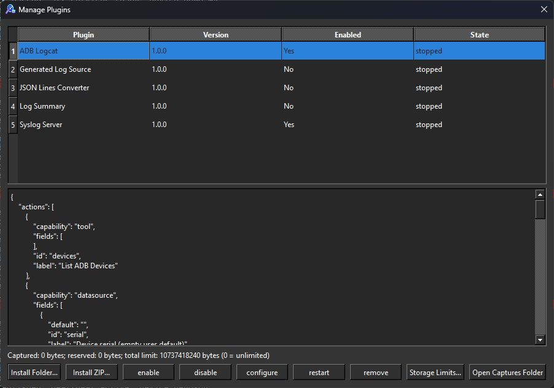
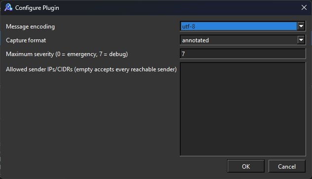

# CILogg process plugins

CILogg plugins run as separate executables. Protocol version 1 supports live
data sources, file converters, and tools. A plugin may expose several capabilities.
Plugins run with the current user's OS permissions. Native LogSquirl libraries
must be ported to this protocol.

## Using plugins



Open **Plugins → Manage Plugins…** to install a folder or ZIP, enable it, configure
it, inspect jobs/errors, restart it, or remove the user-installed copy. ADB Logcat
and Syslog Server are preinstalled and enabled by default; the demonstration
examples are disabled initially. Saved disable choices survive rescans and upgrades.
Both log sources and their SDK files ship in Windows installers/portable ZIPs,
Linux DEB/RPM/AppImage packages, and macOS app bundles/DMGs.
Enabled plugins start on the first action.
Actions appear in the Plugins menu and on the main toolbar unless their manifest
sets `menu` or `toolbar` to false; views get a toolbar button only with
`toolbar: true`. A failed plugin needs an explicit restart. Captured logs survive
stream stop or plugin failure.

**Browse Plugins…** fetches a configurable HTTPS catalog and installs or updates
a selected entry. All catalog packages require SHA-256. Updates preserve enabled
state and configuration. The default repository catalog starts empty; it only
advertises assets after release publication and verification.

Python plugins require Python 3.9 or newer. CILogg checks its existing bundled
Python runtime, `CILOGG_SCRIPT_PYTHON`, then Python on PATH. Each shipped package
includes its standard-library-only SDK module.

## ADB and syslog log sources



Preinstalled **ADB Logcat** provides device discovery and live Android logcat capture.
Configure its ADB executable path, then use **List ADB Devices** or **Start ADB
Logcat**. See `plugins/examples/adb-logcat/README.md` for device selection and filters.

Preinstalled **Syslog Server** receives UDP logs like the syslog feature in Tftpd64.
Configure text encoding, severity filtering and optional sender restrictions.
Syslog defaults to loopback. Remote listeners require an explicit bind address;
configure allowed sender IPs/CIDRs before accepting network traffic.
See `plugins/examples/syslog-server/README.md` for addresses, ports and output
formats. Both plugins use the standard capture, job and
cancellation paths and are included in self-contained ZIP packaging.

## Authoring

Start from `plugins/examples` for Python or `plugins/sdk/cpp/template` for C++17.
The C++ helper links Qt Core and runs inside your executable; it never links a
CILogg host library. Build the C++ template with `CILOGG_PLUGIN_SDK_DIR` pointing
to the directory containing `cilogg_plugin.h`. Put the resulting executable and
its runtime dependencies beside `plugin.json`. Executable names without a suffix
receive `.exe` on Windows.

Each package has `plugin.json` at its root:

```json
{
  "id": "org.example.my-plugin",
  "name": "My Plugin",
  "version": "1.0.0",
  "protocol_version": 1,
  "capabilities": ["tool"],
  "executable": "python",
  "arguments": ["main.py"],
  "actions": [{"id": "hello", "label": "Hello", "capability": "tool", "fields": []}],
  "configuration": []
}
```

`executable` is a relative package path, or the special value `python`.
Arguments are separate strings, never a shell command. IDs contain letters,
digits, dots, underscores and hyphens. Versions use semantic-version notation.
Capabilities are `datasource`, `converter`, and `tool`.

Flat fields use `id`, `label`, `type`, optional `required` and `default`, numeric
`minimum`/`maximum`, and `choices` for choices. Types: `text`, `multiline`,
`number`, `integer`, `boolean`, `choice`, `file`, `directory`.

## Protocol

The optional manifest flag `enabled_by_default: true` is honored only for valid
plugins in CILogg's shipped plugin directory, and only when no enable/disable
choice has been saved. A user-installed package cannot enable itself with this
flag. Valid user-installed updates of a preinstalled plugin retain its default;
invalid overrides are reported without applying a new enable default.

Stdin/stdout carry UTF-8 JSON-RPC 2.0 objects, one per newline. Diagnostics go to
stderr. Messages are limited to 1 MiB, pending stream traffic to 8 MiB. Split large
records into batches; SDK stream writers wait for acknowledgements. The host
terminates initialization after 10 seconds and shutdown after 3 seconds.

Python SDK accepts `stream.write(records, finish_on_cancel=True)` to finish an
already-collected batch during job cancellation. This opt-in limits cancellation
credit/acknowledgement waits to one second and still honors stream stop and plugin
shutdown. Ordinary writes retain their immediate cancellation checks.

Host requests:

| Method | Parameters / result |
| --- | --- |
| `initialize` | `protocol_version`, `plugin_id`, `configuration`, `config_directory`, transport limits, `host_features` (`["views", "view_edit"]`); return identity/version, capabilities, actions, configuration fields |
| `invoke` | `job_id`, `action`, `arguments`, `context`; respond to the request ID when complete |

The plugin process environment also contains `CILOGG_EXECUTABLE` (the running CILogg
executable) and `CILOGG_INSTANCE_ID` (the single-application name that Commander clients use to
reach this instance). A plugin can run `"$CILOGG_EXECUTABLE" command --action ...` to control its
own CILogg, for example `pause_comm --wait` before it opens a serial port.

Host notifications: `configure` (`configuration`), `cancel` (`job_id`), `shutdown`,
`stream/opened` (`stream_id`), `stream/ack` (`stream_id`, `sequence`), and
`stream/stop` (`stream_id`). Host context includes stable window/tab IDs and the
file path when a file is targeted. Jobs return immediately to command callers.

Plugin notifications:

| Method | Parameters |
| --- | --- |
| `progress` | `job_id`, `value` between 0 and 1 |
| `panel/update` | `job_id`, `panel`: `id`, `title`, `elements` |
| `stream/open` | `job_id`, plugin-generated `stream_id`; wait for `stream/opened` |
| `stream/data` | `stream_id`, `sequence` starting at 0, `records` array of UTF-8 strings; wait for the matching acknowledgement |
| `stream/close` | `stream_id` |
| `log` | `message` |

The host acknowledges data after writing and flushing its capture file. Closing
the source tab sends `stream/stop`. Converters receive `input_path` and a
host-assigned `output_path`; only a successful conversion opens the output.
Never overwrite the input. Cancellation must be checked throughout long actions.

Job states are `pending`, `running`, `cancelling`, `completed`, `failed` and `cancelled`;
`pending`, `running` and `cancelling` are active, the others final. `cancel_plugin_job` on a
running job sends `cancel` and moves the job to `cancelling` for up to 10 seconds. During that
grace period the host still accepts the job's `progress`, `panel/update` and final answer, so a
plugin can report its cleanup. The job then ends as `cancelled`. A late `result` or `error` is
kept for diagnostics only: a converter's output is not opened and storage state is unchanged.
Without an answer the job becomes `cancelled` when the grace period ends. A job that was not yet
sent to the plugin, and a job whose window or file is closed, is cancelled at once, without a
grace period. Job arguments that would exceed the 1 MiB message limit fail the job instead of
the plugin.

Panel elements support `text` (`text`), `table` (`columns`, `rows`), `progress`
(`value`), and `button` (`label`, `action`, optional `arguments`). CILogg renders
plain text and native controls, and keeps panels in the originating window.

## Views and message boxes

A plugin can declare interactive **views** in `plugin.json`: docks on any side or floating,
top-level windows and dialogs with fields, buttons, progress bars and large tables. Each view
with `"menu": true` (the default) gets a **Plugins → <title>** entry. Views are updated by
element id, so scroll position, selection, focus and typed text survive progress updates.
Every plugin can also show host message boxes with an optional countdown, from a job or a view,
with or without declared views (at most 8 open and 10 new boxes per 5 seconds per plugin).
Everything is a notification; the plugin still never sends requests to the host.

```json
"views": [
  {"id": "main", "title": "My Tool", "kind": "dock", "area": "right"},
  {"id": "editor", "title": "Editor", "kind": "window", "width": 800, "height": 500},
  {"id": "ask", "title": "Question", "kind": "dialog", "modal": true, "menu": false}
]
```

| Direction | Method | Parameters |
| --- | --- | --- |
| host → plugin | `view/opened` | `view_id`, `window_id`, `context` |
| host → plugin | `view/closed` | `view_id`, `window_id` |
| host → plugin | `view/event` | `view_id`, `window_id`, `element_id`, `type` (`changed`, `clicked`, `selected`, `edited`), `value`, `inputs`; `edited` also has `row_id`, `column_id`, `previous` |
| plugin → host | `view/update` | `view_id`, optional `window_id`, and `root` or `patch` |
| plugin → host | `view/show`, `view/hide` | `view_id`, optional `window_id`; `view/show` also takes `area`, `floating`, `title`, `focus` |
| plugin → host | `ui/message`, `ui/close_message` | `message_id`, `title`, `text`, `icon`, `buttons`, `default`, `timeout_ms`, `modal` |
| host → plugin | `ui/message_result` | `message_id`, `button`, `timed_out`, and `error` when the box was rejected |

A view button with `action` starts a normal plugin job through `invoke_plugin`, so CLI and MCP
callers get the same behaviour. Its `arguments` carry `inputs` (all field values) and
`save_path` when the button has a `save_dialog`. See [plugin views](plugin-views.md) for the
element reference, limits, lifecycle and automation names. The Python SDK has element builders
(`column`, `label`, `field`, `button`, `table`, …), `update`, `patch`, `show_view`, `hide_view`,
`message` (with `Message.wait()` or a callback) and `on_view_opened` / `on_view_closed` /
`on_view_event` callbacks that run on a worker thread. `plugins/examples/view-demo` shows all of
them; it is disabled by default.

Hosts that announce `view_edit` also support editable table cells and the `multichoice` field (see
[plugin views](plugin-views.md), sections 2.5 and 2.3) and the `toolbar` / `menu` / `icon` manifest
keys (section 2.1). The Python SDK helpers are
`table_column(id, title=None, width=None, editable=None)`,
`table_row(id, cells, tone=None, tooltip=None, editors=None)` and
`editor(kind, choices=None, min=None, max=None, max_length=None, placeholder=None, value=None)`.
`Plugin.supports_view_edit` is true when the host announced `view_edit`; a plugin should fall back to
read-only tables when it is false. The view-demo has an editable table.

External windows belong to the plugin process. See the Python `external-window`
SDK example: Tk runs on the main thread while the protocol reader and jobs run on
workers. Keep the protocol reader responsive, and close windows on shutdown.

## CLI and MCP

```text
cilogg command --action get_plugins --pretty
cilogg command --action plugin_manage --plugin-operation enable --plugin-id org.cilogg.generated-source
cilogg command --action invoke_plugin --plugin-id org.cilogg.generated-source --plugin-action start
cilogg command --action get_plugin_job --plugin-job-id <job-id>
cilogg command --action cancel_plugin_job --plugin-job-id <job-id>
```

`get_plugin_job` reports `cancelling` during the cancellation grace period; callers that wait
for a job must treat it as still active.
`cilogg command --action pause_comm --wait [--timeout-ms <ms>] [tab selector]` returns only
after the serial port is actually closed (default timeout 5000 ms, at most 25000 ms) and fails
cleanly when the timeout expires. While it waits, `start_comm`, `play_comm`, `pause_comm`,
`stop_comm` and `close_com` for the same stream fail with a "busy" error. Without `--wait`,
`pause_comm` returns as soon as the close is queued, as before. MCP exposes the same `wait`
option.

Management options and action arguments use `--json-file <file>`. Management
operations: `install`, `remove`, `enable`, `disable`, `configure`, `restart`,
`catalog`, `update`. Local install options: `{"path":"/path/to/package.zip"}`;
configuration: `{"configuration":{"prefix":"DEMO"}}`; catalog: `{"url":"https://…"}`.
Invocation accepts the existing tab/window selectors. Native MCP discovers these
commands through executable help and calls the same Commander implementation.

## Packages and catalog publication

Run `python scripts/plugins/package_examples.py --output build_root/plugin-packages`
to create self-contained example ZIPs. User installs take precedence over shipped
copies. Invalid user overrides are reported rather than silently selecting a
shipped version. Portable builds store plugin data beside their portable settings;
ordinary builds use application data. Runtime binaries are never replaced by an
update while their process is running.

Upload the ZIPs to a GitHub release first. Run the packaging script with
`--published-base-url https://github.com/dm17ryk/klogg/releases/download/<tag>`
to generate a catalog: it downloads the published assets and verifies that their
checksums match. Publish the generated `plugins.json` to the repository root, or
host it at a configured HTTPS URL. Do not list missing assets or blank checksums.
The cross-platform examples workflow publishes ZIPs as CI artifacts for review.

Catalog format: `schema_version: 1`, `plugins` array; entries contain `id`, `name`,
`version`, `protocol_version`, `os` (`windows`/`linux`/`macos`), `arch` (Qt build
architecture such as `x86_64`/`arm64`), `url`, and `sha256`.

Run `python -m unittest discover -s tests/plugins -v` for portable example tests.
Native runtime/package/Commander tests are in the `[plugins]` Catch2 group.
The Python SDK requires Python 3.9 or newer. To exercise the built application
through GUI actions, CLI, and native MCP in an isolated portable instance, run
`python tests/plugins/host_integration.py --build build_root/output/RelWithDebInfo --artifacts build_root/plugin-integration`.
Native UI tests verify window targeting and dock cleanup. ZIP entries use fixed
metadata and stored bytes so package checksums remain reproducible across checkouts.

## Secrets and capture storage

Declare sensitive configuration fields with `"type":"secret"`. CILogg renders
password controls and removes secret values and defaults from `get_plugins`,
management diagnostics, and configuration form descriptions. The
`configuredSecrets` map reports only whether each secret is set. Omitting a secret
from a configuration update preserves its stored value; sending an empty string
clears it. The form offers an explicit clear button. Settings retain secret values
locally with current-user permissions; this is not encrypted credential storage.
Plugins must also avoid writing credentials to stderr, results, or panels.

Capture storage defaults to **1 GiB per file and 10 GiB total**, with a 512 MiB
free-space reserve. Manage Plugins exposes Storage Limits, current usage, and
Open Captures Folder. Limits persist across updates and application restarts.
Zero disables the corresponding limit. Exceeding a limit stops capture and
retains recorded data; no files are automatically deleted. Manual deletion of
retained files releases space. Converter outputs share these limits, reserve
capacity before starting, and are monitored while the plugin process runs.
A violation terminates the converter process and keeps its partial output.
These checks are not OS sandbox quotas: plugins run with current-user permissions,
so arbitrary writes elsewhere and writes between monitoring ticks remain possible.

`get_plugins` includes a `storage` object with `directory`, `limits`,
`captured_bytes`, `reserved_bytes`, and `available_bytes`. Configure host limits
through `plugin_manage`, operation `configure`, with no plugin ID. For example,
put this in `storage-limits.json`:

```json
{"storage_limits":{"max_capture_bytes":1073741824,"max_total_bytes":10737418240,"min_free_bytes":536870912}}
```

```text
cilogg command --action plugin_manage --plugin-operation configure --json-file storage-limits.json
```

Catalog results include a host-generated `entry_id` identifying the exact
version, platform, URL, and checksum. Pass it as `catalog_entry_id` in install or
update options. The Browse dialog does this automatically. Selecting only a
plugin ID is rejected when multiple different entries match. A newer catalog
request supersedes the previous request; obsolete selections are rejected after
refresh. Packages reject traversal, links, Windows device names, and path
components ending in dots or spaces on every platform.
Plugin IDs use lowercase ASCII letters, digits, dots, underscores, and hyphens
to prevent case aliases from replacing another plugin on Windows.

Restart jobs complete only after an enabled plugin successfully initializes;
initialization failures are reported through the job. Streams remain stopped
after restart and require explicit invocation.
