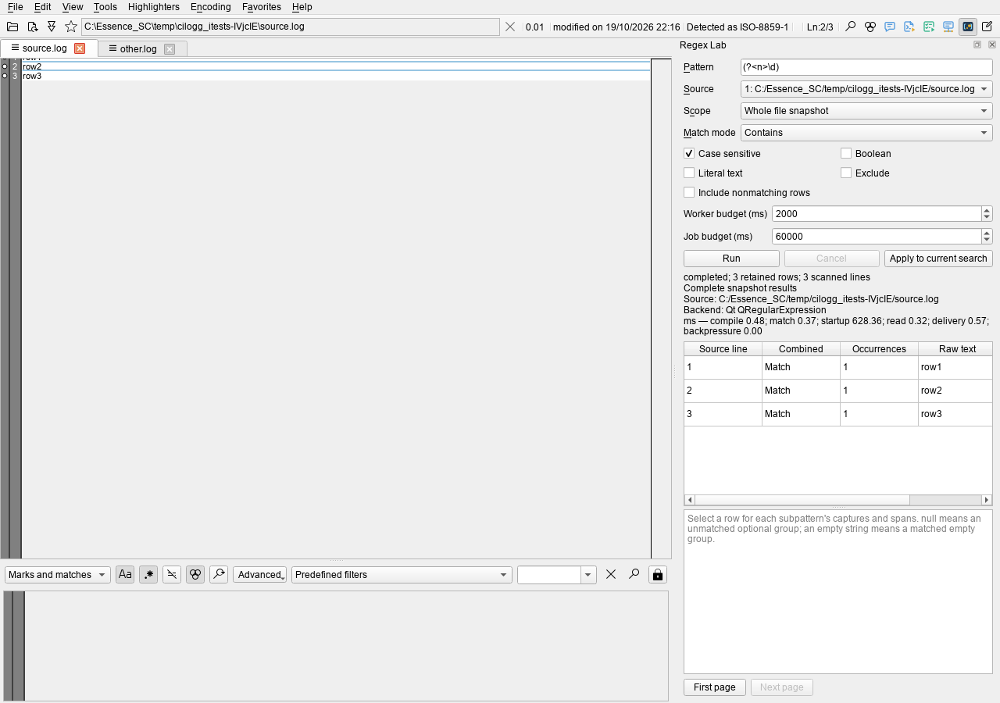

# Regex Lab (P04)

Regex Lab is one dock per main window, opened from Tools, the toolbar or the
viewer menu's **Analyze selected rows in Regex Lab** action. It can float or
dock. The window session saves its layout; patterns and pasted log text remain
runtime-only.



The initial scope is a bounded sample: at most 1,000 physical lines and 4 MiB
of decoded text. Choose whole-file scope explicitly to scan the starting file
snapshot. Selection includes discontiguous physical rows; matches use the
completed search's actual matches, excluding context and marks. Pasted text
preserves Unicode and imported CRLF/CR/LF separators through editing and undo.

Run uses the shared `regex_evaluate` service. The viewer stays available while
the supervised capture worker compiles and matches. Results show combined and
per-subpattern Boolean outcomes, repeated captures, numbered/named groups and
zero-based UTF-16 spans. Source line numbers are one-based. An unmatched group
has a null value and offset -1; a matched empty group has an empty value and a
valid offset. Only one bounded result page is held by the dock at a time.

Status includes the backend, scan counts, separate timing counters, completion
and explicit partial-result reasons. Appends show **Newer data available**;
they do not restart a run. Closed or rewritten sources leave historical output
visible while result activation validates the original source location before
navigation. Editing a draft prevents pending results from replacing its prior
output. Apply becomes available after successful worker compilation and uses
the existing Search command while preserving context, limits, auto-refresh and
keep-results settings. Saved filters and preview definitions are not modified.

## Commander, CLI and MCP

All four operations use Commander and native MCP's ordinary command discovery:

| Operation | Result |
| --- | --- |
| `show_regex_lab` | Show this window's dock and return its bounded state |
| `get_regex_lab` | Return draft preview, source, revision, job status and current-page metadata |
| `set_regex_lab` | Validate and atomically update a draft or perform a semantic operation |
| `apply_regex_lab_pattern` | Apply the current compiled draft to the current search |

Use `--window-index`, `--tab-id`, or `--window-index` plus `--tab-index`.
Tab selectors must belong to the receiving window. A selected tab is the source
when configuring/running a draft and the search target when applying; paging,
activation and visibility operations do not silently change the draft revision.

For example:

```console
cilogg command --action show_regex_lab --window-index 0
cilogg command --action set_regex_lab --json-file lab.json --window-index 0
cilogg command --action get_regex_lab --window-index 0
cilogg command --action apply_regex_lab_pattern --window-index 0
```

`lab.json`:

```json
{
  "pattern": "(?<level>ERROR|WARN) (?<message>.*)",
  "scope": "text",
  "text": "ERROR example\r\nWARN another example",
  "options": { "caseSensitive": true, "includeUnmatched": true },
  "visible": true,
  "operation": "run"
}
```

Native MCP accepts the same object as `analysis_json` or `definition` on
`set_regex_lab`. Draft keys are `pattern`, `scope`, `text`, `sourceTabId`,
`options`, `limits`, `visible` and `floating`. Options and limits share the
analysis service's bounds. Operations are `run`, `cancel`, `release`,
`first_page`, and `next_page`. A definition containing only
`activateResultIndex` activates that zero-based current-page result index;
invalid types and stale locations return structured errors.

Use `get_analysis_results` with the returned job ID for exact machine-readable
captures and opaque-cursor paging. The dock state exposes only a 4,096 UTF-16
unit text preview and labels truncated previews explicitly.

The behavior reference is LogSquirl's pinned Regex Lab at
<https://github.com/64x-lunicorn/LogSquirl/blob/a88c4a4d/src/regex/include/regexlab.h>.
This implementation uses CILogg's own service, Commander and dock architecture;
no source from that reference was copied.

## Validation and measurements

The Windows accelerated build passed all four local CTest suites. Focused
fixtures cover draft revisions, capture details, paging, cancellation, window
ownership, tab switching, historical locations and layout restoration. The
isolated packaged-host harness compares GUI Run, CLI and native MCP captures:

```console
python tests/mcp/analysis_parity.py --executable build_root/output/RelWithDebInfo/cilogg_portable.exe --artifacts build_root/regex-lab-parity --regex-lab --measure
```

A Windows Qt 6.10.1 RelWithDebInfo run on 2026-10-21 scanned a frozen 64 MiB /
1,048,576-line file while the full CTest suite and a separate Qt-only build were
running. Appending during the active
job preserved the original line count and watermark and published newer data.

| Measurement | Observed value |
| --- | --- |
| Scan elapsed, including CLI polling | 35.72 s |
| Throughput, including CLI polling | 1.79 MiB/s |
| Public Commander round trip, median / maximum | 615 / 2,261 ms |
| Host peak working set before / after scan | 152.00 / 152.00 MiB |
| Worker compilation / matching / startup | 0.61 / 13,588.73 / 706.07 ms |
| Source reading / result delivery / backpressure | 3,632.26 / 23.99 / 0.02 ms |

These are observations under concurrent build load, not performance gates.
Commander timings include launching a CLI process and IPC; they do not measure
GUI frame latency. The memory counter covers the host, not its worker process
tree. P00 frame-latency and aggregate-memory budgets remain open until measured.
