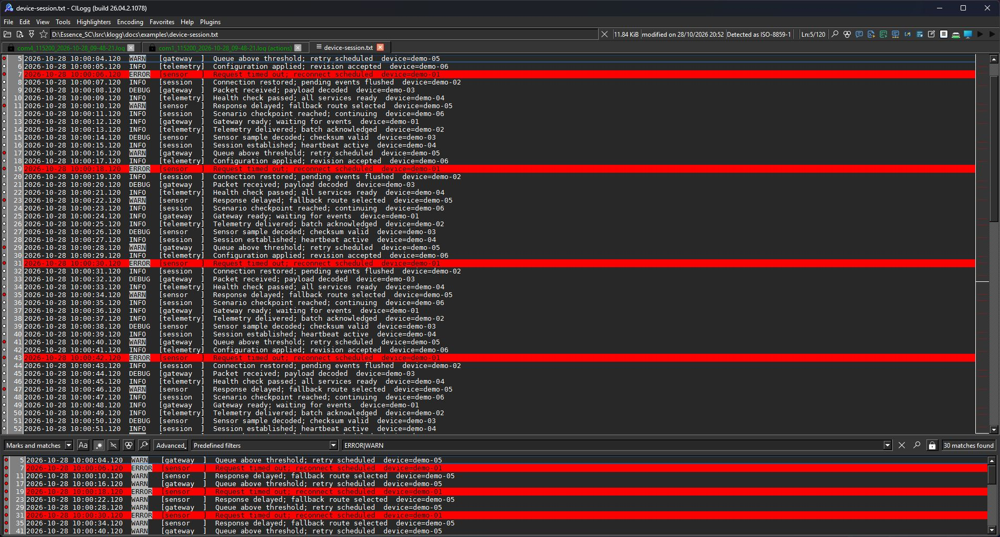
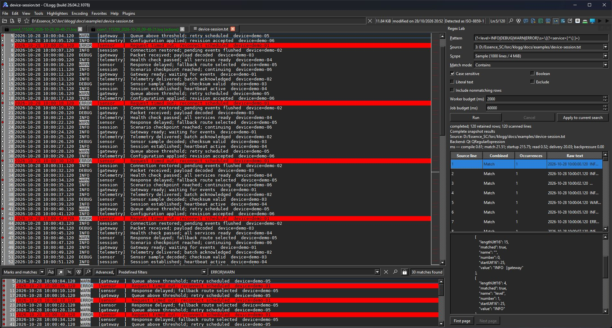
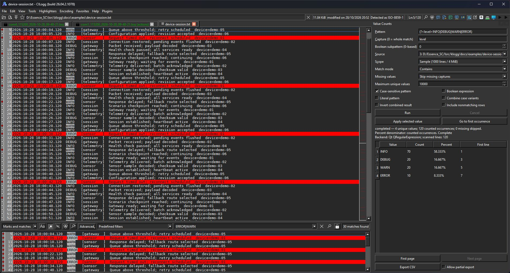
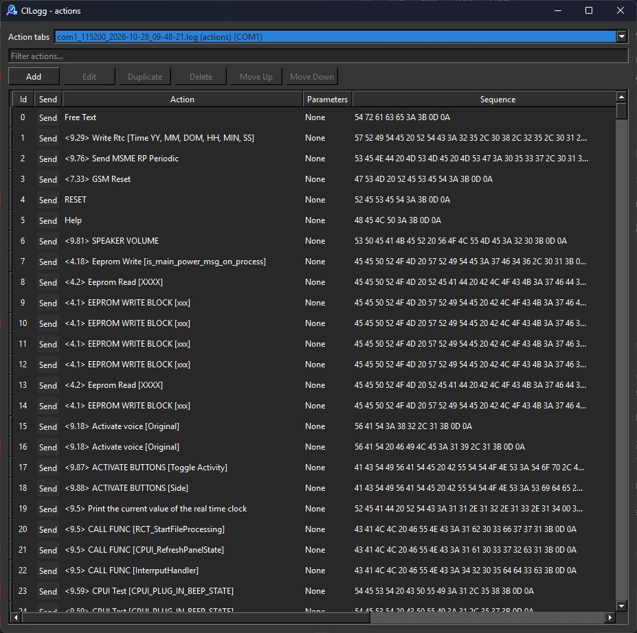
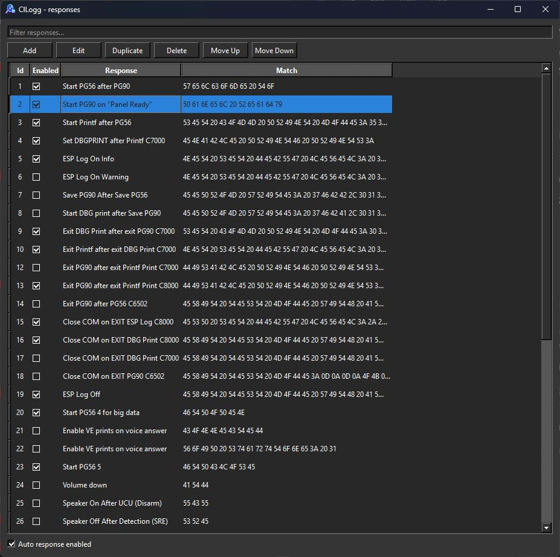
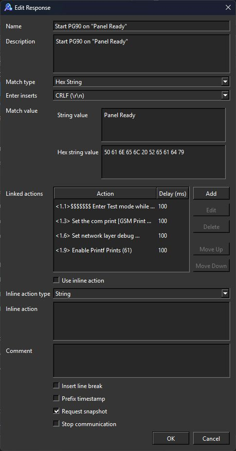
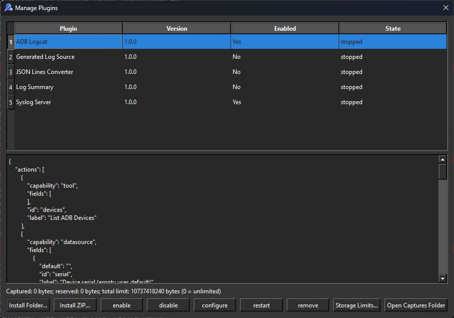
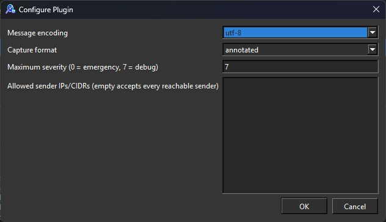
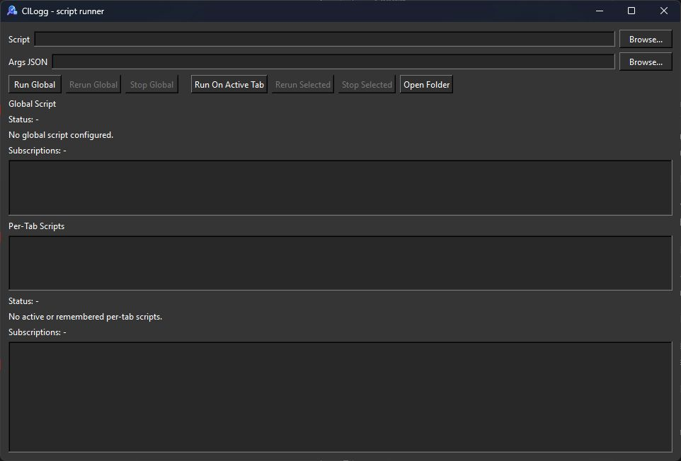
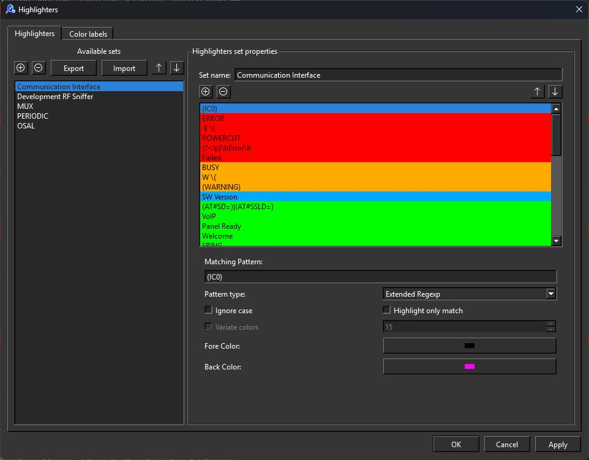

# CILogg in pictures

**Explore ten views of the normal installed Windows application.** These screenshots
come from CILogg **26.04.2.1078**, captured on 28 October 2026. Click an image to
open it at full resolution.

[Project overview](../README.md) · [User guide](../DOCUMENTATION.md) ·
[Sample investigation](../DOCUMENTATION.md#your-first-investigation)

## Log investigation

### Full context, focused results

Browse the full log above the matching lines. The sample contains 30 warnings and
errors; the existing COM capture tabs remain visible beside it.

### Regex Lab: see what your pattern captures

Inspect named groups, values, and source positions before applying a pattern.
[Regex Lab guide →](regex-lab.md)

### Value Counts: find the values that dominate

Rank captured values, apply a selected value as a filter, navigate to its first
occurrence, or export CSV. [Value Counts guide →](value-counts.md)

## Device workflows

### Actions: keep commands ready to use

Select an action destination and browse reusable command definitions.
[Actions and routing guide →](multiple-action-tabs.md)

### Responses: react to the log

Configure which incoming patterns should trigger a response.
[Automatic responses guide →](automatic-responses.md)

### Response editor: connect a trigger to a sequence

This configured response matches `Panel Ready`, then runs linked actions with
delays. The editor also exposes comments, timestamps, snapshots, and communication
controls. It was opened for inspection and cancelled without saving changes.

## Sources and automation

### Plugins: expand your sources and tools

Manage installed plugins, enable or disable them, inspect details, and configure
capture storage. [Plugin guide →](plugin-sdk.md)

### Syslog: choose how network logs appear

Configure decoding, annotated output, severity filtering, and sender restrictions.
The listener address and UDP port are selected when starting a capture.
[Syslog guide →](../plugins/examples/syslog-server/README.md)

### Script Runner: global and per-tab workflows

Choose a Python script and optional JSON arguments, then run it globally or on the
active tab. This screenshot shows the controls before a script is selected.
[CLI and MCP automation →](../MCP.md)

## Visual triage

### Highlighters: make important events stand out

Organize patterns into sets and choose whole-line or match-only colors.
[Highlighter guide →](../DOCUMENTATION.md#using-highlighters)

[Capture details and reproduction notes](images/README.md) ·
[Back to the user guide](../DOCUMENTATION.md)
