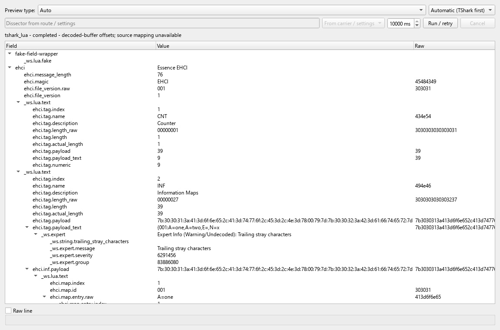
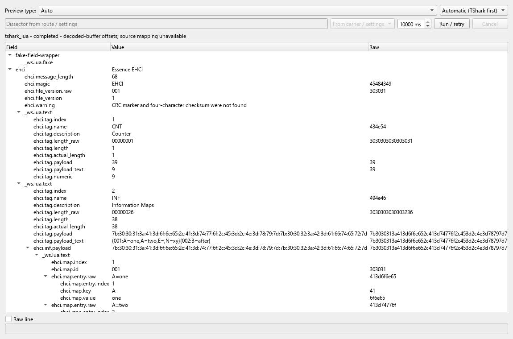

# MD01e — EHCI partial and binary capability qualification

This slice starts from merged master 080b504c (PR87, PR88 and PR89).
It qualifies the actual external EHCI Lua pack through the existing TShark
preview integration. It preserves the remaining MD01, W0 and generic MD03 gates.

## Cause and repair

The original pinned EHCI pack (SHA-256
7cf4bef218f2d48b0dc229c950d91a82a52bb29c3b2de50cdc6411914ffddaea)
produces no protocol tree for bare partial and direct embedded-NUL inputs.
The native byte-API probe observed string length 1 and raw length 10 for a
10-byte synthetic buffer containing NUL. Exported-PDU can_desegment was numeric 0;
Lua treats 0 as truthy. Missing CRC also prevented the old body decoder from
publishing observed tags/maps.

The local external-pack repair uses raw bytes, checks positive numeric TCP
reassembly capability, and shares a bounded structural walk between framing
and body decoding. It skips declared tag payloads before looking for a checksum,
retains existing SEI length recovery, and publishes observed partial fields
without inventing checksum fields. Optional CILOGG_EHCI_TRACE=1 diagnostics
write decisions, offsets and lengths to stderr, without payload values.

Review found a regression in the first repair: generic CRCA/CRCX tags looked
like checksum markers. The reproduced failure is fixed by giving a valid tag
header priority over a CRC prefix. Public synthetic regression coverage includes
both tags, a following INF map and a valid terminal checksum.

The qualified private copy has SHA-256
2f7d0209cf3166a38867e88603fcbdc579f00766d1c75335d7e1e7df073d3c80.
The public PR contains synthetic fixtures, raw-byte proof assertions and
end-to-end qualification tests. It does not redistribute private Lua or captures;
external-pack licensing/distribution remains unverified.

## Reproduce

Supply explicit trusted TShark/text2pcap paths and the qualified external Lua
through CILOGG_TSHARK, CILOGG_TEXT2PCAP and CILOGG_EHCI_CAPABILITIES_LUA.
Run the capability module with Python unittest discovery:

```text
python -m unittest discover -s tests/plugins -p test_message_decoder_capabilities.py -v
```

Absent external inputs cause explicit skips; those skips are not capability passes.

The strict [manifest](../../test_data/message_decoders/ehci-capabilities.json)
has nine cases: partial, NUL, checksum text inside complete/partial values,
zero-length unknown tag, truncated tag header, oversized declared length,
SEI recovery and CRC-prefixed tags. Its optional expectRaw entries compare exact
PDML value attributes, preserving absent versus empty values and occurrence order.
Display and raw assertions share the existing 128-field limit.

The opt-in CLI/native-MCP harness is tests/mcp/tshark_preview_parity.py with
--ehci-capabilities and --external-config. It uses existing preview_message
operations and the shared backend. The hidden native GUI test is selected with
[previewehcicapabilitiesui]; also supply the absolute fixture directory through
CILOGG_EHCI_CAPABILITY_FIXTURES. It validates pane fields against the native
result and builds tooltip HTML for the same result. It explicitly selects the
supported 10000-ms pane budget. Default 3000-ms preview timing is unchanged and
not qualified by this opt-in test.

## Evidence and boundaries

See [machine-readable observations](md01e-windows-observations.json) for exact
runs, hashes, failures, skips and remaining gates. The initial pack failed 5/8
capability tests. The corrected copy passed 15/15 including 71 prefixes and real
synthetic segmented TCP reassembly. A selected genuine 3281-byte EHCI PDU produced
equal native-carrier and Exported-PDU trees with the corrected copy. Full-capture
stderr diagnostics remain; selected equality is not full-capture acceptance or
independent semantic validation of the external Lua.

The fresh Qt6.10.1 native build passed after the local CPM cache repair and an
incremental continuation of the timed-out full rebuild. All seven registered
CTest groups passed in 579.54 seconds. GUI qualification failed four assertions
with the original pack, then passed 1278 assertions with the corrected copy. All
51 strict CLI/native-MCP comparisons passed, including the nine new capability
cases. Portable decoder discovery passed on Python 3.14.10 and 3.9.25: 75 passes
and 47 external-input skips each. The 15-case capability suite passed without
skips on both interpreters: 11 tests use the native engine and four check portable
raw-byte oracles. These are local Windows checks; hosted,
other-platform, release and default-budget performance acceptance remain open.

Source-incomplete assembly still has its existing explicit
incomplete/unavailable result: direct partial-PDU qualification does not silently
change assembly completion policy. Engine buffer offsets remain unresolved with
respect to original log bytes. Protocol completeness/integrity remain not_reported
unless the engine supplies explicit evidence; processing completion is separate.

Remaining gates include external licenses/distribution, broader MD01/W0 acceptance,
generated-field/source mappings, generic datasets, cross-platform/release checks,
performance acceptance and later decoder-core tasks. The unified terminal follows
accepted decoder core under the existing execution policy.

## Native pane captures

These are native Qt widget captures using public synthetic inputs and the
qualified external pack. The complete field tree is checked by the test;
additional rows continue below the visible area.





## Local qualified pack

The local qualification installs byte-verified scripts into
`%LOCALAPPDATA%\CILogg\decoder-packs\md01e-2f7d0209`. The directory also contains
`decoder-settings.json`, with trusted explicit tool/script paths and an EHCI
assembly route. Load that configuration through `set_preview_decoder` using the
existing CLI JSON-file option or the equivalent native-MCP configuration object.
The versioned directory is CILogg-specific; global Wireshark upgrade, full-capture
acceptance and private-pack redistribution remain separate gates.

For historical pinned-pack negative tests, point `CILOGG_EHCI_LUA` at the original
7cf4bef2 pack. Point `CILOGG_EHCI_CAPABILITIES_LUA` at the qualified 2f7d0209 copy
for this profile. Their separate opt-ins preserve the original evidence epoch.
