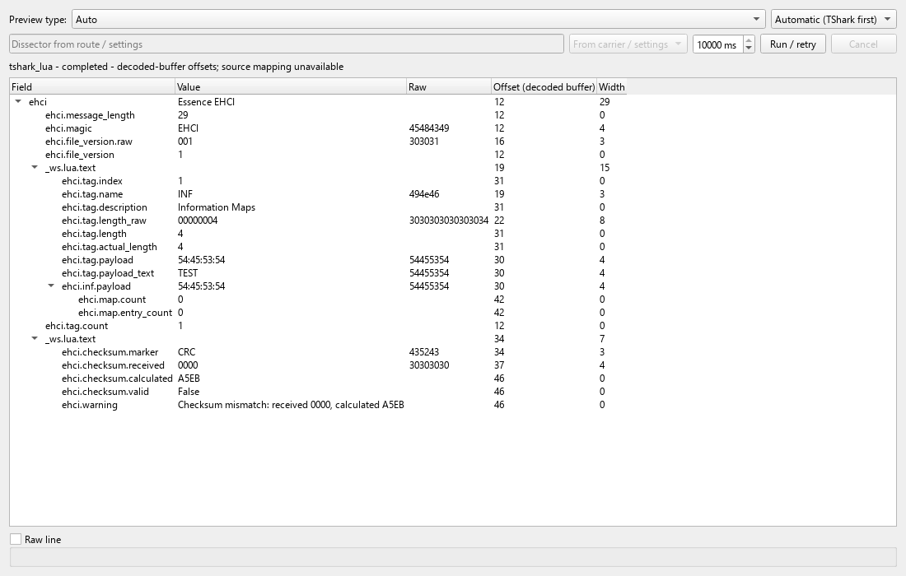
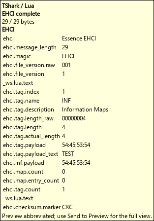

# TShark/Lua message previews

Open **Tools > Preview Decoder Settings** or use its toolbar button. The decoder
is disabled by default. Select your own `tshark` and `text2pcap` executables and
Lua scripts, then explicitly enable external Lua and the decoder. Apply validates
the complete configuration atomically; a rejected change leaves the previous
settings active. Lua is executable code: select only scripts you trust. Neither
Wireshark tools nor private protocol packs are shipped with CILogg, and this
feature does not claim an OS sandbox. CILogg resolves its bundled Python runtime
when available, otherwise a suitable system Python; a trusted
`CILOGG_SCRIPT_PYTHON` can select an interpreter for controlled deployments.

Configure preview routes by existing preview definition name, and protocol
routes by assembled protocol name. Each selects a named dissector and may
specify its expected protocol; protocol routes also select input encoding.
`defaultDissector` starts empty. Set it deliberately, including `data` if a
catchall is wanted; otherwise configure selective routes. Existing JSON
definitions can extract carrier text for Lua, and can also provide a fallback.
TShark and the selected Lua own protocol semantics.

The preview pane offers **Automatic (TShark first)**, **TShark/Lua**, and
**JSON**. Auto first tries an assembly protocol route, then mapped matching
carriers even when an earlier JSON-only definition matches. It next tries the
configured default on a carrier or directly on input. Disabled Auto retains the
legacy JSON behavior. Explicit TShark permits a named dissector and UTF-8, hex,
or base64 input. JSON explicitly selects the legacy renderer. The request budget
is available in every mode, defaults to 3000 ms and is bounded to 100-10000 ms.
Its displayed value covers selection, startup and delivery, including Automatic
routes and fallback. A cold engine may need a larger budget; increase it and run
again while keeping Automatic selected. Hover keeps its fixed 3000 ms budget.

Auto falls back to JSON when no TShark route/default applies or the selected
dissector produces no decoded output. Results expose the actual backend,
`preferredBackend`, `decoderAttempts`, and `fallbackReason`. Lua, timeout,
malformed input and engine/protocol failures remain visible; explicit TShark
does not fall back. A completed processing result does not establish protocol
integrity. Engine offsets refer to decoded buffers and have unresolved source
mapping, not guaranteed positions in the original log.

The same configuration and preview service are available through Commander CLI
and native MCP. Supply configuration directly, not inside a wrapper:

```text
cilogg command --action get_preview_decoder
cilogg command --action set_preview_decoder --json-file decoder-settings.json
cilogg command --action show_preview_decoder_settings
cilogg command --action preview_message --analysis-json "{\"text\":\"4142\",\"decoder\":\"tshark\",\"dissector\":\"data\",\"inputEncoding\":\"hex\",\"timeoutMs\":10000}"
```

For native MCP call `cilogg_execute` with `action: "set_preview_decoder"` and
`arguments: {"analysis_json": <configuration object>}`. For a preview use
`action: "preview_message"` and put the same preview object in `analysis_json`.
Executable and Lua paths belong only in trusted settings, never preview request
arguments or imported JSON preview definitions.

The [local validation record](tshark-preview-validation.md) documents the tested
Windows/tool versions, result counts, preserved failures and qualification limits.
Other versions, hosted CI, platforms and release packages need separate checks.

The following captures show the actual native pane and hover for a public
synthetic EHCI message. Its `CRC0000` is intentionally invalid, as reported by
the external Lua dissector. The Automatic pane capture explicitly selects the
supported 10000-ms budget; hover retains its default 3000-ms budget. These
captures passed the final 29-assertion external EHCI GUI check.





For separately qualified external EHCI scripts, the [MD01e capability profile](md01e-ehci-capabilities.md)
checks partial observed fields and exact NUL bytes through this same service.
Use a matching trusted pack; the original pinned script retains its documented
failures. Direct partial-message support does not change source-incomplete
assembly handling. Raw hex is authoritative for embedded NUL values.
