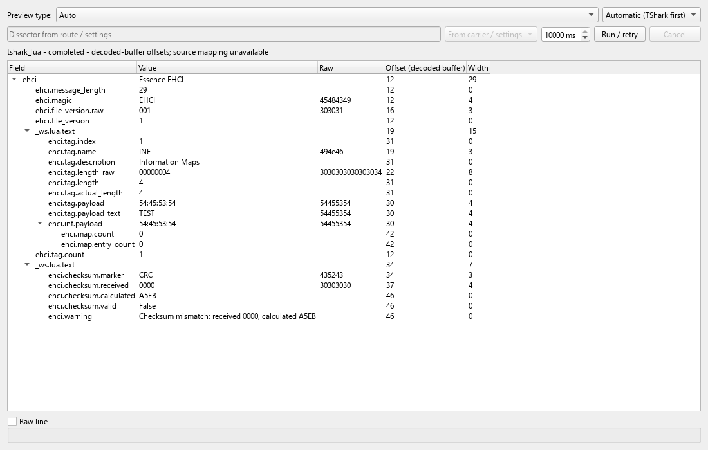
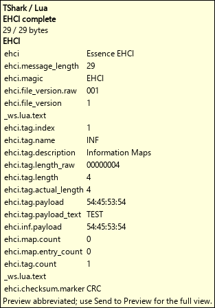

# TShark/Lua message previews

Open **Tools > Preview Decoder Settings** or use its toolbar button. The decoder
is disabled by default. Select your own `tshark` and `text2pcap` executables and
Lua scripts, then explicitly enable external Lua and the decoder. Apply validates
the complete configuration atomically; a rejected change leaves the previous
settings active. Lua is executable code: select only scripts you trust. Neither
Wireshark tools nor private protocol packs are shipped with CILogg, and this
feature does not claim an OS sandbox. CILogg resolves its bundled Python runtime
when available, otherwise a suitable system Python; a trusted
`CILOGG_SCRIPT_PYTHON` can select an interpreter for controlled deployments.

**Configuration packs** (plugins with `"kind": "config-pack"`, see
[plugin repositories and configuration packs](../plugin-repositories.md) section 4.3) can add
Lua and routes. While a pack is enabled, its Lua files load before your own scripts, without the
external Lua approval (installing and enabling the pack is that decision), each pack in a Lua
environment of its own. A session holds at most 32 Lua files, your 8 included. Pack routes sit
below yours: a route of yours with the same key wins. Pack Lua and routes are added when a
session starts and are never written into these settings, their exports or projects. Enabling,
disabling or updating a pack starts new TShark sessions. Without TShark, pack previews use
their JSON definitions.

**Python decoders** of enabled packs (MD03b, [section 4.4](../plugin-repositories.md)) use the
same routes: a route whose decoder column reads `python:<pack-id>/<decoder-id>` sends its preview
or assembled protocol to that decoder's `decode(payload, context)` in a supervised Python worker
(backend `python_decoder`). A Python route applies while its pack is enabled, also when TShark is
disabled or not configured, and has a TShark route's place in Automatic mode. Automatic falls back
to JSON only when the decoder returns `None` (`decoder_not_dispatched`); explicit TShark ignores
Python routes. **Add Python decoder**, on both route tabs, lists the enabled packs' decoders as
"<pack name>: <decoder id>" (with the pack's ID when two packs share a name) and adds a route to
the one you pick; name its preview or protocol in the first column. Python's own parser decides
what it lists: the modules where `decode` may be a function after the top level. It reads each
module with `ast` and runs nothing. Helper modules a pack also lists are left out, and so are
modules Python cannot compile; the button's tooltip lists the latter with their line. The check
runs with the preview's Python interpreter when the packs change; without an interpreter the menu
stays empty and says why. A route's decoder cell says which pack the decoder belongs to, why its
module is not offered, or that its pack is not enabled (the route then does not apply). A preview's
tooltip and status show the decoder with its pack's name (E16b).

Configure preview routes by existing preview definition name, and protocol
routes by assembled protocol name. Each selects a named dissector and may
specify its expected protocol; protocol routes also select input encoding.
`defaultDissector` starts empty. Set it deliberately, including `data` if a
catchall is wanted; otherwise configure selective routes. Existing JSON
definitions can extract carrier text for Lua, and can also provide a fallback.
TShark and the selected Lua own protocol semantics.

**Route fields** are drop-downs of the values CILogg knows. You can still type
any value; typing filters the list by any part of a name.

| Field | Offers |
|---|---|
| **Preview definition** (Preview routes) | Your previews, then the previews of enabled configuration packs. |
| **Assembly protocol** (Assembly protocol routes) | The protocols message assembly gives messages (`EHCI`). |
| **Named dissector or `python:<pack>/<decoder>`** | The dissectors the selected Lua files and the enabled packs' Lua files register, then the enabled packs' Python decoders (the ones **Add Python decoder** lists), then TShark's protocols. |
| **PDML protocol (optional)** | The row's dissector first, then the other dissectors. Empty shows every decoded protocol. |
| **Encoding** | `utf8`, `hex` or `base64`. |
| **Default named dissector** | The Lua dissectors and TShark's protocols. A Python decoder can't be the default. |

The **named dissector** is the name the Lua file registers, not the file's
name. CILogg reads it from each `Proto("<name>", ...)` or
`Proto.new("<name>", ...)` declaration and lowercases it, as Wireshark does.
Declarations in comments and strings don't count. A name built at run time
(`Proto(NAME, ...)`) can't be read; type it. TShark's protocols come from
`tshark -G protocols`. It runs in the background, at most 5 seconds, and only
for the saved TShark executable while TShark is enabled: like a preview, only
applied settings run anything. It runs once per executable, again after the
settings change (the saved executable may have been replaced), and again when
the dialog is shown after a failure. It uses no personal or global Wireshark
plugins or settings, like a preview session. The line under the routes counts
what each source offers.

When you choose a dissector that a selected Lua file declares, an empty PDML
protocol takes its name, because that is also the protocol the Lua dissector
adds to the tree. It keeps following the dissector until you choose another PDML
protocol. **Use the declared names** (below) does the same. Any other dissector,
TShark's own included, leaves it empty, which shows every decoded protocol. A
Python decoder takes no PDML protocol, so choosing one clears the field.

**The dialog checks the saved routes** when it opens and on Apply. Apply saves
the settings first, then CILogg warns about:

- a dissector that no selected Lua file declares and TShark doesn't list, and
- a `python:` route to a decoder that no enabled pack has.

TShark lists protocols, not every dissector name, so a valid dissector-only name
can also be warned about. The warning doesn't block it. While TShark is still
listing its protocols, any name except a Lua file name waits for that list and
is checked when it arrives. While TShark is disabled, no TShark route runs, so
only names that don't need its list are reported.

When the value looks like a Lua file name (`my_proto.lua`), or differs from a
known name only in case, the warning names the dissector to use. **Use the
declared names** puts those names into the routes and applies again. When OK
shows new warnings, the dialog stays open; press OK again to close it.

Example: a synthetic Lua file `C:\lua\my_proto.lua` declares one dissector.

```lua
local my_proto = Proto("my_proto", "My protocol")
function my_proto.dissector(buffer, pinfo, tree)
    tree:add(my_proto, buffer(), "My protocol message")
end
```

Add the file under **Add Lua…**, approve external Lua and apply. The routes then
offer `my_proto`:

| Route | Named dissector | PDML protocol | Encoding |
|---|---|---|---|
| Preview route `My carrier` | `my_proto` | `my_proto` | |
| Assembly protocol route `EHCI` | `my_proto` | `my_proto` | `utf8` |

Had the dissector been typed as `my_proto.lua`, Apply would save it and warn:
``Preview route "My carrier": `my_proto.lua` looks like a file name; the Lua
file registers `my_proto`.`` Such a route sends the message to a dissector that
does not exist, so Automatic previews fall back to JSON with
`fallback: dissector_not_dispatched`.

**Assembly HTTP hosts** (`assemblyHttpHosts`) lists the `Host` header values
that mark an HTTP request as a message carrier for
[reassembly](../preview-message-tooltips.md). It holds up to 16 names of
printable ASCII without spaces or commas (a port may follow a colon), and the
comparison ignores case. The empty default accepts any host. Message assembly
uses the list even while the decoder is disabled.

The preview pane offers **Automatic (TShark first)**, **TShark/Lua**, and
**JSON**. Auto first tries an assembly protocol route, then mapped matching
carriers even when an earlier JSON-only definition matches. It next tries the
configured default on a carrier or directly on input. Disabled Auto retains the
legacy JSON behavior. Explicit TShark permits a named dissector and UTF-8, hex,
or base64 input. JSON explicitly selects the legacy renderer. The request budget
is available in every mode, defaults to 3000 ms and is bounded to 100-10000 ms.
Its displayed value covers selection, startup and delivery, including Automatic
routes and fallback. A cold engine may need a larger budget; increase it and run
again while keeping Automatic selected. Hover keeps its fixed 3000 ms budget.

Auto falls back to JSON when no TShark route/default applies or the selected
dissector produces no decoded output. Results expose the actual backend,
`preferredBackend`, `decoderAttempts`, and `fallbackReason`. Lua, timeout,
malformed input and engine/protocol failures remain visible; explicit TShark
does not fall back. A completed processing result does not establish protocol
integrity. Engine offsets refer to decoded buffers and have unresolved source
mapping, not guaranteed positions in the original log.

The same configuration and preview service are available through Commander CLI
and native MCP. Supply configuration directly, not inside a wrapper:

```text
cilogg command --action get_preview_decoder
cilogg command --action set_preview_decoder --json-file decoder-settings.json
cilogg command --action show_preview_decoder_settings
cilogg command --action preview_message --analysis-json "{\"text\":\"4142\",\"decoder\":\"tshark\",\"dissector\":\"data\",\"inputEncoding\":\"hex\",\"timeoutMs\":10000}"
```

For native MCP call `cilogg_execute` with `action: "set_preview_decoder"` and
`arguments: {"analysis_json": <configuration object>}`. For a preview use
`action: "preview_message"` and put the same preview object in `analysis_json`.
Executable and Lua paths belong only in trusted settings, never preview request
arguments or imported JSON preview definitions.

The [local validation record](tshark-preview-validation.md) documents the tested
Windows/tool versions, result counts, preserved failures and qualification limits.
Other versions, hosted CI, platforms and release packages need separate checks.

The following captures show the actual native pane and hover for a public
synthetic EHCI message. Its `CRC0000` is intentionally invalid, as reported by
the external Lua dissector. The Automatic pane capture explicitly selects the
supported 10000-ms budget; hover retains its default 3000-ms budget. These
captures passed the final 29-assertion external EHCI GUI check.





For separately qualified external EHCI scripts, the [MD01e capability profile](md01e-ehci-capabilities.md)
checks partial observed fields and exact NUL bytes through this same service.
Use a matching trusted pack; the original pinned script retains its documented
failures. Direct partial-message support does not change source-incomplete
assembly handling. Raw hex is authoritative for embedded NUL values.
