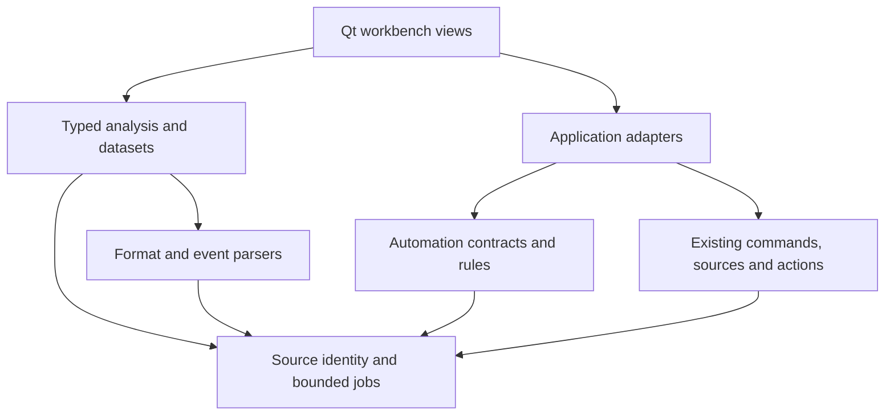

# Verified CILogg Baseline and Integration Map

Research snapshot checked 2026-10-21. **Superseded for execution on 2026-10-22 by [the reconciled baseline](../../docs/workbench/baseline.md) and [merged coverage map](MERGE_MAP.md).** Current master is `177f73861b3bc58ddf5c8b15021471a814673a1d`; P05 is merged through PR #45. The historical pins below explain the original research and are not the current merge state. No new product build, GUI run or hardware validation is claimed by reconciliation.

**Spec:** `00-product-spec.md` and `MASTER_GUIDE.md`; source evidence below supplements that specification.

## Repository state

- Repository: [dm17ryk/klogg](https://github.com/dm17ryk/klogg).
- Default branch `master`: [`bd74c338424845a2caac03d62fdff5187e7e8f0a`](https://github.com/dm17ryk/klogg/commit/bd74c338424845a2caac03d62fdff5187e7e8f0a).
- Value Counts branch `codex/value-counts-p05`: [`01cb637be7c96f2c9e3925247510c162380736b7`](https://github.com/dm17ryk/klogg/commit/01cb637be7c96f2c9e3925247510c162380736b7).
- [Existing analysis roadmap](https://github.com/dm17ryk/klogg/blob/01cb637be7c96f2c9e3925247510c162380736b7/plans/log-analysis-roadmap.md) records P00–P04 infrastructure/Regex Lab and P19b selection work as merged, P05 implemented on its branch, remaining performance gates and P06–P24 pending.
- Current instructions retain C++17/Qt5/Qt6 core support. Windows AGENTS references Qt 6.12; local historical validation used Qt 6.10.1. Actual SDK selection is verified at G01.

## Existing systems to extend

All links below pin the inspected master unless P05 is named.

| System | Evidence anchor | Implementation implication |
|---|---|---|
| Source identities, generations and watermarks | [sourcelocation.h](https://github.com/dm17ryk/klogg/blob/bd74c338424845a2caac03d62fdff5187e7e8f0a/src/logdata/include/sourcelocation.h), [source identity contract](https://github.com/dm17ryk/klogg/blob/bd74c338424845a2caac03d62fdff5187e7e8f0a/docs/analysis-source-identity.md) | Preserve zero-based physical lines, UTF-16 spans, provisional final-line/revision behavior and source validation. Watermarks alone do not retain immutable filesystem bytes. |
| Bounded analysis service | [analysisjob.h](https://github.com/dm17ryk/klogg/blob/bd74c338424845a2caac03d62fdff5187e7e8f0a/src/logdata/include/analysisjob.h), [job contract](https://github.com/dm17ryk/klogg/blob/bd74c338424845a2caac03d62fdff5187e7e8f0a/docs/analysis-scan-jobs.md) | Reuse admission, deadlines, cancellation, backpressure, paging, result retention and source lifetime. |
| Shared operation dispatch | [analysiscommands.h](https://github.com/dm17ryk/klogg/blob/bd74c338424845a2caac03d62fdff5187e7e8f0a/src/logdata/include/analysiscommands.h), [commands documentation](https://github.com/dm17ryk/klogg/blob/bd74c338424845a2caac03d62fdff5187e7e8f0a/docs/analysis-commands.md) | Add operations to Commander and existing native MCP discovery, with one result contract. |
| Supervised extraction and Regex Lab | [analysisregex.h](https://github.com/dm17ryk/klogg/blob/bd74c338424845a2caac03d62fdff5187e7e8f0a/src/logdata/include/analysisregex.h), [Regex Lab dock](https://github.com/dm17ryk/klogg/blob/bd74c338424845a2caac03d62fdff5187e7e8f0a/src/ui/include/regexlabdock.h) | Use the existing capture-capable worker and enforcement for arbitrary regex; do not add another unbounded GUI evaluator. |
| Value Counts P05 | [Value Counts contract](https://github.com/dm17ryk/klogg/blob/01cb637be7c96f2c9e3925247510c162380736b7/docs/value-counts.md) | Exact accepted-occurrence denominator, missing/empty distinction, decimal counts, deterministic ordering, caps and validated navigation are existing behavior. |
| Communication session | [streamsession.h](https://github.com/dm17ryk/klogg/blob/bd74c338424845a2caac03d62fdff5187e7e8f0a/src/ui/include/streamsession.h) | Existing sendBytes/raw RX-TX signals, counters, logging and action generations are anchors. The presentation log is not a byte-perfect recording format. |
| Actions and expressions | [actionsconfig.h](https://github.com/dm17ryk/klogg/blob/bd74c338424845a2caac03d62fdff5187e7e8f0a/src/ui/include/actionsconfig.h), [actionexpression.cpp](https://github.com/dm17ryk/klogg/blob/bd74c338424845a2caac03d62fdff5187e7e8f0a/src/ui/src/actionexpression.cpp) | Typed parameters, repeated sends, dynamic replies and checksum/packing helpers already exist. Consolidate/expose rather than recreate them. |
| Automatic responses | [automatic-responses.md](https://github.com/dm17ryk/klogg/blob/bd74c338424845a2caac03d62fdff5187e7e8f0a/docs/automatic-responses.md), [actionruntime.h](https://github.com/dm17ryk/klogg/blob/bd74c338424845a2caac03d62fdff5187e7e8f0a/src/ui/include/actionruntime.h) | Existing Wildcard is text/line matching; new byte wildcard/optional/bitmask semantics require a separate explicit dialect. |
| Script and scenario supervision | [scriptsupervisor.h](https://github.com/dm17ryk/klogg/blob/bd74c338424845a2caac03d62fdff5187e7e8f0a/src/ui/include/scriptsupervisor.h), [scenariorunner.h](https://github.com/dm17ryk/klogg/blob/bd74c338424845a2caac03d62fdff5187e7e8f0a/src/ui/include/scenariorunner.h) | Reuse process ownership, subscriptions, cancellation and existing JSON/JUnit report paths. |
| Python and lab integration | [Python client](https://github.com/dm17ryk/klogg/blob/bd74c338424845a2caac03d62fdff5187e7e8f0a/src/app/python_runtime/klogg/client.py), [testing helpers](https://github.com/dm17ryk/klogg/blob/bd74c338424845a2caac03d62fdff5187e7e8f0a/src/app/python_runtime/klogg/test.py), [lab service](https://github.com/dm17ryk/klogg/blob/bd74c338424845a2caac03d62fdff5187e7e8f0a/src/app/labcontrollerservice.h) | Extend supported APIs and event metadata for general workflows, preserving existing Python imports and scenario/lab behavior. |
| Plugins and source registry | [plugin SDK](https://github.com/dm17ryk/klogg/blob/bd74c338424845a2caac03d62fdff5187e7e8f0a/docs/plugin-sdk.md), [pluginprocess.h](https://github.com/dm17ryk/klogg/blob/bd74c338424845a2caac03d62fdff5187e7e8f0a/src/plugins/include/pluginprocess.h) | Preserve existing text protocol v1 and acknowledgement/backpressure. Negotiate additional structured/binary capabilities explicitly. |
| Project and workspace persistence | [mainwindowproject.cpp](https://github.com/dm17ryk/klogg/blob/bd74c338424845a2caac03d62fdff5187e7e8f0a/src/ui/src/mainwindowproject.cpp) | Extend versioned persistence and stable IDs; restore definitions without auto-starting effectful work. |
| Build/test automation | [build-windows.ps1](https://github.com/dm17ryk/klogg/blob/bd74c338424845a2caac03d62fdff5187e7e8f0a/scripts/codex/build-windows.ps1), [run-tests.ps1](https://github.com/dm17ryk/klogg/blob/bd74c338424845a2caac03d62fdff5187e7e8f0a/scripts/codex/run-tests.ps1), [test registration](https://github.com/dm17ryk/klogg/blob/bd74c338424845a2caac03d62fdff5187e7e8f0a/tests/ui/CMakeLists.txt) | Actual test switch is KLOGG_BUILD_TESTS; Windows integration tests are partitioned by `[logdata]`/`[ui]`; use the selected SDK and packaged smoke checks. |

## Proposed modules and dependency direction

Early V01/V02 native capture charts use only CORE/common value contracts and existing extraction. Optional web panels consume bounded render frames and send selection events through UI/app adapters. No parser/UI dependency points back into source identity/jobs. Transport endpoint ownership remains explicit while generic rules and replay consume immutable event records.

## Scope and evidence limitations

The feature analysis is an implementation target, not a claim that source presence proves a feature is complete. Hardware-specific signal observations, timestamp accuracy, third-party project compatibility, backend API versions, and optional compiler/renderer support require task-specific verification. Proprietary Docklight TAP/VTP behavior cannot be promised from current CILogg source; D18 tracks a capability/certification path and records unavailable evidence explicitly.
