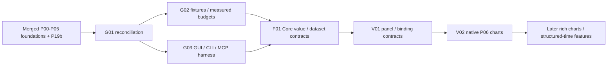

# Merged roadmap coverage and execution order

Reconciled 2026-10-22 against master `177f73861b3bc58ddf5c8b15021471a814673a1d`.
The [baseline](../../docs/workbench/baseline.md) records current source evidence;
[decisions](../../docs/workbench/decisions.md) record the integration policy.
`PROGRESS.json` is the execution ledger. The original P00-P24 specification remains
available at [log-analysis-roadmap.md](../log-analysis-roadmap.md).

## Completed and remaining work

| Previous package | Current state | Workbench ownership / remaining acceptance |
|---|---|---|
| P00 baseline/donor inventory | Existing partial evidence | [G02](tasks/G02.md) and [R02](tasks/R02.md) finish measurements; budgets remain open |
| P01 viewport wrapping/selection | Merged | G02 measures; R01/R02 regressions preserve behavior |
| P02 encoding fast path | Merged | G02 measures; F02/F03 preserve decoding and forced-encoding behavior |
| P03a source identity | Merged | F01/F10 extend existing SourceSnapshot/SourceLocation |
| P03b bounded scans | PR #41 merged | Existing AnalysisJobService remains lifecycle authority |
| P03c supervised captures | PR #42 merged | Existing worker remains capture/deadline backend |
| P03d CLI/MCP operations | PR #43 merged | [G03](tasks/G03.md) extends the existing shared parity route |
| P04 Regex Lab | PR #44 merged | Reuse dock, captures and semantic commands |
| P05 Value Counts | PR #45 merged | F09/V05 consume the existing exact reducer and public operations |
| P06 linked regex charts | Planned | [F01](tasks/F01.md) Core-only contracts → [V01](tasks/V01.md) → [V02](tasks/V02.md); V03-V18 expand later |
| P07 folder engine | Planned | F16 owns recursive manifests/readers/search; F07/F08 provide shared dataset/query prerequisites |
| P08 folder results UI | Planned | F16 owns grouped paging, source revalidation and lazy reopening with F10 lineage |
| P09 formats and fields | Planned | F01-F04, F07 own typed values, registry/parsers, multiline and inspection |
| P10 timestamps | Planned | F05 owns exact time, zones, resets and clock domains |
| P11 time navigation/delta | Planned | F06 owns seek/ranges/alignment; F07 supplies source sets |
| P12 structured tables | Planned | F07, U04 and V08; reuse one canonical virtual table |
| P13a field queries / Matches Only | Planned | F08 with U05 query controls |
| P13b bounded typed sorting | Planned | F08 sorting with F07's virtual table; preserve row/byte caps, stable source ties and explicit sort-limit state |
| P13c CSV/query export | Planned | F15, with U04/V18 presentation/export adapters |
| P14 Value Names | Planned | F12 with U04/U12 presentation; preserve raw text |
| P15 retained searches | Planned | U06 |
| P16 filter groups | Planned | U07 |
| P17 tab groups | Planned | U08 |
| P18 ANSI | Planned | U12 |
| P19a QuickFind | Planned | U09 |
| P19b discontiguous selection | Merged | U09 regression integration only; do not redesign/reimplement Ctrl selection |
| P20 command palette | Planned | U10 |
| P21 process/stdin capture | Planned expansion | E02 audits existing process/plugin capture and adds remaining requested behavior |
| P22 zstd/lz4 | Planned | F13 owns bounded compressed input and capability reporting |
| P23 persistent index | Planned | F13 owns cache lifecycle; F10 owns dataset lineage |
| P24 Git Team Folder | Planned | E09 |

Every P package/slice remains represented. The Workbench scope additionally keeps
the 173 mapped requirements for dashboards, investigation analysis, automation,
communication testing, integrations and product/release quality. See
[FEATURE_COVERAGE.md](FEATURE_COVERAGE.md); these future requirements are not marked
delivered merely because their existing foundation is reused.

## Dependency and release policy

G01 is reconciled in this integration; G02 is the preferred next task and G03 is
also runnable. The full hard-dependency graph remains `TASK_INDEX.json`. Read the
task's subsystem contracts before implementation. Do not gate V02 on F07/F09/F11,
time parsing, the full chart gallery or WebEngine.

PR #47 is the independent Qt/platform distribution track. Its code, merge status
and CI evidence are not inherited by this planning PR. Future feature PRs start
from then-current merged master, include required GUI/CLI/MCP parity, and merge in
dependency order. Public consumers are rolled back before their supporting
services; internal contract slices can land only with their own tests and without
claiming public feature completion.

## Message decoder revision-2 integration

Read [10-message-decoders.md](10-message-decoders.md) for the primary real TShark/Lua backend, shared typed results, exact provenance, EHCP/EHCI, AT and nested SRING decoding. MD01–MD08 and DEC01–DEC14 extend the same ledger/DAG; G02/G03 prerequisites, existing completed work and early V02 independence are preserved. The imported document's handoff is specification material, not authorization to execute it. Decoder runtime and package evidence remain unrun. See [public issue tracking](PUBLIC_TRACKING.md).
