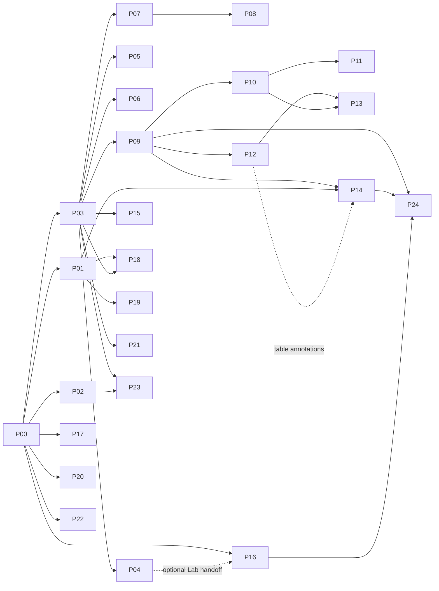

# CILogg log-analysis implementation roadmap

Date: 2026-10-15. Status updated 2026-10-21: P00-P02 baseline, P03a source identity and P19b discontiguous selection are merged. P03b bounded jobs (PR #41), P03c capture worker (PR #42), P03d automation (PR #43), and P04 Regex Lab (PR #44) are merged. P05 Value Counts is implemented on `codex/value-counts-p05`; see `plans/value-counts-p05.md` and `docs/value-counts.md`. Remaining P00 release budgets and P06-P24 slices are pending. All feature entry points require command-line and MCP access. Tracking issue: [#37](https://github.com/dm17ryk/klogg/issues/37).

Initial implementation baseline: `fec85fdf`. The first batch adds a deterministic benchmark corpus, viewport-bounded pixel wrapping and hit testing, selection-count deferral during drag, wrapped jump visibility, and a BOM/validated-UTF-8 detection fast path with independent fallback detectors. See `docs/log-analysis-baseline.md` for measured evidence and remaining P00 performance gates. P05 starts from merged PR #44 (`bd74c338`), reusing P03's bounded service and public commands. P06 linked regex charts follows P05.

## Objective and baseline

Deliver the features in the supplied LogSquirl/ZEACENT comparison in independently releasable increments, preserving CILogg's large-file performance, live capture, existing settings, and GUI/CLI/Python/MCP behavior.

Planning baseline inspected locally: `d980d1c426f7f36e74b5c8117e930c4e24289aac`, branch `codex/preinstalled-adb-syslog`. The attachment compared an older CILogg revision, `06a4851a`; do not treat its gap list as a diff against this checkout. Start implementation from the then-current default branch and repeat the gap check.

Verified integration anchors at the planning baseline (the first batch changes selection and detector behavior below):

- `src/ui/src/abstractlogview.cpp`: `AbstractLogView::mouseMoveEvent()` currently materializes selected text while extending a selection. This is a concrete first performance target.
- `src/ui/src/crawlerwidget.cpp`: `CrawlerWidget::doSetData()` attaches shared `LogData` and `LogFilteredData`; `CrawlerWidgetContext::toString()` persists search/context/follow options. Extend these ownership and persistence boundaries carefully.
- `src/logdata/include/logdataworker.h`: `LogDataWorker` already supports full indexing, appended-line indexing, interruption, and progress. Add analysis beside existing indexing rather than replacing it.
- `src/logdata/include/encodingdetector.h`: `EncodingDetector` is a singleton with a shared mutex. Determine which detector state actually needs serialization before narrowing locks.
- `src/ui/src/predefinedfilters.cpp`: filters have stable IDs and versioned storage. Preserve these IDs during grouping, imports, synchronization, and team sharing.
- `src/ui/src/tabbedcrawlerwidget.cpp`: tabs already have UUIDs and capture/connection state. Group membership must reference tab identity rather than tab position.
- `src/ui/include/commander.h`, `src/ui/src/commander.cpp`, `src/app/kloggapp.h`, and `MainWindow::executeCommanderRequest()` form the shared automation route. `src/app/mcp/` provides the native MCP runtime.
- Top-level CMake specifies C++17 and Qt5/Qt6 discovery. Preserve that compatibility; an upgrade is a separate decision.
- `src/ui/include/decompressor.h` and its implementation provide the existing compressed-file entry point.

The remaining proposed filenames below are design targets, not claims that those files already exist. Reconfirm exact function signatures, current tests, and graph freshness before editing each implementation step.

## Delivery order

| Release | Steps | User-visible outcome | Gate |
|---|---|---|---|
| R1: faster everyday use | P00-P02; P19-P20 can join | Responsive wrapping/selection, faster safe encoding detection, improved QuickFind, action palette | Baseline comparisons and existing capture/search tests pass |
| R2: immediate analysis | P03-P06 | Regex Lab, value counts, linked regex charts | Counts/points resolve to original lines, including appended logs |
| R3: investigate directories | P07-P08 | Recursive search, grouped results, context and source navigation | Bounded memory, cancellation, visible per-file failures |
| R4: structured and time-aware logs | P09-P13 | Regex/JSON/logfmt fields, timestamps, delta time, tables, field queries, CSV | Raw/filtered/table/time views agree on source identity |
| R5: investigation workspace | P14-P18 | Value Names, retained searches, filter groups, tab groups, ANSI | Settings migration and independent live-view behavior pass |
| Independent follow-ons | P21-P24 | Command/stdin capture, zstd/lz4, persistent index cache, Git team folder | Each meets its own packaging, invalidation, and rollback gate |

Recommended first implementation scope: P00-P02. Then deliver P03-P06 together as the first analysis release. Avoid waiting for structured tables before shipping useful regex charts.

## Architecture and invariants

### Keep the data and display layers distinct

Use four explicit layers: source bytes -> decoded raw lines -> extracted fields/results -> rendered presentation. ANSI styles and Value Names belong in presentation. Parsing must never rewrite capture files. Existing raw-text searches continue to search the decoded raw line; field queries and clean/display-text exports are explicit separate modes.

Every derived result carries a proposed `SourceLocation`: source identity, content generation, physical line number, and optional raw byte/character span. Document internal and external line-number bases and Unicode offset units. A sorted table row or sampled chart point is never itself a source line number.

Appending extends a generation; truncation, replacement, incompatible decoding changes, or rewritten indexed content invalidates it. Keep a separate indexed revision/end watermark so a snapshot can remain consistent while a file grows. Generation changes invalidate analysis results, retained searches, timestamp indexes, and relevant caches together. Never silently navigate an old result into a replacement file.

For a final unterminated line, retain its starting byte offset. On append, replace that provisional record and recompute affected aggregates; do not count it twice or miss text that completed a match across the append boundary.

### Add a small shared analysis service

Introduce proposed files under `src/logdata/include/` and `src/logdata/src/` for `analysisjob`, `sourcelocation`, and `captureextractor`; add matching entries to `src/logdata/CMakeLists.txt`. Keep them independent of QWidget classes.

Job requests contain an explicit source, scope (selection/current matches/whole file), pattern or format ID, options, source revision, and resource limits. Results are bounded batches with progress, completion state, errors, and a request generation. State transitions are queued -> running -> completed/cancelled/failed; consumers reject stale batches. Reuse existing search-generation conventions and existing job machinery where suitable; do not replace all search workers with a new scheduler.

Define caps for concurrent scans, queued result bytes, unique count keys, retained result sets, chart buckets, parser-cache bytes, decompression output, and disk cache. Surface limits and partial results in GUI and automation output. A preview/sample result must never be labeled a complete whole-file result.

Accelerated line matching and capture-group extraction have different capabilities. Preserve the existing accelerated search path; use a capture-capable implementation for extraction. Report backend/fallback choices. Verify actual engine limits before choosing an API: moving a pathological regex to a thread does not make a single match interruptible. Use verified match/depth limits where available; otherwise isolate budgeted arbitrary-pattern evaluation in a supervised worker process that can be terminated. This is mandatory for Regex Lab's timeout promise.

### Extend formats gradually

Proposed `src/logformat/` holds versioned format definitions, registry, regex/JSON/logfmt parsers, field types, and timestamp parsing. It consumes the P03 source/extraction contracts. Start with one physical line per record, bounded nested JSON handling, and explicit malformed-record states. Multiline record assembly is deferred until its physical-line mapping and append rules have a separate design.

Field types distinguish missing, null, empty text, integer, floating point, boolean, and timestamp. Preserve exact integer values where floating-point conversion would lose precision. Store field spans where available for highlighting/navigation. Auto-detection samples a bounded number of lines, reports confidence, and allows manual override; changing a format invalidates derived results.

Represent absolute timestamps with explicit units/precision and offset metadata; do not route all values through millisecond or floating-point storage. Device uptime and wall-clock time are distinct domains. Date-less timestamps require a documented anchor and rollover policy. Unknown timezone and ambiguous local time remain visible; do not silently invent UTC. Timestamp navigation must support missing, duplicate, and out-of-order timestamps; binary search is valid only within verified ordered ranges.

### GUI and automation parity

Every new feature must be accessible through both the command line and MCP before completion, including presentation and workspace features. Every public feature PR includes discoverable command schemas, execution, structured output, status/cancellation where applicable, GUI actions, and parity tests. Add routes through Commander and existing MCP discovery rather than a second MCP-only feature catalog. Presentation features must expose explicit settings/state and operations through these interfaces; screen-coordinate automation alone does not satisfy this requirement.

Proposed operation families: regex evaluation; counts; chart extraction; folder search; format selection; time seek/range/delta; table query/export; retained-search management; filter/tab groups; display settings; cache management; capture; and team-folder synchronization. Names are provisional until checked against current CLI syntax.

Long scans return job IDs and expose paged results rather than putting millions of rows in one response. Errors distinguish invalid pattern, unsupported format, stale source, cancellation, resource limit, I/O failure, and partial success. Test direct service results against CLI and MCP results on the same fixtures.

Expose feature entry points in menus and toolbars with distinct icons, concise tooltips, shortcuts where useful, stable `objectName`, and accessible names. Keep the main text viewer usable while a dock is open. Preserve keyboard operation and provide table alternatives for chart data.

## Implementation steps

The roadmap has 25 work packages and 31 initial PR slices: P03 has four slices, P13 three, and P19 two; the remaining packages each start as one PR. All inherit the execution/verification/rollback contract later in this document. Split further when measured scope warrants it, keeping dependency edges explicit. An internal service PR may land without a public entry point; every PR that exposes a feature must include its complete GUI/automation surface.

### P00 — Baseline, donor inventory, and reproducible fixtures

Dependencies: none. Risk: low. Context: the attachment describes donor snapshots and has not validated the ports at runtime.

- Add `docs/log-analysis-baseline.md`, `docs/log-analysis-donor-map.md`, and deterministic fixtures/generators under `test_data/analysis/` and `scripts/benchmarks/`.
- Inventory each donor feature against current CILogg. Record exact donor SHAs, files, licenses/attribution, required dependencies, and whether to adapt code or reimplement its behavior. Verify that referenced beta/master-only features exist in the pinned snapshot before scheduling a port.
- Measure open/index/search throughput, peak memory, selection drag latency, wrap scrolling, time to first result, and append-to-result latency. Cover ASCII, Unicode, mixed encodings, long lines, dense matches, and many small files; record hardware/build/backend.
- Keep large benchmark logs generated or external, not committed. Use synthetic CP-style examples until representative user logs are available.
- Exit: repeatable baseline, feature coverage matrix, and numerical latency, memory, throughput, result-volume and concurrency budgets recorded in the document. These recorded values are required before performance/scale release gates can pass; provisional targets elsewhere are not sufficient. Rollback: documentation/fixture-only revert.

### P01 — Viewport wrapping and selection performance

Dependencies: P00. Risk: high because main and filtered views share rendering and selection code.

- Modify `src/ui/src/abstractlogview.cpp` / matching header: remove eager multi-line text extraction from `mouseMoveEvent()`. Emit inexpensive selection coordinates/count metadata immediately; materialize text for copy and deferred consumers only. Audit slots consuming `newSelection` before changing length availability.
- Adapt pixel-measured wrap layout and coordinate caches, using `src/ui/include/wrappedstring.h` and `selection.h` / corresponding implementations as needed. Key caches by source revision, font, DPI, tab width, wrap mode, and viewport width. Bound offscreen wrapping work without losing correct scrollbar/source navigation behavior.
- Add focused coverage in `tests/ui/crawlerwidget_test.cpp` and proposed rendering/selection tests. Include reverse drag, partial selection, filtered context, wide Unicode, tabs, resize, DPI/font changes, and copy fidelity.
- Exit: no full-selection materialization during drag; measured latency improves on the P00 workload; selected bytes/text remain correct. Rollback: disable/revert the new layout cache and deferred-count path independently.

### P02 — Encoding detection fast path and lock scope

Dependencies: P00. Risk: medium.

- Modify `src/logdata/src/encodingdetector.cpp` and header around `EncodingDetector::detectEncoding()`: retain forced encoding and BOM precedence, add validated UTF-8 detection, and isolate any mutable detector state per task before reducing lock scope.
- Preserve fallback behavior on invalid or inconclusive samples, including UTF-16 and binary-looking input. A sample ending inside a multibyte sequence is inconclusive rather than automatically invalid. Keep decoder state across input blocks.
- Verify parallel opens, ASCII-only ambiguity, empty input, split sequences, malformed UTF-8, forced legacy encodings, and append behavior in `tests/ui/logdata_test.cpp` plus focused detector tests.
- Exit: equivalent fixture decoding and improved concurrent-open measurements. Rollback: retain original fallback path and restore serialization if safety is unproven.

### P03 — Source identity, bounded jobs, and capture extraction

Dependencies: P00. Risk: high; shared by later analysis features.

Land four serial PR slices, each usable and testable internally before exposing consumers:

1. **P03a: source identity/revisions.** Add source-location types and generation/watermark integration only. Exit: append, partial-final-line, truncation, replacement, forced-encoding and close tests pass with existing search unchanged. Rollback: revert the unused identity additions.
2. **P03b: bounded scan jobs.** Depends on P03a. Add lifecycle, progress, cancellation, source snapshots and bounded batch delivery, reusing current infrastructure. Exit: a test scan proves backpressure, stale-batch rejection and close/cancel cleanup. Rollback: unregister new internal job types.
3. **P03c: capture extraction and regex budgets.** Depends on P03b. Add capture semantics and verified engine limits or supervised execution. Exit: exact group/span fixtures and adversarial timeout tests pass without leaked workers. Rollback: remove the new extractor backend; legacy search remains available.
4. **P03d: shared automation routes.** Depends on P03c. Add command schemas/discovery, dispatch, paged results, status/cancellation and parity tests. Exit: direct-service, CLI and MCP job results agree on fixtures. Rollback: remove the new operation family before reverting services.

P03a contract and validation entry point: `docs/analysis-source-identity.md`. This
internal slice adds no public feature; P03d remains mandatory before exposing
analysis consumers.

References to P03 below mean all four slices are available.

- Add the minimal source/job/extraction types described above; integrate source generation with `LogData`, indexing completion, and file-change handling. Inspect `src/logdata/src/logdata.cpp`, `logdataworker.cpp`, `logfiltereddata.cpp`, and existing generation logic before choosing mutation points.
- Implement streaming capture batches, named/numbered groups, optional groups, zero-length matches, scope snapshots, numeric conversion status, and explicit limits. Publish source and request generations on every batch.
- Implement and test the regex execution budget mechanism; cancellation must actually stop expensive execution or its supervised worker.
- Add common Commander job/status/pagination routes in `commander.h` / `commander.cpp`, app dispatch, and existing runtime integration. GUI and headless paths use the same service.
- Exit: append/truncate/replace/close and partial-final-line tests pass; stale results are rejected; bounded queues and regex timeout verified. Rollback: remove new consumers first; keep original search/indexing functional.

### P04 — Regex Lab

Dependencies: P03. Risk: medium.

- Add proposed `src/ui/include/regexlabdialog.h`, `src/ui/src/regexlabdialog.cpp`, and model/controller; build on the extraction service rather than a separate regex implementation.
- Load selection, current matches, or a bounded sample. Show compile error position, capture names/values/spans, per-pattern timing, boolean subpattern results where supported, backend limitations, and timeout state. A timing result is diagnostic, not a proof of safe whole-file performance.
- Add actions through `MainWindow::createActions()`, menus/toolbars and selected-text context actions; route evaluation and explicit application to an existing filter/parser editor through shared commands.
- Exit: invalid, Unicode, optional-group, zero-width, boolean, slow-pattern and cancel/close cases work without blocking the GUI. Rollback: remove the Lab action while preserving P03.

### P05 — Value counts

Dependencies: P03; P04 optional. Risk: medium.

- Add proposed `valuecountjob` in logdata and `valuecountmodel` / `valuecountwidget` in UI. Count a selected capture or whole matched value with explicit scope and missing-value policy.
- Define percentage denominator, case handling, deterministic tie ordering, unique-value cap, and partial/capped state. First version uses exact bounded counting; do not silently substitute approximate counts.
- Selecting a value applies a properly escaped literal filter; later field-aware filtering uses the typed query path. Export counts and expose paged automation results.
- Exit: counts and percentages match a reference fixture, appended final lines are not double-counted, and high-cardinality data stays within limits. Rollback: hide the dock/action.

### P06 — Linked regex charts

Dependencies: P03; P05's aggregation utilities where useful. Risk: medium-high.

- Add proposed `chartextractionjob`, `chartseriesmodel`, and `chartwidget`. Start with numeric captures, line-number X axis, counts/relative-frequency buckets, and bounded min/max envelope rendering using the existing painter approach. Line buckets do not represent elapsed time. Add timestamp X axes and event-time rates such as messages/second after P10; label the clock domain and denominator in charts and automation output. Do not infer event time from ingestion speed.
- Retain source locations behind sampled points and bucket ranges. Point activation resolves an original record; an aggregate bucket opens its matching range rather than claiming to be one exact line.
- Define units, missing/invalid numbers, finite-number checks, bucket denominator, live-window retention, pause/follow, and export of underlying values. Include CP-style RSSI, free heap, and latency examples.
- Exit: static and appended-log charts agree with source values; spikes survive downsampling; navigation, cancellation and bounded memory pass. Rollback: disable the chart action/renderer independently of extraction.

### P07 — Recursive folder-search engine

Dependencies: P03. Risk: high due to I/O and result volume.

- Add proposed `src/logdata/include/foldersearchengine.h`, implementation, request/result types, and a bounded streaming line reader. Reuse matching/encoding semantics without constructing a complete persistent index for every file.
- Support include/exclude globs, recursion, case/regex/literal options, context, explicit forced/auto encoding, file/result/size limits, bounded concurrency, cancellation, and per-file errors. Default to no traversal of symlink/reparse directories; explicit opt-in must detect cycles.
- Preserve incomplete decoder state across blocks, CR/LF variants, empty/final lines, match-at-block-boundary correctness, and raw source offsets. Handle unreadable, deleted and concurrently rewritten files with reported outcomes.
- Initial scope searches ordinary files. Compressed-folder search is enabled only with P22's shared decoder and decompression limits; show excluded compressed files in the summary.
- Exit: reference-corpus match counts/context/offsets agree with single-file search; first results arrive before full traversal; result backpressure and cancellation are verified. Rollback: remove folder-job creation.

### P08 — Folder-search UI and source navigation

Dependencies: P07. Risk: medium.

- Add proposed `foldersearchdialog`, `foldersearchresultsmodel`, and dock; add MainWindow open-at-source handling and Commander search/result/open operations.
- Group by path, page/virtualize results, show scanned/skipped/failed counts and partial status, and let users open a hit in its original file with surrounding context. Recheck source identity and confirm/research when a hit became stale.
- Do not load every result file into a tab or expand every result group automatically. Persist search options/history, not an unbounded result payload.
- Exit: keyboard/mouse/CLI/MCP navigation lands on the same fixture line; cancellation and partial errors remain visible. Rollback: remove UI entry points; engine remains testable.

### P09 — Format registry and regex/JSON fields

Dependencies: P03. Risk: high; establishes persisted format semantics.

- Add proposed `src/logformat/CMakeLists.txt`, `include/` and `src/` files for `logformatdefinition`, `logformatregistry`, and regex/JSON parsers. Register in `src/CMakeLists.txt`; keep dependencies one-way toward shared data types, not UI.
- Implement manual selection, bounded detection, schema versions, regex named-field mapping, JSON Lines, explicit nested-field paths and parse-error records. Preserve raw values and physical-line identity. Limit record length, nesting and field count.
- Extend existing configuration import/export and preview integration through adapters; do not replace preview definitions or their IDs. Add a format editor/preview with stable automation targets.
- Exit: malformed/mixed-format records remain visible, overrides persist, import/export round-trips, and workers invalidate on format revision. Rollback: plain-text mode remains the default fallback; retain older settings.

### P10 — Logfmt, typed timestamps, and time indexes

Dependencies: P09. Risk: high.

- Add logfmt parser and proposed `timestampparser` / `timestampindex` in logformat. Define quoted/escaped values, duplicate keys and missing values explicitly.
- Implement configured timestamp formats, epoch units, offset-aware wall time, date-less/uptime policies, rollover, precision and invalid values. Keep chronological lookup separate from physical file order.
- Build lazy sparse indexes and ordered-range metadata in background jobs. Store enough source locations to refine time searches without holding every parsed record in memory. Invalidate on source/format/time-policy changes.
- Exit: duplicate, out-of-order, missing timezone, daylight-saving ambiguity, midnight and device-reset fixtures return deterministic documented results. Rollback: disable time-index reuse and keep field parsing available.

### P11 — Time navigation and elapsed time

Dependencies: P10. Risk: medium.

- Add proposed `timenavigationwidget`, source-linked delta-time selection, and Commander seek/range/around-event/delta operations. Integrate `CrawlerWidget` and `AbstractLogView` source navigation.
- Define nearest/before/after behavior, inclusive range edges, ties, no-match behavior, and incompatible clock domains. Return all matching source ranges where timestamps are unordered. Time filters compose with existing filters without silently changing raw regex semantics.
- Enable timestamp axes in P06 charts through the shared parser.
- Exit: UI/CLI/MCP agree on source locations and deltas, including duplicate/out-of-order data and append. Rollback: disable the time controls; preserve plain line navigation.

### P12 — Virtual structured-log table

Dependencies: P09. Risk: high due to scale and view synchronization.

- Add proposed `structuredlogmodel` / `structuredlogview` in UI, backed by lazy field batches and a bounded parsed-record cache. Raw and table modes share source data; do not allocate a QWidget or persistent full object graph per record.
- Add column selection/order/width, raw-line inspection, source-linked selection, malformed-record indication, and persisted layouts per format. Initial table order follows physical file order.
- Ensure selection, marks, live follow and filter changes resolve by source location, not table row. Keep raw view immediately available for unsupported or mixed input.
- Exit: large fixtures stay within the recorded memory budget; table-to-text and text-to-table selection agree; append does not rebuild all rows. Rollback: turn off table mode without removing formats.

### P13 — Field queries, sorting, Matches Only, and CSV

Dependencies: P12; timestamp operators additionally require P10. Risk: high.

Use three independently reviewable PR slices:

1. **P13a: field queries and Matches Only.** Depends on P12, and P10 for timestamp operators. Implement the grammar/evaluator, scope UI, command schema and query parity tests. Exit: missing/null/type/precedence/escaping cases pass. Rollback: disable the new query syntax and view scope.
2. **P13b: bounded typed sorting.** Depends on P12; combines with P13a when present. Implement stable source-linked sorting with an explicit row/byte cap and resource-limit error. External/spill sorting is a later benchmark-driven extension, not hidden work in this PR. Exit: ordering, cancellation and over-cap behavior pass without silently sorting only loaded rows. Rollback: restore physical source order.
3. **P13c: streaming CSV export.** Depends on P12; integrates optional P13a/P13b query/order snapshots when available. Add atomic export, quoting/value modes, progress/cancellation and GUI/CLI/MCP tests. Exit: reference CSV and append-during-export tests pass. Rollback: remove the new export action/operation.

- Add a small versioned field-query grammar/AST and evaluator in logformat. Support field equality, comparison, text contains/regex, existence, and boolean composition with documented escaping and null/missing semantics. Preserve legacy regex mode as a separate selectable syntax.
- Add stable typed sorting with source-location tie-breaks, explicit memory/row limits and cancellation. Never claim an all-record sort when only loaded rows were sorted. Persist column layout; expose Matches Only as an explicit view scope.
- Add snapshot-based streaming CSV export with column order, encoding, delimiter/newline/quote rules, raw/display value choice, progress and cancellation. Offer an explicit spreadsheet-safe escaping option; preserve exact raw export when requested. Export to a temporary sibling and publish on success.
- Exit: numeric/text/time ordering, query precedence, quoted CSV, Unicode, partial jobs and append-during-export fixtures pass; row identity is stable after sorting. Rollback: disable field query/sort actions independently; retain physical-order tables.

### P14 — Value Names annotations

Dependencies: P09 and P01. Main/filtered-view annotations can ship first; table annotations additionally require P12, and field-query integration uses P13. Risk: medium-high.

- Add proposed `src/valuenames/` registry/resolver and UI editor. Definitions target a format field or explicit regex capture; support versioned imports, numeric bases, deterministic precedence, duplicates and unknown values.
- Modify presentation hooks in main/filtered views and P12 table delegates to display annotations/tooltips with raw values preserved. Maintain raw-to-display coordinate maps for hit testing and selection.
- Extend existing configuration export and preview adapters. Name-table changes invalidate presentation caches, not raw indexes or raw search results.
- Exit: raw copy/search/export are unchanged by default; annotated output is explicit; wraps, highlights, selections and unknown codes behave correctly. Rollback: turn annotations off and retain definitions.

### P15 — Multiple retained searches per source

Dependencies: P03. Risk: high due to worker lifetime and memory.

- Add proposed `retainedsearchesmodel` / controller and UI views around shared `LogData` with independent `LogFilteredData` or equivalent result handles. Do not repurpose `SavedSearches` history as retained result ownership.
- Give each retained search an ID, pattern/options, source generation, follow policy, selection/scroll context, cancellation and memory budget. Share indexing; cap active scans and result storage. Persist definitions and layout, recompute results on restore.
- Update `CrawlerWidget`, `ViewInterface`, session/context serialization, Commander addressing and close handling so one view cannot cancel or overwrite another view's search.
- Exit: modem/Wi-Fi/audio searches update independently on append and close cleanly; truncation resets them consistently. Rollback: restore the original single-result view and preserve retained definitions for later reuse.

### P16 — Filter groups and synchronized management

Dependencies: P00. Regex Lab handoff is optional and additionally requires P04; base filter management can ship independently. Risk: medium.

- Extend `predefinedfilters.h` / `.cpp`, editor, combobox/sidebar, and `configurationexport` with group IDs, ordering, enabled checks and migration. Keep each existing stable filter ID.
- Add save-as/overwrite comparison, sorted favorites, duplicate-name handling and coordinated settings reload. Define conflict detection by revision and atomic writes; do not overwrite another process's updates blindly.
- Separate shared filter definitions from per-window activation unless a user explicitly requests linked activation. Add Commander CRUD/group/activation operations.
- Exit: old settings upgrade once, IDs survive import/rename/group moves, and two-window edits produce predictable conflict behavior. Rollback: retain compatible flat fields and backup before migration.

### P17 — Persistent tab groups

Dependencies: P00. Risk: medium; combine regression testing with P15 if both are present.

- Add proposed `tabgroupmodel` and modify `TabbedCrawlerWidget` / `CrawlerTabBar`, session and session-info serialization. Use group UUIDs and tab UUID membership, never index membership.
- Support name/color/collapse/reorder/move/ungroup and restore. Preserve selected tab, live-capture indicators, actions-port ownership and close confirmation behavior for hidden tabs.
- Add group commands and keyboard-accessible controls. Missing files and unavailable captures restore as reported states rather than silently starting devices/processes.
- Exit: restart and cross-window move tests preserve membership/order and capture behavior. Rollback: flatten visual grouping while retaining open tabs and source sessions.

### P18 — ANSI rendering

Dependencies: P01 and P03 source/span contracts. Risk: high because display and raw positions differ.

- Add proposed `ansicolorprocessor` with bounded stateful parsing and style spans. Support SGR basic/bright, indexed and true colors; safely consume or visibly escape unsupported control sequences without executing terminal actions.
- Store checkpoints so rendering a scrolled-to line reconstructs inherited style without rescanning from the start. Bound sequence length/state; handle sequences split across append blocks.
- Integrate `AbstractLogView` painting and coordinate maps. Define precedence: selection/readability and active search indicators remain visible; highlighters can override ANSI according to an explicit option. Provide raw copy versus clean displayed-text copy.
- Exit: main/filtered views, wraps, dark/light themes, resets, malformed sequences and append checkpoints pass. Rollback: display raw/escaped controls and disable ANSI presentation.

### P19 — QuickFind controls and discontiguous selection

Dependencies: P01 for selection; QuickFind work can start after P00. Risk: medium.

Use two PR slices: **P19a** changes only QuickFind controls/history after P00, with option/escaping/history and command/UI-state tests; **P19b** adds discontiguous selection after P01, with coordinate/copy/keyboard tests. Each can be disabled or reverted independently. Do not put a selection-model rewrite into the QuickFind PR.

- Extend `quickfindwidget.h` / `.cpp`, `quickfindpattern`, and history wiring with visible Regex/Whole Word switches and a history dropdown; retain current shortcuts and literal/regex option semantics.
- Extend `selection.h` / `.cpp` and AbstractLogView input handling for Ctrl-click line sets, range combinations, deterministic file-order copying, clearing and filtered-view mapping. Define interaction with partial-text selection explicitly.
- Exit: keyboard and mouse combinations, escaping, history restore and non-contiguous raw copy pass on main and filtered views. Rollback: disable the additional selection mode; original selection remains functional.

### P20 — Command palette

Dependencies: P00. Risk: low-medium.

- Add proposed `commandpalettedialog` and action catalog adapter. Enumerate existing QActions/Commander metadata, enabled state, context and shortcuts rather than maintaining another command list.
- Filter/search actions and dispatch through existing execution paths. Avoid duplicate labels, stale pointers and triggering actions disabled for the current source.
- Exit: keyboard-only use, current-context enablement and invocation parity pass. Rollback: remove the palette action/shortcut.

### P21 — Command-output and stdin capture

Dependencies: P03; current plugin SDK and host-managed captures remain the foundation. Risk: medium-high.

- Add a bundled command-source plugin under proposed `plugins/examples/command-output/` using the existing process protocol and acknowledged batches. Add command argv, working directory, encoding, stdout/stderr handling, exit status, cancellation and process-tree cleanup. Shell interpretation is an explicit mode, not the default.
- Inspect the existing executable's startup/stdin handling. Add explicit `--stdin` capture into a host-managed followed file; do not compete with native MCP's JSON-RPC stdin or consume input accidentally on ordinary startup. Decide EOF/exit behavior in command help.
- Update both build/install plugin payload lists, SDK docs, example packaging and release validation. Persist a capture definition without automatically restarting a command on session restore.
- Exit: quoting/metacharacters, high-rate backpressure, stderr-only failure, EOF, cancellation and packaged GUI/CLI/MCP capture tests pass. Rollback: disable/remove the bundled example and new startup option.

### P22 — zstd/lz4 compressed logs

Dependencies: P00; P07 integration uses the common stream-reader contract. Risk: medium.

- Inspect current `decompressor.cpp` and linked archive libraries before adding dependencies: formats may already be available in a library but absent from detection/UI. Add signature-based detection and streaming decompression through the existing abstraction.
- Bound output bytes/ratio/temp storage; support cancellation, truncated/corrupt streams and cleanup. Define random access through managed decompressed backing files initially; do not promise tailing compressed streams.
- Add folder-search decoding only through the same bounded abstraction; record the original archive/member identity in results and reopen through managed extraction. Update packages/licenses/CI for every new runtime dependency.
- Exit: extensionless, concatenated-frame where supported, corrupt, huge-ratio and cancelled-input tests pass on packaged platforms. Rollback: disable formats and remove their optional package dependencies.

### P23 — Persistent line-index cache

Dependencies: P03 and P02; can proceed independently of tables. Risk: high because stale offsets corrupt navigation.

- Add proposed `indexcache.h` / `.cpp` beside logdata, with versioned header, explicit integer widths/byte order, encoding/indexer revision, checksums, source identity/size/metadata and bounded validated offsets. Cache is disposable and never authoritative.
- Integrate restore/save at `LogDataWorker` indexing boundaries. Distinguish this from the current in-memory search-result cache. Cache only complete consistent snapshots; write atomically and tolerate concurrent readers/writers.
- Specify trust explicitly: filesystem identity/metadata plus sampled fingerprints are heuristic change detection, not proof of unchanged content. Test same-size rewrites and preserved timestamps; for files without a trustworthy change token, use stronger validation or decline reuse. Append-resume requires validation of the indexed prefix and final incomplete-line boundary. Do not advertise guaranteed correctness based on sampled hashes alone.
- Add disk quota, LRU/age eviction, clear/disable/status controls and no-cache fallback for unstable/network/temporary/plugin sources until their lifecycle is covered. Corruption, unknown versions and invalid offsets trigger full indexing.
- Exit: warm-open speedup is measured including validation cost; truncate/replace/rewrite/encoding/version/corruption/concurrent-open tests pass. Rollback: disable cache reads and rebuild normally; user logs are untouched.

### P24 — Git-backed Team Folder

Dependencies: P09, P14 and P16 schemas. Risk: medium-high; deliver after local import/export is stable.

- Add proposed team-folder service around versioned export bundles for filters, highlighters, formats and Value Names. Reuse existing configuration import/export and stable IDs. Include preview definitions only through their existing supported schema.
- Initial workflow: explicit pull -> validate -> preview diff/conflicts -> apply selected changes; explicit commit/push for publishing. Invoke Git with literal arguments, use existing credential helpers and redact credentials from diagnostics.
- Treat team content as data: do not import/execute commands, hooks, plugins or scripts automatically. Handle offline state, divergent history, conflicting IDs, deletion, invalid bundles and read-only repositories with visible outcomes. Preserve a local pre-apply backup and revision.
- Exit: two-clone collaboration tests show deterministic conflicts and safe rollback; GUI/CLI/MCP agree on planned/applied changes. Rollback: disconnect sync and restore the pre-apply bundle; local definitions continue working.

## Dependency and scheduling rules



- Independent work is possible after P00: rendering, encoding, analysis contracts, tab groups, palette, and compression. Prefer separate feature branches; do not create workers automatically merely because work could run concurrently.
- After P03, counts/charts and folder-search engine can proceed beside format parsing. Merge P03 contracts first and freeze their initial API before consumers diverge.
- MainWindow, Commander, UI CMake and test registration are shared integration files. Schedule their final wiring serially or assign a single integration owner; independent features are not automatically conflict-free edits.
- P15/P17 share session/tab behavior and must pass a combined restore/close regression. P01/P14/P18/P19 share rendering/selection and need combined coordinate/copy tests.
- P22 can later enable compressed folder search; it is not a prerequisite for ordinary folder search. P23 is not a prerequisite for any analysis release.

## Logging and diagnostics

Every implementation PR adds detailed debug diagnostics at decision branches: request validation; chosen source/scope/backend; auto-detection decisions; fallback; job start/finish/cancel; generation mismatch; parse failure; invalid numeric/time value; queue/cap pressure; cache hit/miss/rejection/eviction; settings migration/conflict; export commit/failure; and navigation resolution.

Include job/source/request IDs, source generation/revision, processed bytes/lines, emitted rows, elapsed duration, limit values and reason codes. Use existing logging macros and verbosity controls. Per-record and paint/mouse-event details are trace-level or rate-limited; aggregate repeated failures with counters. Diagnostics must be sufficient to reproduce a branch choice without making the performance fix slower. Avoid raw log bodies, passwords, environment secrets or complete command credentials in ordinary logs. Add a diagnostic snapshot export for active analysis jobs and selected configuration versions.

## Verification and completion contract for every feature PR

1. Rebase the plan against the current default branch and inspect relevant source/tests. Run GitNexus upstream impact analysis on symbols to be changed; report direct callers, affected processes, and HIGH/CRITICAL risk before edits. Use CodeGraph source/call paths; reread specifically flagged stale files. If an index/tool is unavailable, record it and use direct evidence rather than claiming graph verification.
2. Implement a focused service/UI slice, add decision logging, and add meaningful correctness/regression tests. Use existing `tests/unit/` and `tests/ui/` CMake registration. New files follow local naming/formatting conventions and stay C++17/Qt5/Qt6 compatible.
3. Run focused tests, the relevant complete local CTest suite, representative packaged GUI checks, and the existing Windows/macOS/Linux CI matrix appropriate to changed code. Keep pending CI separate from completed local evidence. No product builds or runtime tests were required for this planning document.
4. Verify GUI/CLI/Python/MCP parity for every new feature, including presentation settings/state, workspace operations, cancellation, invalid input, settings migration and source invalidation. Document concrete CLI examples and MCP discovery/execution examples and test both against the same fixtures. A GUI-only implementation is incomplete. Test accelerated and Qt-only matching paths where semantics can differ.
5. Refresh every available relevant code database after code edits, then run change-scope detection before committing. CodeGraph is available in this planning session; GitNexus CLI availability/freshness is checked separately; no code-review-graph MCP tool is exposed here. Do not confuse the GitHub Code Review connector with a local graph indexer.
6. Perform C++ and general code review, preserve donor notices, update documentation/examples, and capture screenshots for UI changes. Branch names use `codex/`; PR descriptions include concrete behavior and completed validation. Open a tracking issue before beginning major implementation as required by repository guidance.
7. Each PR documents its rollback switch or clean revert and keeps existing workflows usable. Persisted-schema changes are additive/versioned, back up prior settings, and avoid destructive downgrade behavior. Revert consumers before foundational services if rolling back a chain.

Verified Windows entry points (run in a clean terminal; inspect current scripts before execution):

```powershell
$env:QTDIR = 'C:\Essence_SC\qt6.10.1'
$env:CILOGG_QT_DIR = $env:QTDIR
$env:CMAKE_PREFIX_PATH = $env:QTDIR
$env:CILOGG_WORKSPACE = 'D:\Essence_SC\lsrc\klogg'
$env:CILOGG_BUILD_ROOT = 'build_root'
$env:platform = 'x64'
$env:CILOGG_QT = 'Qt6'
$env:PATH = "$env:QTDIR\bin;$env:PATH"
& .\scripts\codex\build-windows.ps1 -Config RelWithDebInfo
& .\scripts\codex\run-tests.ps1 -Config RelWithDebInfo
```

The build script discovers VS2022 through `vswhere`/`VSINSTALLDIR`, invokes `VsDevCmd`, and configures/builds inside `build_root`. The test script deploys Qt and `qoffscreen` and invokes CTest there. The actual CMake test option is `KLOGG_BUILD_TESTS`, not the generic `BUILD_TESTS` example in AGENTS.md. Do not configure in the repository root. Do not stop an existing CILogg capture to free a COM port; use `pause_comm` / `play_comm` when hardware verification needs it.

Proposed initial performance acceptance targets, to calibrate and freeze in P00: no GUI-thread whole-file scans or selected-text assembly during drag; p95 interactive event latency below 100 ms on the recorded benchmark machine; cancellation acknowledgement within 1 second for local analysis workloads; bounded memory as input grows. Measure cancellation separately from a stalled OS/network read. Report median/p95 over repeated runs, cold/warm conditions, and feature-disabled overhead. Targets are not measurements or unconditional guarantees.

Required combined scenarios: growing COM/ADB/syslog capture while searching/counting/charting; replacement/truncation during jobs; partial last-line completion; closing a source while work is queued; duplicate/out-of-order times; repeated matches per line; large cardinality; malformed encodings/JSON/logfmt/ANSI; retained searches plus tab groups; ANSI plus Value Names plus wrapped discontiguous copy; CSV during append; corrupted cache recovery; and multi-window settings conflicts.

## Scope boundaries and decisions

- Default choices in this plan: preserve C++17/Qt5/Qt6; adapt donor modules selectively; preserve current configuration identities and supervised plugin protocol; render initial charts without adding Qt Charts; ordinary-file folder search first; one physical line per structured record initially.
- Chronological multi-file merge is a separate optional feature. The supplied comparison describes concatenation in both donors. If added, depend on P10 and design clock-domain alignment, ties, missing timestamps, late arrivals, deduplication policy and source provenance before implementation. Do not promise chronological merge as part of folder search.
- Automatic team sync, remote collaboration servers, unrestricted SQL, general terminal emulation, native donor plugin ABIs, and multiline record assembly are outside the initial scope.
- Representative CP traces, desired numeric limits and which release to prioritize can refine the roadmap; they do not prevent P00-P02 from starting. Calendar estimates wait for P00 and one completed service/UI port. Relative risk is more reliable than invented week counts for these donor adaptations.
- Plan changes require updating dependency edges, affected acceptance tests, and migration/rollback notes. Record skipped/replaced steps and reasons; do not let consumers silently depend on an abandoned foundation.

## Sources and evidence limits

Independent architecture review completed for this draft: no critical/high blockers. Its medium findings were addressed with explicit P03/P13/P19 PR slicing, event-time rate dependencies, conditional table/Lab integration edges, and mandatory recorded P00 budgets. Implementation still requires per-feature code review and runtime verification.

The pasted feature analysis is the scope source. Current CILogg anchors above were inspected through CodeGraph and local repository metadata; this was architectural planning, not a complete source audit or donor build.

Planning-session index status: the initial GitNexus refresh timed out. During implementation, GitNexus successfully indexed the current branch (11,252 nodes, 28,003 edges); CodeGraph was also synchronized. GitNexus full-text search remains unavailable, and some method lookups still return no target, so class impact and direct caller inspection supplement those queries. Change-scope detection reports a broad critical aggregate around the shared viewer; full suite and independent reviews are required. No code-review-graph MCP tool was exposed. See the baseline evidence log for final refresh and verification results.

Representative pinned donor references checked during planning:

- [LogSquirl chart extraction](https://github.com/64x-lunicorn/LogSquirl/blob/a88c4a4d/src/ui/include/chartextraction.h).
- [ZEACENT folder-search engine](https://github.com/ZEACENT/klogg/blob/61d16a58/src/logdata/include/foldersearchengine.h).
- [ZEACENT rendering/selection changes](https://github.com/ZEACENT/klogg/commit/be4bc966971ab1827fa3acd3eeaa85bd96ac7c6a).

Other donor claims, release labels, and unpinned master-only additions remain inputs to verify in P00. No donor feature is considered ported, compatible, or performance-validated merely because a source file exists.
